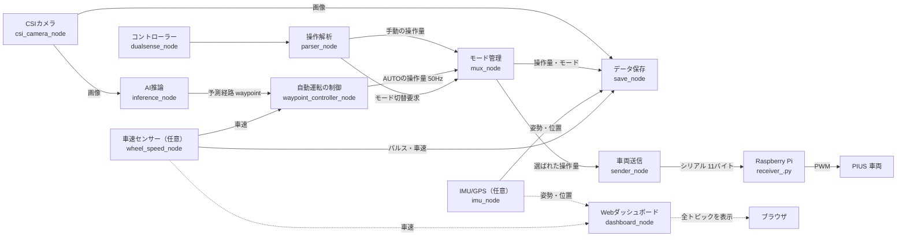

# Yoshida Smart Driver PIUS 自律走行システム

PIUSの自動走行のために専用に設計されたYoshida Smart Driver(YSD)の派生システム

Jetson Orin Nano 上で Docker と ROS 2 を用いて動作し、コントローラーによる手動走行・学習データ収集・AI による自動走行を 1 つのシステムで行えます。

*   **手動走行とデータ収集**: DualShock / DualSense で運転しながら、カメラ画像（空を除いて 320×128、10 Hz）と操作量・センサーの値を学習データとして記録
*   **進路予測モデル（waypoint）**: ResNet-18 + GRU が、カメラ画像だけからこの先の進路（後軸中心の座標で 1 m ごとに 5 点）を予測。正解は記録した車輪パルスと IMU から自動で作成（人手のアノテーション不要）
*   **自動走行**: 制御ノードが予測経路を 50 Hz の操作量に変換（再投影 + Pure Pursuit でステア、目標速度 + PI でアクセル・ブレーキ）。ダッシュボードで予測経路をカメラ画像に重ね、上から見た経路も表示
*   **Web ダッシュボード**: 走行モード・記録状態・カメラ画像・操作量・各ノードの接続状況をブラウザで確認
*   **IMU / GPS**: WitMotion WTGAHRS3 の姿勢・加速度・角速度・位置をダッシュボードに表示し、学習データと一緒に記録（つながっていなくても走行・記録には影響しません）
*   **車速センサー**: 後輪のリードスイッチ（1 回転 1 パルス）のノイズを除き、パルスの間を IMU で補って連続した車速を求めてダッシュボードに表示し、パルスの時刻を記録
*   **進路の正解データ用の高頻度記録**: IMU の全サンプル（50 Hz）・GPS・車輪パルスを、カメラ画像（10 Hz）とは別系列で同じファイルに記録（waypoint の正解の作成用）
*   **安全機能**: 通信断・ノード停止・コントローラー切断・カメラ切断時に自動で停止（フルブレーキ）し、カメラやコントローラーは自動で再接続

---

## ドキュメント

| ドキュメント | 内容 | 対象 |
| :--- | :--- | :--- |
| [ユーザーマニュアル](user_manual.md) | 準備・起動・操作・データ収集・学習・机上テストの手順 | システムを使う人 |
| [仕様書](docs/specification.md) | ノード・トピック・安全機能・シリアル通信・データ形式・設定項目の詳細 | 開発・保守する人 |
| [トラブルシューティング](docs/troubleshooting.md) | 症状別の原因と対処 | 困ったとき |

---

## システム構成



*   走行モード（MANUAL / AUTO）は `mux_node` が一元管理し、AUTO はモデル・カメラ・コントローラーがすべて正常なときだけ有効になります。予測した進路（`/inference/waypoints`）は `waypoint_controller_node` が操作量に変えます。タイヤ外周・ヨーレートの符号・操舵の対応表が仮の値の間は、AUTO に切り替わりません（[マニュアル 3.10](user_manual.md#310-仮の値未確定のパラメータの確認)）。
*   学習データは MANUAL 走行中のみ `data/` に HDF5 形式で保存されます。
*   IMU/GPS（WitMotion WTGAHRS3、USB 接続）は任意のセンサーです。いつ抜き差ししても走行・モード切替・記録には影響せず、値はダッシュボードに表示され、各フレームと一緒に記録されます。
*   車速センサー（後輪左のリードスイッチ、40 ピンヘッダの GPIO に接続）も任意のセンサーで、走行・モード切替・記録には影響しません。速度を求めるには `config.yaml` の `wheel.circumference_m`（タイヤ外周）の設定が必要です。
*   記録 ON の間は、IMU の全サンプル（50 Hz）・GPS・車輪パルスをカメラ画像とは別系列で記録します（走行モードに関係なく記録。学習には使いません）。
*   詳細は [仕様書](docs/specification.md) を参照してください。

---

## クイックスタート

> [!IMPORTANT]
> 初めて使う場合や、うまく動かない場合は [ユーザーマニュアル](user_manual.md) の手順に従ってください。

### 1. 起動

Jetson（ホスト）の端末で実行します。シリアルポートの権限設定・コンテナ起動・ROS 2 の起動をまとめて行います。

```bash
cd /home/yl00/pius
./start_system.sh            # models/waypoint.pth を使用（config.yaml の inference.model_path）
./start_system.sh my_model   # models/my_model.pth を使用
```

### 2. ダッシュボードを開く

Jetson 本体のブラウザで **`http://localhost:8080`**、または Tailscale でつないだ PC・スマートフォンで **`http://<Jetson の Tailscale の IP>:8080`** を開きます。ローカルネットワーク（同じ Wi-Fi など）からのアクセスは拒否します。

### 3. 操作（DualShock / DualSense）

| 操作 | ボタン |
| :--- | :--- |
| ステアリング | 左スティック 左右 |
| アクセル / ブレーキ | R2 / L2 |
| シフト D（前進）/ R（後退） | × |
| 走行モード MANUAL / AUTO | SHARE |
| 学習データ記録 ON / OFF | OPTIONS |

### 4. 終了

起動した端末で **`Ctrl + C`**。車両には停止・フルブレーキの指令が送られ、記録中のデータは保存されてから終了します。

### 車両を動かさずに試す（机上テスト）

コンテナ内で実行します。ダミーのカメラとコントローラーを使い、シリアルには一切送信しません。

```bash
ros2 launch pius_control pius_launch.py use_dummy_camera:=true use_dummy_joy:=true dry_run:=true
```

---

## ディレクトリ構成

ホストの `/home/yl00/pius` は、コンテナ内では `/home/orin/dev/ws/colcon_ws` にマウントされます。

```
pius/
├── README.md                 # このファイル
├── user_manual.md            # ユーザーマニュアル
├── docs/
│   ├── specification.md      # 仕様書
│   └── troubleshooting.md    # トラブルシューティング
├── config.yaml               # 全ノード共通の設定ファイル
├── start_system.sh           # 一括起動スクリプト（ホストで実行）
├── Dockerfile / docker-compose.yml / requirements.txt
├── receiver_.py              # Raspberry Pi 側の受信プログラム（tools/pi/install_receiver.sh で Pi に設置）
├── train_waypoint.py         # waypoint モデルの学習スクリプト
├── verify_h5.py              # 学習データの検証ツール
├── legacy/                   # 使わなくなったもの（以前のモデルの学習・DonkeyCar 変換など。参照用）
├── drivers/
│   └── ch341/                # IMU の USB シリアル（CH340）ドライバ（ホストで初回のみインストール）
├── tools/
│   ├── witmotion_check.py    # IMU/GPS センサー単体の動作確認スクリプト
│   ├── imu_config.py         # IMU/GPS センサーの出力設定（50 Hz・115200 bps）
│   ├── speed_sensor_check.py # 車速センサー単体の動作確認スクリプト（ホストで実行）
│   ├── speed_live.sh         # 車速のリアルタイム表示とログ記録（ブラウザ :8888）
│   ├── speed_replay.py       # 車速ログを推定処理で再生して検証
│   ├── trajectory_check.py   # 走行ログから後軸中心の軌跡を復元（外周・片輪補正の確認）
│   ├── benchmark_model.py    # モデルの推論時間の実測（コンテナで実行）
│   ├── check_calibration.py  # 仮の値（未確定のパラメータ）の一覧と求め方
│   ├── steering_calibration.py # 走行ログから操舵の対応表を作る
│   ├── camera_calibration.py # カメラのキャリブレーション（経路の重ね表示用）
│   ├── sim_controller.py     # 制御の閉ループ・シミュレーション
│   ├── camera_white_balance.py # ダッシュボードの映像の色補正を白い紙から測る
│   ├── steer_hold.py         # ステアを決まった値で保つ（操舵角の測定用、ホストで実行）
│   ├── imu_forward_axis.py   # IMU の前方向を走行ログから推定
│   ├── h5_cut.py             # 記録ファイルから時間の範囲を切り出す（学習用・検証用に分ける）
│   ├── camera_isp.sh         # カメラの色補正ファイルの導入（ホストで実行）
│   └── pi/                   # Raspberry Pi の受信プログラムをサービスとして設置するスクリプト
├── models/                   # 学習済みモデル（waypoint.pth など）※Git管理外
├── data/                     # 収集した学習データ（*.h5）※Git管理外
└── src/
    ├── pius_control/         # 本システムのノード群・launch・ダッシュボード
    ├── camera/               # CSIカメラノード
    ├── gamepad/              # コントローラーノード
    ├── control_msgs/         # 操作量メッセージ定義
    └── gamepad_msgs/         # コントローラーメッセージ定義
```

---

## 開発者向けメモ

*   **ビルド**（コンテナ内）: コードを変更したら再ビルドが必要です。現在のイメージでは `--symlink-install` が失敗するため付けないでください。
    ```bash
    cd /home/orin/dev/ws/colcon_ws
    colcon build
    source install/setup.bash
    ```
*   **動作確認済みベースライン**: この更新前の状態はタグ `baseline-verified-20260923` に、更新前のコンテナはイメージ `namazyake/roscar2:backup-20260923` に保存されています。
*   **Raspberry Pi 側**: `receiver_.py` を変更した場合は Pi にコピーして再起動してください（手順はユーザーマニュアル参照）。
*   **IMU/GPS の USB シリアルドライバ**（ホスト、初回のみ）: JetPack 6 のカーネルには IMU に内蔵された CH340（USB ID `1a86:7523`）のドライバがないため、`drivers/ch341/` でビルドしてインストールします。インストール後は `/dev/ttyUSB0` と `/dev/serial/by-id/usb-1a86_USB_Serial-if00-port0` が作られます。
    ```bash
    cd /home/yl00/pius/drivers/ch341
    make
    sudo ./install.sh
    ```
    **カーネルを更新したら再ビルドが必要**です（`make clean && make` → `sudo ./install.sh`）。元に戻すときは `sudo ./uninstall.sh`。詳細は [drivers/ch341/README.md](drivers/ch341/README.md) を参照してください。
*   **IMU/GPS の出力設定**（ホスト、設定済み）: センサーは `tools/imu_config.py --apply` で 50 Hz・115200 bps（出力は 51/52/53/57/58/5A のみ）に設定して保存してあり、`config.yaml` の `imu.baudrate` も 115200 です。走行システムを止めてから、コンテナのイメージで実行します（`--show` で確認、`--factory-reset` で出荷時の 9600 bps・10 Hz に戻す。戻した場合は `imu.baudrate` も 9600 に）。
    ```bash
    docker run --rm -it --device /dev/ttyUSB0 --group-add 20 -v /home/yl00/pius:/ws namazyake/roscar2:cu126 python3 /ws/tools/imu_config.py --show
    ```
*   **車速センサーの GPIO**: `wheel_speed_node` はホストの NVIDIA Jetson.GPIO（イメージには入っていない）を `docker-compose.yml` でマウントして使います。コンテナでは `/proc/device-tree` が見えないため、環境変数 `JETSON_MODEL_NAME=JETSON_ORIN_NANO` でボードを指定しています。配線と確認手順は [仕様書 11章](docs/specification.md#11-車速センサー仕様) を参照してください。
