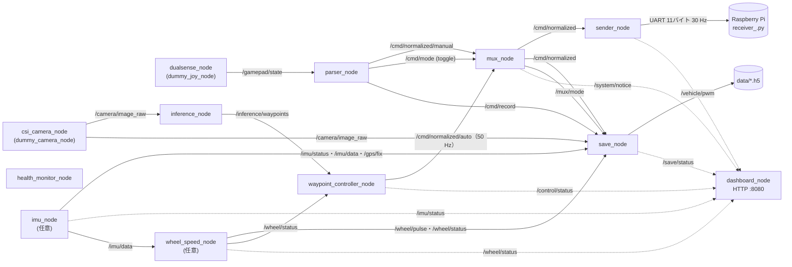
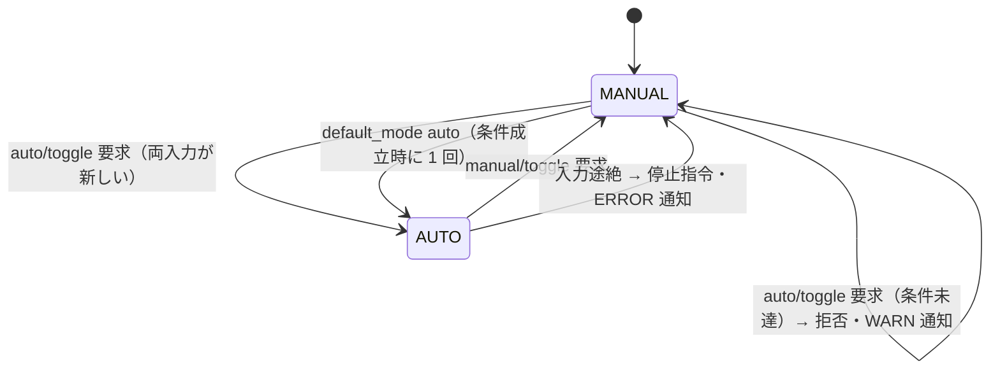

# PIUS 自律走行システム 技術仕様書

本書は PIUS 自律走行システムの技術仕様をまとめたものです。記載内容はすべてソースコード（ブランチ `feature/imu-wtgahrs3`、2026-09-30 時点）で確認しています。**コードと本書が食い違う場合はコードが正**です。

- 使い方（起動・運転・データ収集の手順）は `user_manual.md`、困ったときは [troubleshooting.md](troubleshooting.md) を参照してください。
- 旧 `handover_notes.md`（シリアル通信仕様）の内容は、本書の [6章](#6-シリアル通信仕様) と [7章](#7-受信プログラム仕様) に統合しました。
- パスの表記: ホストの `/home/yl00/pius` とコンテナ内の `/home/orin/dev/ws/colcon_ws` は同じディレクトリです。本書ではリポジトリ内のファイルを相対パスで表記します。

## 目次

1. [概要とシステム構成](#1-概要とシステム構成)
2. [ノード一覧](#2-ノード一覧)
3. [トピック一覧](#3-トピック一覧)
4. [走行モード管理](#4-走行モード管理)
5. [安全機能一覧](#5-安全機能一覧)
6. [シリアル通信仕様](#6-シリアル通信仕様)
7. [受信プログラム仕様](#7-受信プログラム仕様)
8. [カメラノード仕様](#8-カメラノード仕様)
9. [コントローラーノード仕様](#9-コントローラーノード仕様)
10. [IMU/GPS 仕様](#10-imugps-仕様)
11. [車速センサー仕様](#11-車速センサー仕様)
12. [データ保存仕様](#12-データ保存仕様)
13. [推論モデル仕様](#13-推論モデル仕様)
14. [学習スクリプト仕様](#14-学習スクリプト仕様)
15. [Webダッシュボード仕様](#15-webダッシュボード仕様)
16. [設定ファイルリファレンス](#16-設定ファイルリファレンス)
17. [launch 引数](#17-launch-引数)
18. [実行環境](#18-実行環境)
19. [変更履歴の要点](#19-変更履歴の要点)

---

## 1. 概要とシステム構成

PIUS は、CSI カメラの画像からステアリングとスロットルを推定する E2E 模倣学習の自律走行システムです。人がコントローラーで運転したデータを記録し、そのデータで学習した ResNet-18 モデルで自動走行します。

### 1.1 ハードウェア構成

| 機器 | 役割 | 接続・デバイス |
| :--- | :--- | :--- |
| Jetson Orin Nano | ROS 2 ノードの実行（カメラ取得・推論・モード管理・データ保存・シリアル送信・ダッシュボード・IMU/GPS 取得・車速センサー取得） | — |
| CSI カメラ | 前方画像の取得 | CSI（`nvarguscamerasrc sensor-id=0`）、`/dev/video0` |
| DualShock 4 / DualSense | 手動運転、モード切替、記録 ON/OFF | USB または Bluetooth（evdev、`/dev/input/event*`） |
| WitMotion WTGAHRS3-TTL（任意） | IMU（加速度・角速度・姿勢）と GNSS（位置・速度）の計測。表示と記録のみで、走行制御には使いません（[10章](#10-imugps-仕様)） | USB（内蔵 CH340、USB ID `1a86:7523`）→ `/dev/ttyUSB0`（固定名 `/dev/serial/by-id/usb-1a86_USB_Serial-if00-port0`）、115200 bps・50 Hz（`tools/imu_config.py --apply` で設定。出荷時は 9600 bps・10 Hz） |
| 車速センサー（リードスイッチ、任意） | 後輪左のブレーキディスクに付けた磁石を検出（タイヤ 1 回転で 1 パルス）。PIUS 純正の速度計のセンサーを Jetson につなぎ替えたもの。表示・記録・正解データの作成と、AUTO の速度制御に使用（[11章](#11-車速センサー仕様)） | 74HC14 バッファ基板経由で Jetson の 40 ピンヘッダ：1 番 3.3 V、7 番 GPIO09（入力）、9 番 GND |
| Raspberry Pi | 指令の受信と PWM・GPIO 出力（`receiver_.py`、pigpio） | UART：Jetson `/dev/ttyTHS1` → Pi `/dev/serial0`、115200 bps |
| ステアリングサーボ | 操舵 | Pi GPIO 19（PWM） |
| スロットル（ESC/モーター） | 駆動力 | Pi GPIO 12（PWM） |
| ブレーキ | 制動（`1135` = フルブレーキ、`1948` = 解放） | Pi GPIO 13（PWM） |
| ドライブ/リバース信号 | 進行方向 | Pi GPIO 16（ドライブ）、GPIO 26（リバース） |

### 1.2 ソフトウェア階層

| 層 | 内容 |
| :--- | :--- |
| ホスト OS | JetPack 6 系（L4T R36）。`nvargus-daemon` がカメラを管理。IMU 用に CH340 USB シリアルドライバを追加でインストール（[18.5](#185-ch340-usb-シリアルドライバホスト)）。車速センサー用の NVIDIA Jetson.GPIO（2.1.9）はホストのものをコンテナにマウントして使用（[11.5](#115-コンテナから-gpio-を使うための設定)） |
| コンテナ | Docker（`roscar2`、イメージ `namazyake/roscar2:cu126`）。ROS 2 Humble、PyTorch、OpenCV（[18章](#18-実行環境)） |
| ROS 2 パッケージ | `pius_control`（主要ノード・launch・ダッシュボード）、`camera`（CSI カメラ）、`gamepad`（コントローラー）、`control_msgs` / `gamepad_msgs`（メッセージ定義） |
| 設定 | `config.yaml`。各ノードが実行時に `/home/orin/dev/ws/colcon_ws/config.yaml` を直接読み込むため、変更は**再起動だけで反映**されます（再ビルド不要） |
| Raspberry Pi | `receiver_.py`（リポジトリで管理し、Pi へ手動でコピー） |
| オフラインツール | `train_waypoint.py`（waypoint モデルの学習）、`legacy/train.py`（以前の操作量モデルの学習）、`verify_h5.py`（データ検証）、`tools/trajectory_check.py`（軌跡の復元）、`tools/benchmark_model.py`（推論時間の実測）、`tools/speed_live.sh` / `tools/speed_replay.py`（車速の確認）、`legacy/convert_donkey_to_h5.py`（DonkeyCar データ変換）、`tools/witmotion_check.py`（IMU/GPS センサー単体の確認）、`tools/imu_config.py`（IMU/GPS センサーの出力設定）、`tools/speed_sensor_check.py`（車速センサー単体の確認）、`tools/camera_isp.sh`（カメラの色補正ファイルの導入） |

### 1.3 ノードとトピックの構成



- 図の他に、各ノードは `/system/health` にハートビートを送り、`health_monitor_node` と `dashboard_node` が受信します。
- `dashboard_node` は上記のほぼすべてのトピックを購読する読み取り専用ノードです（[15章](#15-webダッシュボード仕様)）。
- `imu_node` は標準の `/imu/data`（`sensor_msgs/Imu`）と `/gps/fix`（`sensor_msgs/NavSatFix`）も配信し、`save_node` がこれらを全サンプル（約 50 Hz）記録します（[12.4](#124-高頻度データimu_hr--gps_hr--wheel)）。IMU/GPS は走行制御・モード管理には一切関与しません。
- `wheel_speed_node` は採用したパルスの時刻（`/wheel/pulse`）と推定車速（`/wheel/status`）を配信します。`/imu/data` があればパルスの検証とパルス間の速度の補間に使います。車速センサーも走行制御・モード管理には一切関与しません（[11章](#11-車速センサー仕様)）。
- `inference_node` は waypoint モデルで予測した進路を `/inference/waypoints` に配信し、`waypoint_controller_node` がそれを 50 Hz の AUTO 用操作量（`/cmd/normalized/auto`）に変えます。AUTO に必須のパラメータが仮の値の間は操作量を出しません（[13.6](#136-車両側の制御waypoint_controller_node)、[16.1](#161-仮の値unverified)）。

---

## 2. ノード一覧

### 2.1 一覧

| ノード | パッケージ | 実行ファイル | 起動条件 | respawn |
| :--- | :--- | :--- | :--- | :--- |
| `csi_camera_node` | `camera` | `csi_camera_node` | `use_dummy_camera:=false`（既定） | あり（2 秒後） |
| `dummy_camera_node` | `pius_control` | `dummy_camera_node` | `use_dummy_camera:=true` | なし |
| `dualsense_node` | `gamepad` | `dualsense_node` | `use_dummy_joy:=false`（既定） | あり（2 秒後） |
| `dummy_joy_node` | `pius_control` | `dummy_joy_node` | `use_dummy_joy:=true` | なし |
| `parser_node` | `pius_control` | `parser_node` | 常時 | なし |
| `mux_node` | `pius_control` | `mux_node` | 常時 | なし |
| `inference_node` | `pius_control` | `inference_node` | 常時 | なし |
| `waypoint_controller_node` | `pius_control` | `waypoint_controller_node` | 常時 | なし |
| `save_node` | `pius_control` | `save_node` | 常時 | なし |
| `sender_node` | `pius_control` | `sender_node` | 常時 | なし |
| `health_monitor_node` | `pius_control` | `health_monitor_node` | 常時 | なし |
| `imu_node` | `pius_control` | `imu_node` | `use_imu:=true`（既定） | あり（2 秒後） |
| `wheel_speed_node` | `pius_control` | `wheel_speed_node` | `use_wheel:=true`（既定） | あり（2 秒後） |
| `dashboard_node` | `pius_control` | `dashboard_node` | 常時 | あり（2 秒後） |

respawn は `pius_launch.py` の `respawn=True, respawn_delay=2.0` です。respawn なしのノードが停止した場合は、システム全体の再起動が必要です。

### 2.2 各ノードの詳細

#### csi_camera_node
| 項目 | 内容 |
| :--- | :--- |
| 役割 | CSI カメラの画像を取得し、空を除いた範囲を 320×128 の BGR 画像として配信 |
| 購読 | なし |
| 配信 | `/camera/image_raw`（推論・記録用、320×128・10 Hz）、`/camera/preview/compressed`（ダッシュボード表示専用、640×360 の JPEG・15 Hz）、`/system/health`（`camera:OK:<fps>fps` など）、`/system/notice` |
| 主な動作 | 取得専用スレッド、自動再接続、フリーズ時の自己再起動、同一フレームの再送防止（[8章](#8-カメラノード仕様)） |
| パラメータ | `config.yaml` の `camera` セクションを launch が ROS パラメータとして渡す |

#### dummy_camera_node
| 項目 | 内容 |
| :--- | :--- |
| 役割 | 机上テスト用に、左右に動く白い帯（道路の模擬）の画像を生成 |
| 配信 | `/camera/image_raw`（`camera.resize` のサイズ、`camera.pub_hz`、`bgr8`）、`/system/health`（`camera:DUMMY`） |
| 主な動作 | 実カメラと同様に ±4 のノイズを付加（`save_node` のフリーズ判定に誤検知されないため） |

#### dualsense_node
| 項目 | 内容 |
| :--- | :--- |
| 役割 | DualShock 4 / DualSense の入力を読み取り配信 |
| 配信 | `/gamepad/state`（10 Hz）、`/system/health`（`gamepad:OK:<デバイスパス>` / `gamepad:RECONNECTING:<理由>`）、`/system/notice` |
| 主な動作 | 100 Hz で入力を読み取り、10 Hz で配信。切断中は**何も配信しない**。1 秒ごとに再接続を試行（[9章](#9-コントローラーノード仕様)） |
| パラメータ | launch が `config.yaml` の `dummy_joy` セクションを渡す（`output_topic`、`update_hz`、`pub_hz`、`verbose` を使用） |

#### dummy_joy_node
| 項目 | 内容 |
| :--- | :--- |
| 役割 | 机上テスト用のコントローラー入力を生成 |
| 配信 | `/gamepad/state`（`dummy_joy.pub_hz` = 10 Hz）、`/system/health`（`gamepad:DUMMY`） |
| 主な動作 | `pattern` に応じて `lx`（ステア）と `r2`（アクセル）を生成。15 秒周期の最初の 0.5 秒だけ SHARE を押す（MANUAL/AUTO の切替要求） |

| pattern | lx（ステア） | r2（アクセル） |
| :--- | :--- | :--- |
| `straight` | 0.0 | 0.5 |
| `turn` | 0.6 | 0.3 |
| `stop` | 0.0 | 0.0 |
| `zigzag`（既定） | 0.6 × sin(2π × 0.2 × t)（周期 5 秒） | 0.4 |

#### parser_node
| 項目 | 内容 |
| :--- | :--- |
| 役割 | コントローラー入力を正規化操作量とボタン操作に変換 |
| 購読 | `/gamepad/state` |
| 配信 | `/cmd/normalized/manual`、`/cmd/mode`、`/cmd/record`、`/cmd/shift`、`/system/health`（`parser:OK`） |
| 主な動作 | 下表のとおり。`/cmd/normalized/manual`・`/cmd/record`・`/cmd/shift` はコントローラー入力を受けるたび（10 Hz）に配信 |

| 入力 | 処理 |
| :--- | :--- |
| 左スティック X（`lx`） | ch0 ステアリング（-1.0 左 〜 +1.0 右） |
| R2（`r2`、0〜1） | ch1 スロットル。シフト R のときは符号を反転（-1.0〜0.0） |
| L2（`l2`、0〜1） | ch2 ブレーキ（アクセルと同時に送られます） |
| × | 押した瞬間にシフト D / R を切替（初期値 D）。`/cmd/shift` に `"D"` / `"R"` |
| SHARE | 押した瞬間に `/cmd/mode` へ `"toggle"` を送信（モードの決定は `mux_node`） |
| OPTIONS | 押した瞬間に記録 ON/OFF を切替（初期値 ON）。`/cmd/record` に `true` / `false` |

#### mux_node
| 項目 | 内容 |
| :--- | :--- |
| 役割 | 走行モードの**唯一の管理者**。MANUAL / AUTO に応じて操作量の出力元を選択 |
| 購読 | `/cmd/normalized/manual`、`/cmd/normalized/auto`、`/cmd/mode` |
| 配信 | `/cmd/normalized`、`/mux/mode`（5 Hz と変化時）、`/system/notice`、`/system/health`（`mux:OK:<mode>`） |
| 主な動作 | AUTO の許可・拒否・中断（[4章](#4-走行モード管理)） |

#### inference_node
| 項目 | 内容 |
| :--- | :--- |
| 役割 | カメラ画像を waypoint モデルで推論し、この先の進路（waypoint）を配信 |
| 購読 | `/camera/image_raw` |
| 配信 | `/inference/waypoints`（JSON、画像 1 枚ごと、最大 10 Hz）、`/system/health`（`inference:OK:<モデル名>（waypoint 予測のみ・<推論時間> ms）` / `inference:NO_MODEL:<モデル名>（理由）`） |
| 主な動作 | GPU では FP16 で推論。モデル未読込・画像サイズ違い・推論エラーのときは何も配信しない。操作量は `waypoint_controller_node` が作る（[13章](#13-推論モデル仕様)） |
| パラメータ | `model_path`（launch 引数）。その他は `config.yaml` の `inference` を直接読む |

#### waypoint_controller_node
| 項目 | 内容 |
| :--- | :--- |
| 役割 | 予測した waypoint を AUTO 用の操作量（ステア・スロットル・ブレーキ）に変える |
| 購読 | `/inference/waypoints`、`/wheel/status`（車速・進む向き）、`/imu/data`（ヨーレート）、`/mux/mode` |
| 配信 | `/cmd/normalized/auto`（50 Hz、準備ができているときだけ）、`/control/status`（JSON、10 Hz）、`/system/health`（`control:OK:…` / `control:WAITING:<理由>` / `control:BLOCKED:<仮の値の項目>`） |
| 主な動作 | waypoint の再投影、Pure Pursuit、目標速度 + PI 制御（[13.6](#136-車両側の制御waypoint_controller_node)）。waypoint が 0.4 秒・車速が 0.5 秒より古い、AUTO に必須の値が仮、設定が誤っているときは何も配信しない（mux が AUTO を拒否・中断して停止） |
| パラメータ | `config.yaml` の `controller`・`vehicle` を直接読む |

#### save_node
| 項目 | 内容 |
| :--- | :--- |
| 役割 | MANUAL 走行中の画像と操作量（および IMU/GPS・車速の値）を HDF5 に記録。IMU の全サンプル・GPS・車輪パルスは画像とは別系列で記録 |
| 購読 | `/camera/image_raw`、`/cmd/normalized`、`/cmd/record`、`/mux/mode`、`/imu/status`、`/imu/data`、`/gps/fix`、`/wheel/pulse`、`/wheel/status` |
| 配信 | `/save/status`（JSON、2 Hz）、`/system/health`（`save:RECORDING` / `save:IDLE`、2 Hz） |
| 主な動作 | 記録条件の判定、100 フレームごとの書き出し、高頻度データの 2 秒ごとの書き出し、終了時のフラッシュ（[12章](#12-データ保存仕様)） |

#### sender_node
| 項目 | 内容 |
| :--- | :--- |
| 役割 | 正規化操作量を PWM 値に変換し、Raspberry Pi へシリアル送信 |
| 購読 | `/cmd/normalized`（トピック名は固定。`config.yaml` の `sender.input_topic` は未使用） |
| 配信 | `/vehicle/pwm`（30 Hz、DRY RUN 中も配信）、`/system/health`（`serial:OK:<ポート>` / `serial:DRY_RUN:<理由>`） |
| 主な動作 | 30 Hz で送信。1 秒指令途絶でフルブレーキ。終了時に安全停止パケット。ポートを開けないか `dry_run:=true` なら DRY RUN（[6章](#6-シリアル通信仕様)） |

#### health_monitor_node
| 項目 | 内容 |
| :--- | :--- |
| 役割 | 起動 15 秒後に、カメラ・コントローラー・車両シリアル・AI 推論・IMU/GPS の接続状態のサマリーをターミナルに 1 回だけ表示 |
| 購読 | `/system/health` |
| 主な動作 | カメラ・コントローラー・車両シリアル・AI 推論がすべて正常なら `[システム診断: ALL GREEN]`、そうでなければ `[システム診断: 一部機能制限あり]` と注意事項を表示。IMU/GPS は判定に含めず、`OK` 以外のときは説明に `（任意のセンサーのため、走行・記録には影響しません）` を付ける |

#### imu_node
| 項目 | 内容 |
| :--- | :--- |
| 役割 | WitMotion WTGAHRS3（IMU＋GNSS）のシリアル出力を解析し、IMU・GPS の値を配信 |
| 購読 | なし |
| 配信 | `/imu/data`（`sensor_msgs/Imu`、約 50 Hz）、`/gps/fix`（`sensor_msgs/NavSatFix`、約 50 Hz）、`/imu/status`（JSON、10 Hz）、`/system/health`（`imu:OK:<Hz>・GPS測位中（衛星N）` など、1 Hz）、`/system/notice` |
| 主な動作 | 20 ms ごとにシリアルを読み、パケットを解析。センサーが抜けても落ちずに 1 秒ごとに再接続。角速度の測定範囲到達を警告（[10章](#10-imugps-仕様)） |
| パラメータ | `config.yaml` の `imu` セクションを直接読む |

#### wheel_speed_node
| 項目 | 内容 |
| :--- | :--- |
| 役割 | 車速センサー（リードスイッチ）のパルスを GPIO で検出・検証し、パルス時刻と推定車速を配信 |
| 購読 | `/imu/data`（任意。パルスの検証と速度の補間） |
| 配信 | `/wheel/pulse`（JSON、採用したパルスごと）、`/wheel/pulse_rejected`（JSON、除外したパルスと理由）、`/wheel/status`（JSON、10 Hz）、`/system/health`（`wheel:OK:<速度>（IMU併用 / パルスのみ）・累計Nパルス・除外N` / `wheel:ERROR:…`、1 Hz） |
| 主な動作 | BOARD 7 番ピンを約 1 kHz で読み、10 ms 安定した High をパルスと判定。物理的にありえないパルスを除外し、パルス間は IMU の加速度で速度を補間。GPIO を使えなくても落ちずに `ERROR` を報告し続ける（[11章](#11-車速センサー仕様)） |
| パラメータ | `config.yaml` の `wheel` セクションを直接読む |

#### dashboard_node
| 項目 | 内容 |
| :--- | :--- |
| 役割 | 読み取り専用の Web ダッシュボード（HTTP サーバー） |
| 購読 | `/system/health`、`/system/notice`、`/camera/preview/compressed`（優先）、`/camera/image_raw`（プレビューがないときの代替）、`/gamepad/state`、`/cmd/normalized/manual`、`/cmd/normalized/auto`、`/cmd/normalized`、`/mux/mode`、`/cmd/record`、`/cmd/shift`、`/save/status`、`/vehicle/pwm`、`/inference/path`、`/imu/status`、`/wheel/status` |
| 配信 | なし（ROS への配信はしません） |
| 主な動作 | [15章](#15-webダッシュボード仕様) |

---

## 3. トピック一覧

### 3.1 トピック

| トピック | 型 | 配信 → 購読 | 周期 |
| :--- | :--- | :--- | :--- |
| `/camera/image_raw` | `sensor_msgs/Image`（`bgr8`、320×128） | camera → inference, save, dashboard | 最大 10 Hz（新しいフレームのみ）。QoS は sensor_data |
| `/camera/preview/compressed` | `sensor_msgs/CompressedImage`（`jpeg`、640×360） | camera → dashboard | 最大 15 Hz（`camera.preview_hz`、0 で無効）。表示専用で推論・記録には使いません。QoS は sensor_data |
| `/gamepad/state` | `gamepad_msgs/Gamepad` | dualsense（dummy_joy） → parser, dashboard | 10 Hz（切断中は停止） |
| `/cmd/normalized/manual` | `control_msgs/NormalizedControls` | parser → mux, dashboard | 10 Hz |
| `/cmd/normalized/auto` | `control_msgs/NormalizedControls` | waypoint_controller → mux, dashboard | 50 Hz（準備ができているときだけ。ch0 ステア、ch1 スロットル、ch2 ブレーキ） |
| `/cmd/normalized` | `control_msgs/NormalizedControls` | mux → sender, save, dashboard | 選択中の入力と同じ周期。AUTO 中断時に停止指令を 1 回 |
| `/cmd/mode` | `std_msgs/String`（`manual` / `auto` / `toggle`） | parser（SHARE）→ mux | イベント |
| `/mux/mode` | `std_msgs/String`（`manual` / `auto`） | mux → save, dashboard | 5 Hz ＋ 変化時 |
| `/cmd/record` | `std_msgs/Bool` | parser → save, dashboard | 10 Hz ＋ 切替時 |
| `/cmd/shift` | `std_msgs/String`（`D` / `R`） | parser → dashboard | 10 Hz（表示用。車両の D/R はスロットルの符号から決まる） |
| `/save/status` | `std_msgs/String`（JSON） | save → dashboard | 2 Hz |
| `/vehicle/pwm` | `control_msgs/PwmControls` | sender → dashboard | 30 Hz |
| `/system/health` | `std_msgs/String`（`key:STATE:detail`） | 各ノード → health_monitor, dashboard | 各ノード 1 Hz（save は 2 Hz、camera は状態変化時にも） |
| `/system/notice` | `std_msgs/String`（`LEVEL\|source\|text`） | mux, camera, dualsense, imu → dashboard | イベント |
| `/inference/waypoints` | `std_msgs/String`（JSON） | inference → waypoint_controller, dashboard | 画像ごと（最大 10 Hz）。モデル未読込時は配信なし |
| `/control/status` | `std_msgs/String`（JSON） | waypoint_controller → dashboard（`tools/speed_live.py` も記録） | 10 Hz |
| `/inference/path` | `std_msgs/String`（JSON） | （将来）→ dashboard | 現在は配信ノードなし（waypoint を画像に重ねるにはカメラのキャリブレーションが必要） |
| `/imu/data` | `sensor_msgs/Imu`（`frame_id` `imu_link`） | imu → save, wheel_speed, waypoint_controller | 角度パケットごと（約 50 Hz） |
| `/gps/fix` | `sensor_msgs/NavSatFix`（`frame_id` `gps_link`） | imu → save | 経度・緯度パケットごと（約 50 Hz。GNSS の測位更新は 5 Hz のため、同じ位置が繰り返し届きます）。未測位でも `STATUS_NO_FIX` で配信 |
| `/imu/status` | `std_msgs/String`（JSON） | imu → save, dashboard | 10 Hz（`imu` が `OK` の間のみ） |
| `/wheel/pulse` | `std_msgs/String`（JSON） | wheel_speed → save | 採用したパルスごと（タイヤ 1 回転に 1 回） |
| `/wheel/pulse_rejected` | `std_msgs/String`（JSON） | wheel_speed →（確認用、`tools/speed_live.py`） | 除外したパルスごと |
| `/wheel/status` | `std_msgs/String`（JSON） | wheel_speed → save, dashboard, waypoint_controller | 10 Hz（GPIO を使えない間は配信なし） |

### 3.2 メッセージ定義

| 型 | フィールド |
| :--- | :--- |
| `control_msgs/ChannelNormalized` | `int32 channel`、`float32 normalized` |
| `control_msgs/NormalizedControls` | `ChannelNormalized[] data` |
| `control_msgs/ChannelPwm` | `int32 channel`、`int32 pwm` |
| `control_msgs/PwmControls` | `ChannelPwm[] data` |
| `gamepad_msgs/GamepadAxis` | `float32 lx, ly, rx, ry, l2, r2`、`int32 dpx, dpy` |
| `gamepad_msgs/GamepadButtons` | `bool cross, circle, square, triangle, l1, l2, l3, r1, r2, r3, touch, share, option, ps` |
| `gamepad_msgs/Gamepad` | `GamepadAxis axis`、`GamepadButtons buttons` |

### 3.3 チャンネル割り当て

**NormalizedControls**

| ch | 内容 | 範囲 |
| :--- | :--- | :--- |
| 0 | ステアリング | -1.0（左）〜 +1.0（右） |
| 1 | スロットル | -1.0（後退）〜 +1.0（前進） |
| 2 | ブレーキ | 0.0（なし）〜 1.0（フルブレーキ） |

受信側（sender）は含まれていないチャンネルの値を前回値のまま保持します。そのため mux・inference・parser はいずれも 3 チャンネルすべてを送ります。

**PwmControls（`/vehicle/pwm`）**

| ch | pius プロトコル | donkey プロトコル |
| :--- | :--- | :--- |
| 0 | ステアリング PWM（1139〜1835） | ステアリング PWM |
| 1 | スロットル PWM（1000〜2000） | スロットル PWM |
| 2 | ブレーキ PWM（1135〜1948） | なし |
| 3 | state（0 = D、1 = N、2 = R） | なし |

### 3.4 文字列トピックの書式

**`/system/health`**：`key:STATE:detail`（detail は省略可。detail 内の `:` はそのまま残ります）

| key | STATE と detail | 配信元 |
| :--- | :--- | :--- |
| `camera` | `OK:<取得fps>fps`、`RECONNECTING:<理由>`、`RESTARTING:<理由>`、`DUMMY` | csi_camera / dummy_camera |
| `gamepad` | `OK:<デバイスパス>`、`RECONNECTING:<理由>`、`DUMMY` | dualsense / dummy_joy |
| `parser` | `OK` | parser |
| `mux` | `OK:manual`、`OK:auto` | mux |
| `inference` | `OK:<モデル名>（waypoint 予測のみ・<推論時間> ms）`、`NO_MODEL:<モデル名>（<理由>）` | inference |
| `serial` | `OK:<ポート>`、`DRY_RUN:<理由>` | sender |
| `save` | `RECORDING`、`IDLE` | save |
| `imu` | `OK:<角度パケットの受信Hz>Hz・GPS測位中（衛星N）` / `OK:…・GPS未測位（衛星N）`、`NO_DATA:<理由>`、`RECONNECTING:<理由>` | imu |
| `control` | `OK:目標 <速度> km/h・操舵 <角度>°`（仮の値で動作中なら末尾に `・仮の値で動作中`）、`WAITING:<操作量を出していない理由>`、`BLOCKED:AUTO に必須のパラメータが仮の値（<項目>）` | waypoint_controller |
| `wheel` | `OK:<速度>km/h（IMU併用 / パルスのみ）・累計Nパルス・除外N`（速度が不明なら `速度不明`、外周が未設定なら末尾に `・外周未設定`）、`ERROR:GPIO を使えません: <例外>` / `ERROR:GPIO の読み取りに失敗: <例外>` | wheel_speed |

ダッシュボードはこれに加え、一度も受信していないものを `WAITING`（起動待ち）、`health_timeout_sec`（3 秒）以上途絶えたものを `LOST`（応答なし）と表示します。

**`/system/notice`**：`LEVEL|source|text`。LEVEL は `INFO` / `WARN` / `ERROR`、source は `mux` / `camera` / `gamepad` / `imu` です。

**`/save/status`**（JSON）

| キー | 型 | 内容 |
| :--- | :--- | :--- |
| `enabled` | bool | 記録 ON/OFF（OPTIONS） |
| `recording` | bool | 直近 1 秒以内にフレームを記録したか |
| `reason` | string | 記録していない理由（記録中は空文字） |
| `frames` | int | 記録済みフレーム数（書き出し済み＋バッファ） |
| `file` | string | 保存ファイル名 |

**`/inference/waypoints`**（JSON）：`{"stamp": <画像の時刻>, "frame": "rear_axle", "spacing": 1.0, "points": [[x, y], ...]}`。後軸の中央を原点に x が前方・y が左 [m]。進んだ距離 `spacing` m ごとの点（[13章](#13-推論モデル仕様)）。

**`/control/status`**（JSON、10 Hz）

| キー | 型 | 内容 |
| :--- | :--- | :--- |
| `ready` | bool | 操作量を出しているか |
| `reason` | string | 出していない理由（出しているときは空文字） |
| `mode` | string | `/mux/mode` の値 |
| `path` | [[x, y], ...] | 再投影した waypoint（今の後軸中心座標 [m]） |
| `lookahead` / `lookahead_m` | [x, y] / float | 注視点 [m] と注視距離 [m] |
| `delta_deg` | float | 前輪の操舵角 [°]（左が正） |
| `steer` / `throttle` / `brake` | float | 出している操作量 |
| `curvature` | float | 速度を決めるのに使った曲率 [1/m] |
| `v_target` / `v_meas` | float | 目標速度・実測速度 [m/s] |
| `speed` | float / null | 受信している車速 [m/s] |
| `unverified` / `blocking` | string[] | 仮の値の項目 / そのうち AUTO を止めているもの |
| `allow_unverified` | bool | `controller.allow_unverified` |

**`/inference/path`**（JSON、将来用）：`{"points": [[x, y], ...]}`。x, y は画像に対する正規化座標（0〜1、原点は左上）。

**`/imu/status`**（JSON）。まだ受信していないパケットの値は空配列または `null` です。

| キー | 型 | 内容 |
| :--- | :--- | :--- |
| `euler` | float[3] | ロール・ピッチ・ヨー [°] |
| `acc` | float[3] | 加速度 X・Y・Z [m/s²]（重力を含む） |
| `gyro` | float[3] | 角速度 X・Y・Z [°/s] |
| `temp` | float | センサー温度 [℃] |
| `gyro_saturated` | bool | 直近 1 秒以内に角速度が測定範囲に達したか（[10.7](#107-角速度の飽和警告)） |
| `gps.fix` | bool | 測位中か（[10.6](#106-gps-の測位判定)） |
| `gps.lat` / `gps.lon` | float | 緯度・経度 [°]（未測位時は 0 付近の値） |
| `gps.alt` | float | 高度 [m] |
| `gps.speed` | float | 対地速度 [m/s] |
| `gps.heading` | float | 進行方向 [°] |
| `gps.sats` | int | 衛星数 |
| `gps.hdop` | float | HDOP |

**`/wheel/pulse`**（JSON）。採用したパルスごとに 1 回配信します（除外したパルスは含みません）。

| キー | 型 | 内容 |
| :--- | :--- | :--- |
| `count` | int | 起動から採用したパルスの累計（1 から） |
| `stamp` | float | 検出時刻（ROS 時刻、UNIX 秒。入力が High になった瞬間） |
| `interval` | float / null | 直前に採用したパルスとの間隔 [秒]（最初のパルスは `null`） |

**`/wheel/pulse_rejected`**（JSON）。除外したパルスごとに 1 回配信します（確認用）。

| キー | 型 | 内容 |
| :--- | :--- | :--- |
| `stamp` | float | 検出時刻 |
| `interval` | float / null | 直前に採用したパルスとの間隔 [秒] |
| `reason` | string | 除外の理由（[11.2](#112-検出と速度の計算)）。`too_fast` / `not_moving` / `too_short` / `too_sudden` |
| `rejected` | int | 起動からの除外の累計 |

**`/wheel/status`**（JSON、10 Hz）

| キー | 型 | 内容 |
| :--- | :--- | :--- |
| `speed` | float / null | 推定車速 [m/s]（0 以上）。IMU があればパルス間を IMU で補間した値、なければパルスだけの値（[11.2](#112-検出と速度の計算)）。不明なときは `null` |
| `speed_pulse` | float / null | パルスだけから求めた車速 [m/s]（比較用。以前の方式） |
| `source` | string | `speed` の出どころ。`imu`（IMU 併用）/ `pulse`（パルスのみ） |
| `direction` | int | 進む向き。`1` 前進 / `-1` 後退 / `0` 停止中・不明（IMU が必要） |
| `still` | bool | IMU が停止と判定しているか |
| `count` | int | 採用したパルスの累計 |
| `rejected` | int | 除外したパルスの累計 |
| `last_pulse_age` | float / null | 最後に採用したパルスからの経過秒（パルスがまだないときは `null`） |
| `circumference` | float | 設定されているタイヤ外周 [m]（`wheel.circumference_m`、未設定なら 0.0） |

---

## 4. 走行モード管理

### 4.1 基本方針

- 走行モードは `mux_node` だけが決めます。parser は SHARE で `"toggle"` を要求するだけで、現在のモードは `/mux/mode` で配信されます。
- `/cmd/mode` は `manual` / `auto` / `toggle` を受け付けます（前後の空白と大文字小文字は無視）。それ以外は `MUX received invalid mode: ...` の警告を出して無視します。
- MANUAL 中は `/cmd/normalized/manual` のみ、AUTO 中は `/cmd/normalized/auto` のみを `/cmd/normalized` へ転送します。
- 起動直後は常に MANUAL です。

### 4.2 状態遷移



### 4.3 AUTO の条件

AUTO に入る・AUTO を続けるには、次の 2 つが両方とも `source_timeout_sec`（0.5 秒）以内に届いている必要があります。

| 条件 | 満たされない原因 | 拒否・中断時の理由文 |
| :--- | :--- | :--- |
| `/cmd/normalized/manual` が新しい | コントローラー切断、parser 停止 | `コントローラー入力が途絶えています` |
| `/cmd/normalized/auto` が新しい | モデル未読込、カメラ停止、inference 停止 | `推論出力が届いていません（モデル未読込・カメラ停止・推論ノード停止のいずれか）` |

- コントローラーを条件に含めるのは、AUTO 中に人が介入（SHARE で MANUAL に戻す）できない状態で走らせないためです。
- `/cmd/normalized/auto` は `waypoint_controller_node` が 50 Hz で配信します。制御ノードは、waypoint が 0.4 秒・車速が 0.5 秒より古いとき、AUTO に必須のパラメータが仮の値のとき（[16.1](#161-仮の値unverified)）は配信しないため、その間は AUTO が拒否・中断されます（拒否の理由文は `自動運転の操作量が届いていません（…）`）。

### 4.4 拒否・中断・フォールバック

| 状況 | 動作 | 通知（`/system/notice`） |
| :--- | :--- | :--- |
| AUTO 要求時に条件未達 | MANUAL のまま | `WARN`：`AUTOへの切替を拒否しました: <理由>` |
| AUTO 中に条件が崩れた（20 Hz で監視） | 停止指令（ステア 0.0、スロットル 0.0、ブレーキ 1.0）を 1 回配信し MANUAL へ | `ERROR`：`AUTO走行を中断し、停止してMANUALに戻しました: <理由>` |
| モード変更成功 | — | `INFO`：`走行モードを AUTO に切り替えました` など |

中断後の動き：sender は最後の値（停止指令）を保持するため、直ちにフルブレーキになります。コントローラーが生きていれば以後はコントローラーの操作が反映され、コントローラーが切れていれば 1 秒後に sender のタイムアウトでフルブレーキが続きます。

### 4.5 default_mode

| 値 | 動作 |
| :--- | :--- |
| `manual`（既定） | MANUAL で起動し、SHARE で切替 |
| `auto` | MANUAL で起動し、AUTO の条件が初めて揃った時点で自動的に AUTO へ（理由：`起動時の設定 default_mode: auto`）。それまでに `manual`/`auto`/`toggle` のいずれかを受けると、この自動切替は取り消されます |

---

## 5. 安全機能一覧

| # | トリガー | 動作 | 実装場所 |
| :--- | :--- | :--- | :--- |
| 1 | `/cmd/normalized` が 1 秒以上届かない（起動直後を含む） | ステア 1500、スロットル 1000、ブレーキ 1135（フル）、state 1 を 30 Hz で送信。受信再開で自動復帰 | `sender_node._write_to_serial` |
| 2 | `Ctrl + C` などによる終了 | ポートを閉じる前に安全停止パケット（1500 / 1000 / 1135 / 1）を 1 回送信 | `sender_node.shutdown_vehicle` |
| 3 | シリアルポートを開けない / `dry_run:=true` | シリアルに一切書き込まない（DRY RUN）。health は `DRY_RUN` | `sender_node.__init__` |
| 4 | Pi 側で有効なパケットが 0.5 秒以上届かない | 直進・スロットル停止・フルブレーキ・中立を出力。受信再開で自動復帰 | `receiver_.py` `Receiver.run` |
| 5 | Pi 起動時 | 直進・スロットル停止・フルブレーキ・中立で初期化 | `receiver_.py` `Receiver.__init__` |
| 6 | チェックサム不一致 / 位置ずれ | パケットを破棄し 1 バイトずつずらしてヘッダを再探索 | `receiver_.py` `extract_packets` |
| 7 | 範囲外の値 / 不正な state | ステア 1139〜1835、スロットル 1000〜2000、ブレーキ 1135〜1948 にクランプ。state が 0/1/2 以外なら 1（中立） | `receiver_.py` `sanitize` |
| 8 | Pi の受信プログラムが止まる（`Ctrl + C`・SIGTERM・起動した SSH の切断 = SIGHUP・異常終了） | 安全停止値を出力し、**そのパルスを出し続ける**（pigpiod は終了後も最後のパルスを出し続けるため、0 にすると最後の指令のまま、または信号なしになる）。サービスとして動かすときは `ExecStopPost` の `pigs` でも安全値にする | `receiver_.py` `Receiver.shutdown`、`tools/pi/pius-receiver.service` |
| 9 | AUTO 要求時にコントローラーまたは推論が途絶 | AUTO を拒否し WARN 通知 | `mux_node._request_auto` |
| 10 | AUTO 中にコントローラーまたは推論が 0.5 秒途絶 | 停止指令を配信し MANUAL へ戻して ERROR 通知 | `mux_node._watchdog` |
| 11 | モデル未読込 / 推論エラー | 推論結果を配信しない（→ #9, #10 が働く） | `inference_node._image_callback` |
| 12 | AUTO 時のブレーキ | 推論出力にブレーキ 0.0 を明示し、手動時の L2 の値が残らないようにする | `inference_node._image_callback` |
| 13 | コントローラー切断 | 配信を止め、ERROR 通知、1 秒ごとに再接続（→ #1, #10 が働く） | `dualsense_node._handle_disconnect` |
| 14 | カメラの取得失敗 | カメラを解放し 1→2→4→5 秒間隔で再接続。ERROR 通知 | `csi_camera_node._capture_loop` |
| 15 | カメラ画像が 3 秒止まる（取得が固まる） | 通知後にプロセスを終了し、launch の respawn で 2 秒後に再起動 | `csi_camera_node._watchdog` |
| 16 | 30 秒以上再接続できない | `nvargus-daemon` の再起動を促す ERROR 通知 | `csi_camera_node._watchdog` |
| 17 | 同じフレーム | 再送しない（古い画像で推論させない） | `csi_camera_node._pub` |
| 18 | AUTO 中・操作量が古い・画像フリーズ・後退・停止 | 記録しない（教師データの汚染防止） | `save_node._image_callback` |
| 19 | camera / gamepad / dashboard / imu / wheel_speed ノードの異常終了 | 2 秒後に自動再起動 | `pius_launch.py` |
| 20 | IMU/GPS の切断・データ途絶 | 走行・モード切替・記録には関与しない（記録は続け、IMU/GPS の値を NaN にする）。1 秒ごとに再接続し WARN 通知 | `imu_node`、`save_node._imu_row` |
| 21 | 車速センサーの GPIO を使えない | 走行・モード切替・記録には関与しない（ノードは落ちずに `wheel:ERROR` を報告し続け、記録される車速の列は NaN になる） | `wheel_speed_node.__init__`、`save_node._imu_row` |
| 22 | waypoint・車速が古い、AUTO に必須のパラメータが仮の値、`steer_table` が単調でない | 制御ノードが `/cmd/normalized/auto` を配信しない → mux が AUTO を拒否・中断（停止して MANUAL へ） | `waypoint_controller_node._not_ready` |
| 23 | 実測速度が `controller.max_speed_mps` を超えた、目標速度より 0.1 m/s 以上速い | スロットル 0、ブレーキ（超過量に比例、上限超過時は 0.3 以上） | `waypoint_controller.WaypointController.step` |

---

## 6. シリアル通信仕様

Jetson（`sender_node`）から Raspberry Pi（`receiver_.py`）への片方向通信です。仕様の正はこの 2 ファイルです。元は DonkeyCar の `manage.py`（`SerialTransmitter` クラス）に由来しますが、パケット形式とブレーキ極性が異なるため、`manage.py` の記述をそのまま参考にしないでください。

### 6.1 基本仕様

| 項目 | 送信側（Jetson / `sender_node.py`） | 受信側（Raspberry Pi / `receiver_.py`） |
| :--- | :--- | :--- |
| ポート | `/dev/ttyTHS1`（`sender.port`） | `/dev/serial0` |
| 通信速度 | 115200 bps（`sender.baudrate`） | 115200 bps |
| pyserial の timeout | 1.0 秒 | 0.05 秒 |
| 送信周期 | 30 Hz（`sender.write_hz`） | — |
| 形式 | 11 バイトのバイナリ、リトルエンディアン | 同左 |

### 6.2 パケット構造（11 バイト）

| オフセット | サイズ | 型 | 内容 |
| :--- | :--- | :--- | :--- |
| 0〜1 | 2 | uint16 | 同期ヘッダ `0xFFFF`（バイト列 `FF FF`） |
| 2〜3 | 2 | int16 | steering（ステアリング PWM） |
| 4〜5 | 2 | int16 | throttle（スロットル PWM） |
| 6〜7 | 2 | int16 | brake（ブレーキ PWM） |
| 8〜9 | 2 | int16 | state（シフト状態） |
| 10 | 1 | uint8 | チェックサム |

```python
def pack_pius_packet(steering, throttle, brake, state):
    payload = struct.pack('<4h', steering, throttle, brake, state)
    checksum = sum(payload) & 0x7F
    return struct.pack('<H', 0xFFFF) + payload + bytes([checksum])
```

**例**

| 内容 | バイト列 |
| :--- | :--- |
| 安全停止（1500 / 1000 / 1135 / 1） | `FF FF DC 05 E8 03 6F 04 01 00 40` |
| 停止・ブレーキ解放（1500 / 1000 / 1948 / 1） | `FF FF DC 05 E8 03 9C 07 01 00 70` |

### 6.3 チェックサム

- **規則**：ペイロード 8 バイト（オフセット 2〜9）の各バイトの合計 `& 0x7F`。
- **`0xFF` にならない理由**：最上位ビットを落としているため値は `0x00〜0x7F` です。チェックサムが `0xFF` になり得ると、直後の次パケットのヘッダと合わせて `FF FF FF` が並び、1 バイト手前をヘッダと誤認する可能性があります。`0x7F` 以下に抑えることで、パケット末尾がヘッダと紛れません。
- **ペイロード内の `FF FF`**：各値の上位バイトは `0x00〜0x07`（最大 2000 = `0x07D0`）なので、正常な値ではペイロード内に `FF FF` は現れません。通信途中から受信を始めた場合や、バイトが欠落した場合の誤同期はチェックサムで検出して破棄します。

### 6.4 形式の変遷と互換性

| 世代 | 形式 | 備考 |
| :--- | :--- | :--- |
| `manage.py`（元の仕様） | `struct.pack("4h", ...)` の 8 バイト、ヘッダなし | — |
| 旧 `sender_node` | ヘッダ `0xFFFF` ＋ 4×int16 の 10 バイト（`<H4h`） | — |
| 現在 | 10 バイト形式の末尾にチェックサム 1 バイトを追加した 11 バイト | コミット `4e7e249` |

| 送信側 | 受信側 | 結果 |
| :--- | :--- | :--- |
| 新（11 バイト） | 新 | 正常 |
| 新（11 バイト） | 旧（10 バイト版） | 動作します。旧受信側は 10 バイトを読んだ後、ヘッダ探索で末尾のチェックサム（`0xFF` にならない）を読み捨てます。ただし旧受信側は**起動時ブレーキ解放・受信タイムアウトなし**のため、Pi の更新を推奨します |
| 旧（10 バイト） | 新 | 全パケットがチェックサム不一致で破棄され、Pi は安全停止（フルブレーキ）を保ちます。車両は動きません（安全側） |

したがって、Jetson と Pi は**どちらを先に更新しても危険はありません**。

### 6.5 値の変換（pius プロトコル）

PWM はマイクロ秒単位の整数です。`int()` は切り捨てです。

**① ステアリング（オフセット 2〜3）**

| 入力 | 計算 | 出力 |
| :--- | :--- | :--- |
| `s > 0`（右） | `s × (1.835 − 1.5) + 1.5` | 1500〜1835 |
| `s = 0` | `1.5` | 1500 |
| `s < 0`（左） | `(1.0 + s) × (1.5 − 1.139) + 1.139` | 1139〜1500 |

送信値は `int(clip(val × 1000, 1139, 1835))`。例：-1.0 → 1139、-0.5 → 1319、+0.5 → 1667、+1.0 → 1835。

**② スロットル（オフセット 4〜5）**

- 計算：`|t| × (2.0 − 1.0) + 1.0`、送信値は `int(clip(val × 1000, 1000, 2000))`。
- 前進・後退とも絶対値で送ります（0.0 → 1000、±0.5 → 1500、±1.0 → 2000）。方向は ④ state で指定します。

**③ ブレーキ（オフセット 6〜7）**

- 計算：`pwm = 1948 − b × (1948 − 1135)`（`b` は 0.0〜1.0 にクリップ）、送信値は `int(clip(pwm, 1135, 1948))`。
- 0.0 → **1948（解放）**、0.25 → 1744、0.5 → 1541、1.0 → **1135（フルブレーキ）**。
- 定数：`sender_node.py` の `BRAKE_PWM_FULL = 1135` / `BRAKE_PWM_RELEASED = 1948`、`receiver_.py` の `BRAKE_FULL, BRAKE_RELEASED = 1135, 1948`。

> [!IMPORTANT]
> **ブレーキ極性の経緯**：元の `manage.py` は `val = brake × (1.948 − 1.135) + 1.135`（0.0 → 1135）で、現在と**逆**でした。実車で `1135` = フルブレーキ、`1948` = 解放であることを確認し、コミット `3ddf092` で変換式を反転しました。
> ただし `3ddf092` では、終了時パケット・1 秒タイムアウト時・受信側初期値が旧前提（1948 = フル）のまま残り、実際にはブレーキを**解放**していました。`manage.py` の `shutdown` も `run_threaded(1500, 1000, 1948)` を送っていました。これらはコミット `4e7e249` ですべて 1135（フルブレーキ）に修正済みです。

**④ state（オフセット 8〜9）**

正規化スロットルの符号から向きを決めます（±0.01 の不感帯）。補足資料（村上商会）の注意事項「シフト操作は必ずアクセルを OFF 状態で」に従い、切り替えは `ShiftSequencer`（`sender_node.py`）が順番に行います。

| 条件 | state | 受信側の出力 |
| :--- | :--- | :--- |
| `t > 0.01` | 0（D、前進） | ドライブ GPIO 16 = HIGH、リバース GPIO 26 = LOW |
| `-0.01 ≤ t ≤ 0.01` | 直前の向きを `neutral_delay_sec`（0.5 秒）保ってから 1（N） | 両方 LOW |
| `t < -0.01` | 2（R、後退） | ドライブ LOW、リバース HIGH |

| 規則 | 内容 |
| :--- | :--- |
| 切り替える条件 | スロットルを 1000（オフ）にしてから `shift_hold_sec`（0.3 秒）たっていること |
| 切り替えた後 | `shift_hold_sec` の間はスロットルを 1000 のまま送り、その後に指令どおりのスロットルを送る（発進は約 0.3 秒遅れる） |
| D ↔ R | 必ず N を経由する（N で 0.3 秒保つ） |
| アクセルを離したとき | 向きを 0.5 秒保つ。速度制御でスロットルが 0 付近を行き来しても、D と N を繰り返さない |
| 指令の途絶（1 秒） | すぐに N・スロットル 1000・フルブレーキ（安全を優先） |

向きを切り替えている間と、`|t| ≤ 0.01` のときは、スロットルを 1000 で送ります。

### 6.6 起動時・途絶時・終了時の値

| 場面 | ステア | スロットル | ブレーキ | state |
| :--- | :--- | :--- | :--- | :--- |
| 起動直後（指令未受信 = タイムアウト扱い） | 1500 | 1000 | 1135 | 1 |
| `/cmd/normalized` が 1 秒以上途絶 | 1500 | 1000 | 1135 | 1 |
| 終了時（`shutdown_vehicle`、DRY RUN 以外） | 1500 | 1000 | 1135 | 1 |

- 途絶時のログ：`【安全停止】操作指令が1秒以上届いていません。スロットル停止・フルブレーキを出力します。`、復帰時：`【安全停止解除】操作指令の受信を再開しました。`
- 終了時のログ：`【シリアル切断】車両へ安全停止パケットを送信しました。`

### 6.7 DRY RUN と送信値の配信

- シリアルポートを開けない場合（例：権限不足）、または launch 引数 `dry_run:=true` の場合は DRY RUN になり、シリアルへ一切書き込みません。変換処理は通常どおり行います。
- 送るはずの PWM 値は DRY RUN 中も `/vehicle/pwm` に配信され、ダッシュボードの「車両へ送信した値（PWM）」に表示されます。
- `verbose: 2` にすると、送信ごとに値とバイト列をログに出します。

### 6.8 donkey プロトコル（代替）

`sender.protocol: "donkey"` にすると、テキスト形式で送信します。

| 項目 | 内容 |
| :--- | :--- |
| 形式 | `message_format`（既定 `"S{steering_pwm}T{throttle_pwm}\n"`） |
| ステア | -1〜0 → `left_pwm`(290)〜`center_pwm`(390)、0〜1 → `center_pwm`〜`right_pwm`(490) の線形変換 |
| スロットル | -1〜0 → `reverse_pwm`(220)〜`stopped_pwm`(370)、0〜1 → `stopped_pwm`〜`forward_pwm`(500) の線形変換 |
| ブレーキ・state | 送信しません |
| 終了時 | `center_pwm` / `stopped_pwm` を送信 |
| 既定ポート | `sender.port` が未指定の場合のみ `/dev/ttyUSB0`（現在の `config.yaml` は `/dev/ttyTHS1` を明示） |
| `/vehicle/pwm` | ch0・ch1 の 2 チャンネルのみ |

PIUS 実車では `pius` を使用します。

---

## 7. 受信プログラム仕様

`receiver_.py` は Raspberry Pi で動かすプログラムです。Jetson のリポジトリで管理していますが、自動では Pi に反映されません。

### 7.1 ピン割り当てと定数

| 項目 | 値 |
| :--- | :--- |
| シリアル | `/dev/serial0`、115200 bps、timeout 0.05 秒 |
| ステアリング | GPIO 19（`set_servo_pulsewidth`） |
| スロットル | GPIO 12 |
| ブレーキ | GPIO 13 |
| ドライブ / リバース | GPIO 16 / GPIO 26（デジタル出力） |
| 受信タイムアウト | `RX_TIMEOUT_SEC = 0.5` |
| 必要なもの | pigpio（`pigpio.pi()` で pigpio デーモンに接続）、pyserial。画面は不要 |
| 起動のしかた | systemd のサービス `pius-receiver`（`tools/pi/pius-receiver.service`。起動時に自動で起動、落ちたら 1 秒後に再起動、`pigpiod.service` に依存）。**SSH の端末で動かさない**（2026-11-06、走行中に SSH が切れて受信プログラムが止まり、pigpiod が最後のステア・アクセルを出し続けた） |

### 7.2 処理の流れ

| 段階 | 処理 |
| :--- | :--- |
| 起動 | 全出力を安全値（ステア 1500、スロットル 1000、ブレーキ 1135、ドライブ・リバースとも LOW）に設定。2 秒待機（2026-11 からウィンドウ・Shutdown ボタンはなし） |
| 受信 | 最大 64 バイトずつ読み込み、バッファに追加 |
| 解析（`extract_packets`） | `FF FF` を探し、11 バイト揃ったらチェックサムを確認。一致すれば採用、不一致なら 1 バイト捨てて再探索。ヘッダが見つからないときは末尾の `FF` 1 バイトだけ残してバッファを捨てる |
| 破棄の警告 | `Warning: チェックサム不一致のため N バイトを破棄しました` |
| 値の検証（`sanitize`） | ステア 1139〜1835、スロットル 1000〜2000、ブレーキ 1135〜1948 にクランプ。state が 0/1/2 以外なら 1 |
| 出力 | 1 回の読み込みで複数パケットがあれば**最後の 1 つだけ**を出力。出力ごとに `Steering: …, Throttle: …, Brake: …, Shift: …` を表示 |
| 受信再開 | タイムアウト状態から有効パケットを受けると `Info: 受信を再開しました` |

### 7.3 タイムアウトと終了

| 状況 | 動作 |
| :--- | :--- |
| 有効パケットが 0.5 秒以上ない | `Warning: 0.5秒以上受信がないため、停止・フルブレーキにします` を表示し、ステア 1500、スロットル 1000、ブレーキ 1135、中立を出力（`apply_failsafe`）。次の有効パケットで自動復帰 |
| `Ctrl + C` / SIGTERM（`kill`・サービスの停止）/ SIGHUP（起動した SSH の切断） | 安全値（ステア 1500・スロットル 1000・ブレーキ 1135・ドライブ / リバース LOW）を出力 → 0.2 秒待機 → pigpio 切断・シリアルを閉じる → `停止しました。…` と表示して終了。**PWM は止めず、安全値のパルスを出し続ける** |
| 異常終了・`kill -9` | 受信プログラムの後始末は動かないが、サービスの `ExecStopPost` が `pigs s 19 1500 s 12 1000 s 13 1135 w 16 0 w 26 0` で安全値にする。その後 1 秒で再起動 |
| Raspberry Pi の電源断・pigpiod の停止 | パルスが止まる。補足資料では、ステアとブレーキは「初期値に移動」。アクセルの扱いは未確認（キルスイッチで止める） |
| 読み込みループの例外 | `Error in run loop: …` を表示して 0.1 秒後に継続 |

### 7.4 更新手順

Jetson で `tools/pi/install_receiver.sh [ユーザー@Pi]`（既定 `ais-pius@10.10.10.2`、LAN ケーブルの直結）を実行します。`receiver_.py` とサービスの設定を送り、前の版を `receiver_.py.prev` に残し、`pigpiod` とサービスを有効にして再起動します（Pi の sudo のパスワードを 1 回聞かれる）。

Jetson と Pi はどちらを先に更新しても構いません（[6.4](#64-形式の変遷と互換性)）。

---

## 8. カメラノード仕様

### 8.1 GStreamer パイプライン

`src/camera/camera/csi_camera.py` が OpenCV（`cv2.CAP_GSTREAMER`）で次のパイプラインを開きます（値は `config.yaml` の既定値）。

```
nvarguscamerasrc sensor-id=0
 ! video/x-raw(memory:NVMM), width=1280, height=720, format=NV12, framerate=60/1
 ! nvvidconv flip-method=0 ! video/x-raw, width=640, height=360, format=BGRx
 ! videoconvert ! video/x-raw, format=BGR
 ! appsink drop=true max-buffers=1 sync=false
```

- センサーの 1280×720 モード（16:9）を、`preview_size`（640×360、同じ 16:9）に `nvvidconv` で縮小して取り込みます（以前の 640×480 は縦横比が変わり、画像が縦に伸びていました）。
- **モデル用の画像**：`crop`（`[x, y, 幅, 高さ]`、1280×720 の座標。既定 `[0, 208, 1280, 512]` = 下側 512 行）を取り込みサイズに換算して切り出し、`resize`（320×128）に `cv2.resize`（`INTER_AREA`）で縮小します。上の空を除き、縦横比 2.5:1 を保ちます。`crop` が空なら画像全体を縮小します。
- 切り出し範囲はダッシュボードのカメラ画像に破線の枠で表示されます（[15.5](#155-進路予測の重ね描き)）。カメラの向きに合わせて `y` を調整し、**学習データを集め始めたら変えない** こと（画像と進路の対応が変わるため）。記録ファイルには `camera_crop` 属性として残ります（[12.3](#123-hdf5-形式format_version-5)）。
- 変更前の画像（160×120、縦に伸びた 640×480 からの縮小、色補正前）で集めたデータ・学習したモデルは、今のモデルには使えません。
- 表示用 JPEG の圧縮は 1 枚約 2 ms・約 20 KB です。
- **表示用画像だけの色の補正**：Jetson Nano 用の色補正ファイル（8.4）は Orin では全体を紫寄りにする（蛍光灯の下の白い壁で R/G 1.10・B/G 1.28。補正ファイルを外すと中央はほぼ白だが周辺がピンク）。そこで、`preview_white_balance`（[赤, 緑, 青] の倍率）の LUT を JPEG 圧縮の前にかけます（1 枚約 1 ms）。235 を超える値は 255 へ向けて補正を弱め、白飛びは白のまま残します。**モデル用画像（`/camera/image_raw`）と記録には補正をかけません。** 値は `tools/camera_white_balance.py`（モデル用画像の中央に写した白い紙の平均から 緑/赤・緑/青 を計算）で測ります。Waveshare は Orin 用の補正ファイルを公開していません（2026 年 10 月時点）。
- `appsink drop=true max-buffers=1` のため、常に最新フレームだけを保持します。
- ROS パラメータ `nvargs` は宣言されていますが、現在のパイプラインには使われていません。

### 8.2 取得と配信

| 処理 | 内容 |
| :--- | :--- |
| 取得スレッド | `cap.read()` を専用スレッドで回し続け、最新フレームと連番を保持。1 秒ごとに取得 fps を計算 |
| 配信タイマー | `pub_hz`（10 Hz）で最新フレーム（切り出して 320×128 に縮小したもの）を `bgr8` の Image として配信。`header.stamp` は配信時刻、`frame_id` は `frame` |
| 表示用プレビュー | `preview_hz`（15 Hz）で取り込んだ 640×360 の最新フレーム（切り出し前の全体）を JPEG（`preview_jpeg_quality` 80）に圧縮し、`sensor_msgs/CompressedImage` として `/camera/preview/compressed` に配信。ダッシュボードはこれをそのまま転送します（再圧縮なし）。`preview_hz: 0` で配信を止めても、取り込みサイズは `preview_size` のままです |
| 同一フレームの防止 | 前回配信した連番から更新がなければ配信しません（取得が止まっても古い画像を流し続けない。プレビューも同様） |

### 8.3 再接続とフリーズ対策

| 状況 | 動作 |
| :--- | :--- |
| 起動時にカメラを開けない | 落ちずに待機し再試行。間隔は 1 → 2 → 4 → 5 秒（`max_reconnect_interval` で上限） |
| `read()` が失敗 | カメラを解放し、上と同じ間隔を空けて再オープン。映像が出ていた状態から切れたときだけ `ERROR` 通知 `カメラとの接続が切れました。再接続を試みています（AUTO走行は停止します）`（再接続の失敗ごとには通知しません） |
| 接続の失敗が `restart_after_failures`（5 回）続く | `nvargus-daemon` の再起動などで、プロセス内のカメラ接続（Argus クライアント）が使えない状態になることがあるため、`ERROR` 通知 `カメラに5回続けて接続できませんでした。カメラノードを再起動して接続し直します` を出して `os._exit(1)` で終了し、launch の respawn で新しいプロセスとして接続し直す |
| 再接続に成功 | 間隔を 1 秒に戻し `INFO` 通知 `カメラに再接続しました`（初回は `カメラに接続しました`） |
| `OK` 状態でフレームが `stall_timeout`（3 秒）以上届かない | `read()` が GStreamer 内部で固まっており、別スレッドから安全に中断できないため、`ERROR` 通知 `カメラ画像が3秒以上届いていません。カメラノードを再起動します` を出して `os._exit(1)` で終了。launch の respawn で 2 秒後に再起動 |
| `RECONNECTING` が 30 秒を超える | 1 回だけ `ERROR` 通知 `30秒以上再接続できません。ケーブル接続を確認し、改善しなければホストで sudo systemctl restart nvargus-daemon を実行してください` |

### 8.4 色の補正（ISP オーバーライド）

使用しているカメラは **Waveshare IMX219-160（160° 広角）** です。Jetson 標準の IMX219 用 ISP 補正はこのレンズに合わず、画像の周辺がピンク色（赤と青が強い）になります（周辺の R/G が中心の約 1.7 倍）。

- メーカー配布の補正ファイル（レンズシェーディング・ホワイトバランス・色補正の上書き）を `/var/nvidia/nvcam/settings/camera_overrides.isp` に置くと、周辺の色むらがほぼ解消します（周辺/中心の R/G 比 1.70 → 1.10 を確認）。
- 導入・削除は `sudo ./tools/camera_isp.sh install` / `remove`（Waveshare 公式の `Camera_overrides.tar.gz` をダウンロードして配置し、`nvargus-daemon` を再起動）。補正はカメラを開くときに読み込まれ、動作中のカメラノードは自動で再接続します。
- 補正ファイルは Jetson Nano 向けに配布されているものですが、Orin Nano（JetPack 6）でも周辺の色むらが解消することを確認しています。全体のホワイトバランスはわずかに紫寄りになります。
- **補正の有無でモデルに入力される画像の色が変わります。** 補正前に集めたデータ・学習したモデルとは色が合わないため、補正後にデータを集め直して再学習するのが確実です。

### 8.5 ヘルス状態

| 状態 | 意味 | detail |
| :--- | :--- | :--- |
| `OK` | 取得中 | 取得 fps（例 `59.8fps`。配信は 10 Hz） |
| `RECONNECTING` | 起動中・切断中・再接続中 | `起動中`、`カメラを開けません: …`、`画像の取得に失敗: …` |
| `RESTARTING` | フリーズ検知により自己再起動中 | 通知と同じ文 |

---

## 9. コントローラーノード仕様

### 9.1 デバイスの検出

- evdev の `list_devices()` を順に調べ、デバイス名（小文字化）に `dualsense` または `wireless controller` を含む**最初の**デバイスを使います。DualShock 4 と DualSense はいずれも名前に `Wireless Controller` を含みます。
- 名前が一致するデバイスが複数ある場合（コントローラーによってはタッチパッドやモーションセンサーが別の入力デバイスとして現れます）も、最初に見つかったものが選ばれます。
- 見つからない場合は `DualSense Wireless Controller is not found.` の例外となり、再接続待ちになります。
- 使用中のデバイスパス（`/dev/input/eventN`）は health の detail（ダッシュボードの接続状況）に表示されます。

### 9.2 軸（EV_ABS）

| コード | 名前 | 変換 | デッドゾーン |
| :--- | :--- | :--- | :--- |
| 0 | `lx`（左スティック X） | 中心 0 の -1〜+1（右が +） | 0.05 |
| 1 | `ly`（左スティック Y） | -1〜+1、上が +（符号反転） | 0.05 |
| 2 | `rx`（右スティック X） | -1〜+1 | 0.05 |
| 5 | `ry`（右スティック Y） | -1〜+1、上が +（符号反転） | 0.05 |
| 3 | `l2`（L2 トリガー） | 0〜1 | なし |
| 4 | `r2`（R2 トリガー） | 0〜1 | なし |
| 16 | `dpx`（十字キー X） | -1 / 0 / +1 | — |
| 17 | `dpy`（十字キー Y） | -1 / 0 / +1（上が +） | — |

- スティックは軸情報（`AbsInfo`）の最小・最大の中点を 0 として正規化し、|値| < 0.05 を 0 にします（`DualSense(deadzone=0.05)`、設定ファイルからは変更できません）。
- トリガーは `(値 − 最小) / (最大 − 最小)` で 0〜1 に正規化します。

### 9.3 ボタン（EV_KEY）

| コード | ボタン | PIUS での用途 |
| :--- | :--- | :--- |
| 304 | □ `square` | — |
| 305 | × `cross` | シフト D / R 切替 |
| 306 | ○ `circle` | — |
| 307 | △ `triangle` | — |
| 308 | `l1` | — |
| 309 | `r1` | — |
| 310 | `l2`（デジタル） | — |
| 311 | `r2`（デジタル） | — |
| 312 | `share` | MANUAL / AUTO 切替要求 |
| 313 | `option` | 記録 ON / OFF |
| 314 | `l3` | — |
| 315 | `r3` | — |
| 316 | `ps` | — |
| 317 | `touch` | — |

アクセル・ブレーキはアナログ軸（コード 4・3）を使います。

### 9.4 周期と再接続

| 項目 | 値 |
| :--- | :--- |
| 入力の読み取り | `update_hz` 100 Hz（`read_one()` で溜まったイベントをすべて処理） |
| 配信 | `pub_hz` 10 Hz |
| 再接続の試行 | 1 秒ごと（ROS パラメータ `reconnect_interval`、`config.yaml` には項目なし） |
| 切断の検出 | 読み取り時の `OSError` |
| 切断時 | `ERROR` 通知 `コントローラーとの接続が切れました。再接続を試みています（車両は安全停止します）` を出し、配信を停止。下流のタイムアウト（sender 1 秒、mux 0.5 秒）で車両が停止 |
| 再接続時 | `INFO` 通知 `コントローラーに再接続しました` |
| ログ | 接続失敗のエラーは 1 回目と以後 10 回ごとにだけ表示（毎秒のログで埋まらないように） |

---

## 10. IMU/GPS 仕様

`src/pius_control/pius_control/imu_node.py`（ノード）と `witmotion.py`（プロトコルの解析）で実装しています。IMU/GPS は**任意のセンサー**で、未接続・切断・データ途絶のいずれでも走行・モード切替・データ記録には影響しません。

### 10.1 センサー

| 項目 | 内容 |
| :--- | :--- |
| 型番 | WitMotion WTGAHRS3-TTL |
| IMU | 6 軸（加速度 ±16 g、角速度 ±500 °/s）＋姿勢角。**地磁気センサー・気圧センサーはなく**、ヨーは時間とともにずれます |
| GNSS | GPS / BeiDou / GLONASS / QZSS、水平精度 2.5 m 未満（CEP50）、測位更新 5 Hz。コールドスタート 32 秒以内。屋外で空が見え、アンテナが接続されていることが必要 |
| 電源 | 5〜36 V（USB から供給） |
| USB シリアル | 内蔵 CH340（USB ID `1a86:7523`）。ホストに CH340 ドライバが必要（[18.5](#185-ch340-usb-シリアルドライバホスト)） |
| 通信 | WIT 標準プロトコル。現在の設定は **115200 bps・出力 50 Hz**（`tools/imu_config.py --apply` で変更・保存済み、[10.9](#109-出力設定の変更toolsimu_configpy)）。出荷時は 9600 bps・10 Hz |

### 10.2 接続

| 項目 | 内容 |
| :--- | :--- |
| ホストのデバイス | `/dev/ttyUSB0`、固定名 `/dev/serial/by-id/usb-1a86_USB_Serial-if00-port0` |
| コンテナから開くパス | `/host_dev/serial/by-id/usb-1a86_USB_Serial-if00-port0`（`imu.port`）。ホストの `/dev` を読み取り専用で `/host_dev` にマウントしているため、抜き差しで `ttyUSB` の番号が変わっても同じパスで開けます（[18.1](#181-コンテナdocker-composeyml)） |
| 抜き差し | いつでも可。コンテナは IMU がなくても起動でき、`imu_node` は 1 秒ごとに再接続を試みます |
| pyserial | `serial.Serial(port, baudrate, timeout=0)`（ノンブロッキング、`imu.baudrate` = 115200）。20 ms ごとのタイマーで最大 4096 バイトずつ読み込み（50 Hz × 6 種類 × 11 バイト = 約 3.3 KB/秒） |

### 10.3 通信プロトコル（WIT 標準）

1 パケットは 11 バイトで、値はリトルエンディアンです。

| オフセット | サイズ | 内容 |
| :--- | :--- | :--- |
| 0 | 1 | ヘッダ `0x55` |
| 1 | 1 | 種類 |
| 2〜9 | 8 | データ |
| 10 | 1 | チェックサム = 先頭 10 バイトの合計 `& 0xFF` |

- 解析（`WitMotionParser.feed`）：先頭が `0x55` でなければ 1 バイト捨て、チェックサムが合わなければ 1 バイトずらして再探索します。知らない種類のパケットは読み捨てます。
- 現在の設定（`--apply` 後）でセンサーが出力するのは `0x51`・`0x52`・`0x53`・`0x57`・`0x58`・`0x5A` の 6 種類です。`0x59`（四元数）は出力されません（出荷時の設定では `0x50` 時刻・`0x55` ポートも出力されていました）。

| 種類 | 内容 | データ（8 バイト） | 変換 |
| :--- | :--- | :--- | :--- |
| `0x51` | 加速度・温度 | int16 ×4（ax, ay, az, temp） | 加速度 `v / 32768 × 16 × 9.80665` [m/s²]、温度 `temp / 100` [℃] |
| `0x52` | 角速度 | int16 ×4（wx, wy, wz, —） | `v / 32768 × 2000` [°/s] |
| `0x53` | 角度 | int16 ×4（roll, pitch, yaw, —） | `v / 32768 × 180` [°] |
| `0x57` | 経度・緯度 | int32 ×2（lon, lat） | `dddmm.mmmmm` を整数化した値。度 = `raw // 10⁷ + (raw % 10⁷) / 10⁵ / 60`（符号は保持） |
| `0x58` | GPS 高度・方位・対地速度 | int16 高度、int16 方位、int32 速度 | 高度 `/ 10` [m]、方位 `/ 100` [°]、速度 `/ 1000` [km/h] → `/ 3.6` で [m/s] |
| `0x59` | 四元数 | int16 ×4 | `v / 32768`（解析のみ。配信には使いません） |
| `0x5A` | 衛星数・精度 | int16 ×4（sats, pdop, hdop, vdop） | 衛星数はそのまま、PDOP・HDOP・VDOP は `/ 100` |

### 10.4 配信

| トピック | タイミング | 内容 |
| :--- | :--- | :--- |
| `/imu/data`（`sensor_msgs/Imu`） | 角度パケット（`0x53`）を受けるたび（約 50 Hz） | `frame_id` `imu_link`。`orientation` はロール・ピッチ・ヨーから ZYX 順で求めた四元数。`angular_velocity` は [rad/s]、`linear_acceleration` は [m/s²]（重力を含む）。`header.stamp` は受信時刻。共分散は未設定（0）で、角速度・加速度をまだ受信していないときは該当する共分散の先頭要素を `-1` にします |
| `/gps/fix`（`sensor_msgs/NavSatFix`） | 経度・緯度パケット（`0x57`）を受けるたび（約 50 Hz。GNSS の測位更新は 5 Hz のため、同じ位置が繰り返されます） | `frame_id` `gps_link`。`status` は測位中なら `STATUS_FIX`、そうでなければ `STATUS_NO_FIX`（`service` は `SERVICE_GPS`）。`altitude` は最新の `0x58` の高度。`position_covariance_type` は `COVARIANCE_TYPE_UNKNOWN` |
| `/imu/status`（JSON） | 10 Hz（`OK` の間のみ） | ダッシュボード・記録用のまとめ（[3.4](#34-文字列トピックの書式)） |
| `/system/health` | 1 Hz（切断時は即時） | [10.5](#105-状態と再接続) |

### 10.5 状態と再接続

| 状態 | 条件 | detail |
| :--- | :--- | :--- |
| `RECONNECTING` | 起動直後、ポートを開けない、読み込みエラー（抜けた） | `起動中`、`ポートを開けません: <ポート>`、`接続が切れました: <エラー>` |
| `NO_DATA` | ポートを開いた直後、または `data_timeout_sec`（1 秒）以上正しいパケットが届かない | `データ待ち`、`1秒以上データが届いていません（ボーレート 115200 を確認）`（数値は `imu.baudrate`） |
| `OK` | パケットを受信中 | `<Hz>Hz・GPS測位中（衛星N）` / `<Hz>Hz・GPS未測位（衛星N）`（Hz は角度パケットの受信頻度） |

| 出来事 | 動作 | 通知（`/system/notice`、source `imu`） |
| :--- | :--- | :--- |
| ポートを開けない | `reconnect_interval`（1 秒）ごとに再試行。ログは 1 回目と以後 30 回ごと（`【IMU】ポート … を開けません。センサーの接続を確認してください。再接続を試行中です... (…)`） | — |
| ポートを開いた | パーサーを初期化し `NO_DATA`（`データ待ち`）へ | `INFO`：`IMUのポートを開きました`（2 回目以降は `IMUに再接続しました`） |
| 読み込みでエラー（抜けた） | ポートを閉じ、保持している値を破棄して `RECONNECTING` へ | `WARN`：`IMUとの接続が切れました。再接続を試みています（走行には影響しません）` |
| 1 秒以上データなし | `NO_DATA`。ボーレートの不一致（例：工場出荷状態に戻したセンサーは 9600 bps）が主な原因 | `WARN`：`IMUからデータが届いていません（ボーレート設定 115200 を確認してください）`（数値は `imu.baudrate`。データが戻るまで 1 回だけ） |
| データ受信 | `OK` へ（ログ `【IMU】データの受信を開始しました。`） | — |

- ノードが異常終了した場合は launch の respawn で 2 秒後に再起動します。
- `use_imu:=false` で起動しないこともできます（[17章](#17-launch-引数)）。その場合、ダッシュボードの IMU/GPS は `起動待ち` のままです。

### 10.6 GPS の測位判定

衛星数（`0x5A`）が 4 以上で、かつ緯度・経度（`0x57`）のどちらかが 0 でないとき「測位中」とします。未測位の間も受信機は緯度・経度 0 付近の値を出すため、記録時は NaN に置き換えます（[12.3](#123-hdf5-形式format_version-5)）。屋内では衛星数 0・HDOP 31.2 のような値のまま未測位になりますが、故障ではありません。

### 10.7 角速度の飽和警告

- いずれかの軸の角速度の絶対値が測定範囲 ±500 °/s の 98 %（490 °/s）以上になると、`WARN` 通知 `角速度が測定範囲（±500°/s）に達しました。姿勢・加速度の値がしばらく不正確になる可能性があります` を出します（10 秒に 1 回まで）。
- その後 1 秒間は `/imu/status` の `gyro_saturated` が `true` になり、ダッシュボードの注意書きが赤くなります。
- センサーを手で素早く回したときなどに起こるもので、故障ではありません。時速約 5 km で走る車両ではこの範囲に近づくことはありません。
- 測定範囲を超えると、センサー内部の姿勢計算が狂います。静止させると、ロール・ピッチは重力の向きを基準に（センサー内部のカルマンフィルタにより）少しずつ正しい値へ戻りますが、**ヨーは戻りません**（地磁気センサーがないため基準がない）。
- ヨーを戻すには、センサーの電源を入れ直す（USB を挿し直す）か、ロック解除（`FF AA 69 88 B5`）のあとに `FF AA 01 04 00`（ヨーを 0 にするコマンド）を送ります。`tools/imu_config.py` にはこの操作はありません。

### 10.8 座標系とヨーのずれ

- 軸・角度はセンサー本体の座標系のままです（取り付け向きの補正はしていません）。`frame_id` は IMU が `imu_link`、GPS が `gps_link` です（TF は配信していません）。
- 地磁気センサーがないため、ヨーは角速度の積算で求められ、走行中は時間とともに少しずつずれます。絶対的な方位が必要な場合は、GPS 測位中の進行方向（`0x58`）を使ってください。
- 静止しているときは、センサーの静止判定によりごく小さな角速度が 0 として扱われるため、止まっている間にヨーがずれることはありません。
- センサー内部の補正（GPS の進行方向による方位の更新など）で、ヨーが不連続に跳ぶことがあります。記録したデータから向きの変化を求めるときの扱いは [12.4](#124-高頻度データimu_hr--gps_hr--wheel) を参照してください。

### 10.9 出力設定の変更（tools/imu_config.py）

センサーのレジスタを WIT 標準プロトコルで読み書きするツールです。ホストには pyserial がないため、コンテナのイメージで実行します。**`imu_node` を止めてから**（走行システムを `Ctrl + C` で止めるか `use_imu:=false` で起動して）実行してください。

```bash
docker run --rm -it --device /dev/ttyUSB0 --group-add 20 -v /home/yl00/pius:/ws namazyake/roscar2:cu126 python3 /ws/tools/imu_config.py --show
```

| オプション | 動作 |
| :--- | :--- |
| `--show` | 現在の通信速度・出力内容・出力頻度などのレジスタ値と、実際に届いているパケットの頻度（2 秒間の計測）を表示 |
| `--apply` | 出力内容を RSW `0x058E`（`0x51` `0x52` `0x53` `0x57` `0x58` `0x5A` のみ）、出力頻度を RRATE `0x08`（50 Hz）にして保存し、通信速度が 115200 bps でなければ BAUD を 115200 bps にして保存し直す |
| `--factory-reset` | 工場出荷状態（9600 bps・10 Hz）に戻す |
| `--port` | シリアルポート（既定 `/dev/ttyUSB0`） |

- 通信速度は自動で判定します（9600 → 115200 → 230400 → 57600 → 38400 → 19200 → 4800 bps の順に試し、1.2 秒で 5 パケット以上届いた値を採用）。
- 書き込みはロック解除（`FF AA 69 88 B5`）→ レジスタ書き込み（`FF AA <アドレス> <下位> <上位>`）→ 保存（`FF AA 00 00 00`）の順です。読み出しは `FF AA 27 <アドレス> 00` を送り、返ってくる `0x5F` パケットから 4 レジスタ分を取り出します。
- `--apply` の後は、保存されたことを確かめるため USB を挿し直してから `--show` で 115200 bps・50 Hz のままか確認します。

| レジスタ | 現在の値（`--apply` 後） | 出荷時の値 |
| :--- | :--- | :--- |
| RSW `0x02`（出力内容） | `0x058E`：加速度(51)・角速度(52)・姿勢(53)・GPS位置(57)・GPS速度(58)・衛星情報(5A) | `0x05AF`（上記に加えて 時刻(50)・ポート(55)） |
| RRATE `0x03`（出力頻度） | `0x08` = 50 Hz | `0x06` = 10 Hz |
| BAUD `0x04`（通信速度） | `0x06` = 115200 bps | `0x02` = 9600 bps |

`--show` はこのほか、BANDWIDTH `0x1F`（帯域）、AXIS6 `0x24`（姿勢の計算方式）、GYROCALITHR `0x61`（静止判定しきい値）、GYROCALTIME `0x63`（自動校正時間）も表示します。現在のセンサーでは順に 4、0、0、1000 で、いずれも変更していません。

> [!IMPORTANT]
> センサーの通信速度と `config.yaml` の `imu.baudrate`（115200）が一致していないと、`imu_node` は `NO_DATA` になります。`--factory-reset` などでセンサーが 9600 bps に戻った場合は、`imu.baudrate` を 9600 に戻すか、`--apply` をやり直してください。

---

## 11. 車速センサー仕様

`src/pius_control/pius_control/wheel_speed_node.py` で実装しています。車速センサーは**任意のセンサー**で、未接続・GPIO の異常のいずれでも走行・モード切替・データ記録には影響しません。主な用途は、waypoint モデルの正解データ（走行距離）の記録と、将来の速度制御のための車速の推定です（[12.4](#124-高頻度データimu_hr--gps_hr--wheel)、[14章](#14-学習スクリプト仕様)）。

### 11.1 ハードウェアと配線

| 項目 | 内容 |
| :--- | :--- |
| 検出方式 | リードスイッチ。後輪左のブレーキディスクに付けた磁石が通過するとスイッチが閉じる（タイヤ 1 回転で、磁石の数 `wheel.pulses_per_rev` だけパルス。磁石は等間隔に付ける） |
| センサーの出どころ | PIUS 純正の速度計のセンサー（補足資料の配線図 5/5「灯火器系」の MGS マグネットセンサ）。純正の表示器（SPM、CR2032 の電池式で車両の電源とは独立）から線を外して Jetson につないでいるため、**接続中は PIUS 純正の速度表示は動きません**。センサーを読む機器は Jetson だけです。元に戻すときは SP1・SP2 の線を SPM につなぎ直す |
| バッファ基板 | 74HC14（シュミットトリガ・インバータ）。スイッチが閉じると出力が High になる（立ち上がりエッジ） |
| 基板の部品 | R1 10 kΩ（3.3 V へのプルアップ）、R2 1 kΩ と C1 0.1 µF（ノイズ除去のフィルタ）、C2 0.1 µF（IC の 14 番–7 番間のパスコン）。使わない入力（3・5・9・11・13 番）は GND に接続 |
| ケーブル | 2 芯シールド線（AWG22）。シールド（ドレイン線）は基板側の GND にだけ接続 |
| Jetson との接続 | 40 ピンヘッダの 1 番（3.3 V）、7 番（GPIO09、入力。74HC14 の出力）、9 番（GND） |

> [!WARNING]
> 40 ピンヘッダの 2 番・4 番（5 V）には**絶対に接続しないでください**。Jetson の GPIO は 3.3 V です。

### 11.2 検出と速度の計算

パルスの検証と速度の推定は `wheel_estimator.py`（ROS に依存しない部品）で行い、学習の正解データの作成（`waypoint_labels.py`）と、ログの再生（`tools/speed_replay.py`）でも同じ処理を使います。

**検出**

| 項目 | 内容 |
| :--- | :--- |
| 読み取り | Jetson.GPIO（`GPIO.BOARD` 番号）で `wheel.pin`（7 番）を約 1 kHz で読む専用スレッド（CPU 1 コアの約 3 %） |
| パルスの判定 | 入力が `wheel.stable_ms`（10 ms）続けて Low のあと、`stable_ms` 続けて High になったら 1 パルス。モーターの電流が変わるときのノイズのような短い乱れや、スイッチの跳ね返りを除きます（以前の「100 ms 以内の再検出を無視」は、ゆっくり回したときに 1 回転を 2 回と数えていました） |
| 時刻 | 入力が High になった瞬間の ROS 時刻（判定に要した `stable_ms` を差し引く） |

**パルスの検証**（物理的にありえないパルスを除外。除外したものは `/wheel/pulse_rejected` に理由つきで配信）

| 理由 | 条件 |
| :--- | :--- |
| `too_fast` | 直前に採用したパルスとの間隔が `外周 ÷ wheel.max_speed_kmh`（8 km/h）より短い |
| `not_moving` | IMU が停止と判定している、または動き出しを検出していない（IMU があるときのみ） |
| `too_short` | 停止から動き出した直後で、直前に採用したパルスからの IMU の移動距離が 1 回転の 6 割に満たない |
| `too_sudden` | パルスの間隔が示す速度の上がり方が、IMU の加速度で説明できない（0.4 m/s を超えて速い） |

ただし、直前の 2 回と同じリズム（間隔の比が 0.7〜1.5）で来たパルスは、IMU と食い違っていても採用します（ごく低速では IMU の誤差が相対的に大きいため）。

**IMU に見えない微速（クロール）**：時速 1.5 km 以下でじわじわ進むと、IMU の角速度は 0 のまま、加速度もノイズ以下で、IMU では停止と区別できません。直前の 2 回と間隔が近い（比が 0.6〜1.7、どちらも 8 秒以内）パルスは、IMU が停止と判定していても採用し、次のパルスが来るはずの時刻（間隔の 1.5 倍）まで `外周 ÷ 間隔` の速度を表示します。向き（前進／後退）は分からないため、学習の正解では、この区間をまたぐ waypoint を無効にします。

**速度の推定**

| 項目 | 内容 |
| :--- | :--- |
| 停止の判定 | IMU の角速度がちょうど 0（WitMotion の静止検出）で、前後方向の加速度が 0.12 m/s² 未満の状態が、どちらも 1 秒続いたとき。ゆっくり動き出すと角速度は約 2 秒 0 のままになるため、角速度だけでは判定しません |
| パルス間の速度（IMU があるとき） | 動き出したときの加速の向きで前進／後退を決め（停止するまで変わらない）、IMU の前後方向の加速度（`wheel.imu_forward_axis` の向き）を積分。停止中は 0。パルスごとに「間隔の距離 = 外周」になるよう補正 |
| 止まるときの制限 | 加速度センサーは加速と傾きを区別できません。ブレーキで沈んだ車体がゆっくり戻る間、0.1 m/s² 前後の見かけの加速度が数秒続き、止まった後に速度が残ったり上がったりします。そこで表示する速度は、(1) 一度 0.3 m/s（約 1 km/h）以上で走った後に 0.3 m/s 未満まで減速してきたとき（止まる途中。次のパルスまで）は、0.15 m/s² を超える分の加速度でしか上がらず、時定数 2 秒でゆっくり下がる（発進のときはかけない）、(2) 最後のパルスから 1 回転分進んだのに次のパルスが来ない（物理的にありえない）ときは上がらず、時定数 0.3 秒で 0 に下がる（0.05 m/s 未満は 0）。パルスの検証には、この制限をかけない速度で積算した距離を使います（制限で距離が短くなると、停止後の最初のパルスを `too_short` で誤って除外するため） |
| パルスだけの速度（IMU がないとき・比較用） | `外周 ÷ max(直前のパルス間隔, 最後のパルスからの経過時間)`。`wheel.stop_timeout_sec`（3 秒）パルスがなければ 0 |
| 不明（`null`） | IMU がなく、パルスが 2 回目になるまで、または外周が未設定（`circumference_m` が 0）のとき |
| 表示のなめらかさ | パルスごとの補正や、停止で 0 にするときの切り替えは、段差にせず 0.4 秒かけて表示に反映します（`/wheel/status` の `speed`）。正解データの作成とパルスの検証には、なめらかにする前の値を使います |
| 使うデータ | その時点までのデータだけ（因果的）。モデルの入力に使っても学習時と走行時で食い違いません |

前回の走行ログ（発進・停止・ごく低速を含む約 4 分、パルス 80 回）を再生した結果、時速 46 km などの異常値はすべて除外され（採用 39 回・除外 41 回）、停止後に表示が 1.5〜3 秒残る遅れもなくなりました。

**磁石を増やしたとき（`pulses_per_rev` > 1）**：推定・検証・正解データの「1 回転」はすべて「パルス間の距離（外周 ÷ パルス数）」に置き換わります（`wheel_estimator.py` の `pulse_distance`）。磁石 4 個相当のパルスを 10/13 のログから合成して再生すると、停止後に表示が 0 になるまでが中央値 2.8 秒 → 0.5 秒（最大 5.0 → 2.6 秒）に縮みました。一方、パルス間の距離が短くなる分、発進直後（`too_short`）と急な速度変化（`too_sudden`）の判定が厳しくなります。合成データでは作り方の影響が大きいため既定値は変えていません。磁石を付けた後の実際のログで `min_distance_ratio`・`jump_margin_mps` を見直してください。磁石の間隔が不ぞろいだと、そのまま速度のぶれになります（8 個で 0.5° ずれると約 1%）。

止まるときの制限とクロールの採用は、2026-10-13 のログ（急発進・急ブレーキ・アクセルの一瞬の入り切り・滑らかな発進と停止、約 8 分、パルス 71 回）で確かめました（外周 1.249 m）。

| 指標 | 変更前 | 変更後 |
| :--- | :--- | :--- |
| 急ブレーキで止まった後の見かけの速度（最高） | 1.92 km/h | 0.33 km/h |
| 時速 1 km 未満から、パルスなしで速度が上がった回数 | 25 | 11 |
| 停止後に表示が 0 になるまで（中央値 / 最大） | 4.3 / 6.9 秒 | 3.0 / 5.0 秒 |
| 停止をはさむ区間の距離 ÷ 外周（正しくは 1.00） | 1.23 | 0.93 |
| 表示の段差（20 ms で 0.3 km/h を超える変化） | 46 回 | 2 回 |
| 採用したパルス（クロールで 3 回増） | 64 | 67 |

10/2 のログでは、パルスの採用・除外は変更前と同じで、停止をはさむ区間の距離 ÷ 外周は 1.07 → 0.95、表示の段差は 15 → 1 回でした。IMU を本番の位置に固定したら、新しいログでこれらの値（`tilt_acc` など、`wheel_estimator.py` の既定値）を確かめ直してください。

> [!IMPORTANT]
> 速度と距離はタイヤ外周 `wheel.circumference_m` に比例します。公称値（3.00-10 の外径 406.4 mm × π = 1.277 m）ではなく、人が乗った状態で実測した値を設定してください（手順は [ユーザーマニュアル 3.8](../user_manual.md#38-車速センサーの準備初回のみ)）。

### 11.3 配信

| トピック | タイミング | 内容 |
| :--- | :--- | :--- |
| `/wheel/pulse`（JSON） | 採用したパルスごと | `{"count", "stamp", "interval"}`（[3.4](#34-文字列トピックの書式)） |
| `/wheel/pulse_rejected`（JSON） | 除外したパルスごと | `{"stamp", "interval", "reason", "rejected"}` |
| `/wheel/status`（JSON） | 10 Hz（GPIO を使えない間は配信しない） | `{"speed", "speed_pulse", "source", "direction", "still", "count", "rejected", "last_pulse_age", "circumference", "pulses_per_rev", "pulse_distance", "imu_forward_axis"}`（`pulse_distance` = 外周 ÷ 1 回転のパルス数）（[3.4](#34-文字列トピックの書式)） |
| `/system/health` | 1 Hz | [11.4](#114-状態) |

`verbose: 2` にすると、パルスごとに `Wheel pulse OK / rejected (<理由>) interval=…` をログに出します。

### 11.4 状態

| 状態 | 条件 | detail |
| :--- | :--- | :--- |
| `OK` | GPIO の読み取りを開始できた | `<速度>km/h（IMU併用 / パルスのみ）・累計Nパルス・除外N`（速度が不明なら `速度不明`）。外周が未設定なら末尾に `・外周未設定` |
| `ERROR` | Jetson.GPIO の読み込み・ピンの設定で例外が出た、または読み取り中に例外が出た | `GPIO を使えません: <例外の内容>` / `GPIO の読み取りに失敗: <例外の内容>` |

- `ERROR` でもノードは終了せず、1 秒ごとに同じ状態を報告し続けます（再試行はしません。直すにはノードの再起動が必要です）。ログには `【車速センサー】GPIO を使えません: …（走行・記録には影響しません）` が出ます。
- 起動時のログ：`【車速センサー】BOARD 7 番ピンの監視を開始しました（外周 … m、10 ms 安定でパルスと判定、IMU で補正）`（外周が未設定なら `外周未設定（パルスのみ記録）` と、警告 `【車速センサー】config.yaml の wheel.circumference_m が未設定のため、速度は計算しません。`）。
- センサーがつながっていなくても GPIO が使えれば `OK`（`速度不明・累計0パルス`）です。配線の確認は [11.6](#116-動作確認スクリプトtoolsspeed_sensor_checkpy) のスクリプトで行います。
- 起動時サマリー（`health_monitor_node`）には車速センサーは含まれません。
- `use_wheel:=false` で起動しないこともできます（[17章](#17-launch-引数)）。その場合、ダッシュボードの車速センサーは `起動待ち` のままです。

### 11.5 コンテナから GPIO を使うための設定

NVIDIA の Jetson.GPIO はコンテナのイメージに入っていないため、ホストのものを使います。`docker-compose.yml` に次を設定しています（[18.1](#181-コンテナdocker-composeyml)）。

| 設定 | 内容 | ないとどうなるか（`GPIO を使えません: …` の内容） |
| :--- | :--- | :--- |
| `volumes` | ホストの `/usr/lib/python3/dist-packages/Jetson` を同じパスに読み取り専用でマウント（ホストの Jetson.GPIO 2.1.9） | Jetson.GPIO を読み込めない（`No module named 'Jetson'`） |
| `devices` | `/dev/gpiochip0`、`/dev/gpiochip1` | GPIO のデバイスがない、または権限がない（`The current user does not have permissions set to access the library functionalites. …`） |
| `group_add` | `999`（ホストの `gpio` グループ） | 同上（`/dev/gpiochip*` は `root:gpio` の `crw-rw----`） |
| `environment` | `JETSON_MODEL_NAME: JETSON_ORIN_NANO` | コンテナの中では `/proc/device-tree` が見えず、Jetson.GPIO がボードを判定できない（`Could not determine Jetson model`） |

これらの設定はコンテナを作り直したときに反映されます（`docker compose up -d`、`start_system.sh` でも自動）。

### 11.6 動作確認スクリプト（tools/speed_sensor_check.py）

走行システムと切り離してセンサーだけを確認するスクリプトです。ホスト（Jetson 本体）の端末で実行します。ホストの Jetson.GPIO を使い、ユーザーが `gpio` グループに入っていれば `sudo` は不要です。

```bash
cd /home/yl00/pius
python3 tools/speed_sensor_check.py --raw                   # 配線確認: 入力レベルの変化を表示
python3 tools/speed_sensor_check.py                         # パルス間隔・回転数 [rpm] を表示
python3 tools/speed_sensor_check.py --circumference 1.277   # 速度 [km/h] も表示（タイヤ外周 [m]）
python3 tools/speed_sensor_check.py --slow --circumference 1.277   # 手でゆっくり回す確認（通過ごとに表示、終了時にまとめ）
```

| オプション | 既定値 | 内容 |
| :--- | :--- | :--- |
| `--raw` | — | 入力レベルの変化をそのまま表示（磁石を近づけると `レベル 1  スイッチ閉（マグネット検知）`、離すと `レベル 0  スイッチ開`）。変化がなくても 2 秒ごとに現在のレベルを表示。チャタリング除去はしません |
| `--slow` | — | 手でゆっくり回す確認。磁石の通過ごとに、閉じていた時間・跳ね返りの長さ・間隔を表示し、`Ctrl + C` で通過回数と「100 ms の除去で数えた場合」との比較をまとめる（`--stable-ms`、既定 20 ms で安定と判定） |
| `--circumference` | なし | タイヤ外周 [m]。指定するとパルスごとの速度と、1 秒ごとの推定速度を表示 |
| `--pin` | 7 | BOARD 番号のピン |
| `--debounce-ms` | 100 | 通常モードのチャタリング除去 [ms]（`--slow` では比較用） |
| `--timeout` | 3.0 | この秒数パルスがなければ停止とみなす |

走行システムと一緒に車速を確認するには、次のツールを使います（コンテナで動かし、走行には影響しません）。

| ツール | 内容 |
| :--- | :--- |
| `tools/speed_live.sh` | 車速（推定値・パルスだけの値）、採用・除外したパルス、アクセルをブラウザ（`http://<JetsonのIP>:8888`）にリアルタイム表示し、車速・IMU・操作量をすべて `data/speed_logs/speed_<日時>.jsonl` に記録。`--name 名前` を付けると `speed_<日時>_<名前>.jsonl`（先頭の行 `{"k": "meta", "name": …}` にも名前を残す） |
| `tools/h5_cut.py` | 記録ファイルの時間の範囲を切り出す（元は変えない）。画像ごとのデータは画像の時刻が範囲内のものだけ、高頻度データ（imu_hr・gps_hr・wheel）は前 10 秒・後ろ `--margin`（35 秒）を残す（正解の進路は画像の後の軌跡から作るため）。属性を写し、`cut_source`・`cut_from`・`cut_to` を追加 |
| `tools/imu_forward_axis.py` | IMU の前方向（`wheel.imu_forward_axis`）を、まっすぐ・前進だけで加減速した走行ログから推定。向きは走行中の IMU の水平加速度の主成分、符号は 1 回転分のパルスの間隔から求めた加速度（磁石の間隔の不ぞろいを打ち消す）との相関で決める。ログごとと全体の向き・主成分の割合（目安 0.8 以上）・相関（目安 0.5 以上）を表示。2026-11-06 の 3 本では 89.0〜89.5° でそろった（最小二乗で向きを直接求める方法は、前後に直角な成分が決まらず 42〜171° にばらついたため不採用） |
| `tools/steer_hold.py` | 操舵角の測定用。走行システムを止めた状態で、ホストの Python（標準ライブラリのみ、docker なし）から `/dev/ttyTHS1` に [6章](#6-シリアル通信仕様) と同じパケットを 30 Hz で送り、ステアを決まった値で保つ（アクセル 1000・ブレーキ 1135・state 1 に固定、ステアの変化は 1 秒あたり 1.0 まで）。キーボードで操作し、送っているパルス幅と補足資料の設計値から換算した前輪の角度の目安を表示。`roscar2` が動いていると送らない |
| `tools/speed_replay.py <ログ>` | ログを車速の推定処理で再生し、パルスごとの採用・除外と理由、新旧の表示値の比較グラフ（PNG）を出す。設定を変えたときの効果の確認に使う（ホストで実行） |
| `tools/trajectory_check.py <ログ>` | ログから後軸中心の軌跡を復元（[14.2](#142-正解データの作り方waypoint_labelspy)） |

- 同じピンは 1 つのプログラムしか使えません。走行システム（`wheel_speed_node`）が動いている間はこのスクリプトを実行できず、逆にこのスクリプトを動かしている間は `wheel_speed_node` が `ERROR` になります。走行システムを止めるか、`use_wheel:=false` で起動してから使ってください。
- `Ctrl + C` で終了します（GPIO を解放します）。

---

## 12. データ保存仕様

### 12.1 記録条件

カメラ画像を受けるたびに、次の順に判定します。最初に当てはまった理由が「記録していない理由」として `/save/status` とログ（`【データ保存】記録を停止中: <理由>`）に出ます。`save.record_when` が `"moving"`（既定、2026-11 から）のときの条件です。

| 順 | 条件（満たさないと記録しない） | 理由の文言 |
| :--- | :--- | :--- |
| — | 起動後まだ画像を受けていない | `起動待ち` |
| 0 | 記録 ON（OPTIONS） | `OPTIONSボタンで一時停止中` |
| 1 | `/mux/mode` を 1 秒以内に受信している | `走行モードが不明（MUXノードからの状態が届いていません）` |
| 1 | モードが `manual` | `AUTO走行中は記録しません` |
| 2 | 画像が直前のフレームとビット単位で同一でない（フリーズしていない） | `カメラ画像が更新されていません（フリーズの可能性）` |
| 3 | `/wheel/status` を `max_imu_age_sec`（0.3 秒）以内に受信し、速度が分かっている | `車速が届いていません（車速センサーのノードの停止）` / `車速が不明です（外周が未設定、または起動直後）` |
| 4 | 後退していない（`/wheel/status` の `direction` が −1 でない。操作量があればスロットル ≥ 0 も） | `後退中は記録しません` |
| 5 | 動いている：速度 > `min_speed_mps`（0.05）を最後に受けてから `stop_hold_sec`（2 秒）以内 | `停止中` |

- **操作量は記録の条件ではありません。** `/cmd/normalized` を `max_control_age_sec`（0.3 秒）以内に受けていれば steering / throttle / brake を記録し、そうでなければ 3 つとも NaN（`control_stamp` も NaN）にします。ペダル運転（車両の MANUAL スイッチ）でも記録できます。
- 惰性・ブレーキ・停止直前も記録します（waypoint の正解は走行軌跡から作るため、減速・停止の場面も学習に入れる）。
- `record_when: "throttle"` のときは以前の条件です：順 2 の前に「操作量が 0.3 秒以内」（`操作量が届いていません（コントローラー系の停止）`）、順 3〜5 の代わりに「スロットル ≥ 0」（`後退中は記録しません`）と「`save_on_throttle_only` なら \|スロットル\| ≥ `min_throttle_threshold`」（`スロットルが閾値未満（停止中）`）。
- フリーズ判定は、実カメラの画像には必ずノイズがあるという前提に基づきます。フリーズ判定用の直前フレームは、記録しないときも毎回更新します。
- 記録を再開すると `【データ保存】記録を再開しました。` とログに出ます。
- IMU/GPS の状態は記録条件に含まれません。未接続・未測位でも、上の条件を満たせば記録します（その列は NaN）。
- IMU の全サンプル・GPS・車輪パルスの高頻度データは、この条件とは別に、記録 ON（OPTIONS）の間はモード・速度に関係なく記録します（[12.4](#124-高頻度データimu_hr--gps_hr--wheel)）。

### 12.2 ファイル

| 項目 | 内容 |
| :--- | :--- |
| 保存先 | `save_dir`（`/home/orin/dev/ws/colcon_ws/data` = ホストの `/home/yl00/pius/data`） |
| ファイル名 | `<file_prefix>_<YYYYmmdd_HHMMSS>.h5`（例 `pius_drive_20260709_070130.h5`）。時刻は save_node の起動時刻で、コンテナの時刻（現状 UTC）です |
| 単位 | 1 回の起動で 1 ファイル |
| 作成タイミング | 最初の書き出し時。1 フレームも記録しなければファイルは作られません（高頻度データだけでは作られません） |
| 書き出し | バッファが `buffer_size`（100 フレーム、10 Hz で約 10 秒）に達するたび、および終了時（`destroy_node` / `atexit`）。強制終了するとバッファ内（最大 99 フレーム）は失われます。高頻度データはファイルができた後、2 秒ごとと、フレームの書き出しごと・終了時に書き出します |

### 12.3 HDF5 形式（format_version 6）

| データセット | 型 | 形状 | 内容 |
| :--- | :--- | :--- | :--- |
| `image` | uint8 | (N, 128, 320, 3) | BGR 画像（カメラの `crop` の範囲を 320×128 に縮小。v5 で 160×120 から変更）。chunks = (1, 128, 320, 3) |
| `steering` | float32 | (N,) | ステアリング（-1〜1）。操作量が届いていないフレームは NaN（v6） |
| `throttle` | float32 | (N,) | スロットル（0〜1。v6 では惰性・ブレーキ中の 0 も記録）。操作量がないフレームは NaN |
| `brake` | float32 | (N,) | ブレーキ（0〜1）。v6 で追加。操作量がないフレームは NaN |
| `image_stamp` | float64 | (N,) | 画像の `header.stamp`（カメラノードの配信時刻、UNIX 秒） |
| `control_stamp` | float64 | (N,) | save_node が操作量を受信した時刻（UNIX 秒）。操作量がないフレームは NaN |
| `imu_euler` | float32 | (N, 3) | ロール・ピッチ・ヨー [°] |
| `imu_acc` | float32 | (N, 3) | 加速度 X・Y・Z [m/s²]（重力を含む） |
| `imu_gyro` | float32 | (N, 3) | 角速度 X・Y・Z [°/s] |
| `gps` | float64 | (N, 6) | 緯度 [°]、経度 [°]、高度 [m]、対地速度 [m/s]、進行方向 [°]、衛星数 |
| `gps_fix` | float32 | (N,) | 1 = 測位中、0 = 未測位 |
| `imu_stamp` | float64 | (N,) | save_node が IMU の値（`/imu/status`）を受信した時刻（UNIX 秒） |
| `wheel_speed` | float32 | (N,) | 車速センサーによる推定車速 [m/s]（v4 で追加。不明・値が古いときは NaN） |
| `wheel_pulse_count` | float64 | (N,) | 車輪の累計パルス数（v4 で追加。車速センサーの値がないときは NaN） |
| `imu_hr/…`、`gps_hr/…`、`wheel/…` | float64 | — | 画像とは別系列の高頻度データのグループ（v4 で追加、[12.4](#124-高頻度データimu_hr--gps_hr--wheel)） |

| 属性 | 値 |
| :--- | :--- |
| `color_order` | `'BGR'` |
| `format_version` | `6` |
| `record_when` | 記録条件（`moving` / `throttle`）。v6 で追加 |
| `imu_forward_axis` | 記録時の `wheel.imu_forward_axis`（IMU の前方向）。v6 で追加。正解の軌跡の計算に使う |
| `vehicle_yaw_sign` | 記録時の `vehicle.yaw_sign`。v6 で追加 |
| `wheel_circumference_m` | 記録時の `wheel.circumference_m`（未設定なら 0.0）。v4 で追加 |
| `camera_capture_size` | 記録時の `camera.capture_size`（例 `[1280, 720]`）。v5 で追加 |
| `camera_crop` | 記録時の `camera.crop`（`[x, y, 幅, 高さ]`、`capture_size` の座標）。v5 で追加 |
| `camera_flip_method` | 記録時の `camera.flip_method`。v5 で追加 |
| `wheel_pulses_per_rev` | 記録時の `wheel.pulses_per_rev`（属性がない古いファイルは 1）。`wheel/pulse_stamp` の 1 行 = 外周 ÷ この値の距離 |
| `unverified_params` | 記録時に仮の値だった設定の名前をカンマ区切りで（例 `camera.crop,vehicle.yaw_sign`。なければ `none`）。[16.1](#161-仮の値unverified) |

IMU の取り付けの値（`imu_forward_axis`・`vehicle_yaw_sign`）は、正解の軌跡を作るときに `waypoint_labels.imu_mounting()` が次の順に選びます：コマンドの指定（`--forward_axis`・`--yaw_sign`） > 記録時に実測済みだった（`unverified_params` に含まれない）ならファイルの値 > `config.yaml` の今の値。IMU を付け直しても、付け直す前に実測済みの値で記録したファイルはその値で、仮の値で記録したファイルは後から実測した `config.yaml` の値で、正しく計算されます。

IMU/GPS の列（v3 で追加、chunks は 100 フレーム単位）は、各フレームの記録時点で最新の `/imu/status` の値です。

| 状況 | 記録される値 |
| :--- | :--- |
| `/imu/status` を受信していない、または受信から `max_imu_age_sec`（0.3 秒）を超えている（未接続・切断・データなし） | `imu_euler` / `imu_acc` / `imu_gyro` / `gps` / `gps_fix` / `imu_stamp` のすべてが NaN |
| IMU は受信しているが GPS が未測位 | `gps` の緯度・経度・高度・速度・進行方向が NaN（衛星数は記録）、`gps_fix` = 0 |
| 一部のパケットを未受信 | その 3 要素の列だけ NaN |

車速の列（v4 で追加）は、各フレームの記録時点で最新の `/wheel/status` の値です。

| 状況 | 記録される値 |
| :--- | :--- |
| `/wheel/status` を受信していない、または受信から `max_imu_age_sec`（0.3 秒）を超えている（ノード未起動・GPIO の異常） | `wheel_speed` / `wheel_pulse_count` とも NaN |
| 速度が不明（パルス 2 回目より前、外周が未設定） | `wheel_speed` が NaN、`wheel_pulse_count` は記録 |
| 停止とみなした | `wheel_speed` = 0.0 |

`wheel_speed` は記録時点の推定値（IMU 併用時はパルス間を IMU で補間した値、[11.2](#112-検出と速度の計算)）で、走行中に計算できる値そのものです。モデルの入力には使いません（[13章](#13-推論モデル仕様)）。

### 12.4 高頻度データ（imu_hr / gps_hr / wheel）

カメラのフレーム（10 Hz）とは別に、IMU の全サンプルと GPS・車輪パルスをそれぞれの周期のまま記録します（v4 で追加）。waypoint モデルの正解データ（その後の走行経路）を作るためのものです（[14.2](#142-正解データの作り方waypoint_labelspy)）。

| グループ / データセット | 形状 | 内容 | 周期 |
| :--- | :--- | :--- | :--- |
| `imu_hr/stamp` | (M,) | `/imu/data` の `header.stamp`（imu_node の受信時刻、UNIX 秒） | 全サンプル（約 50 Hz） |
| `imu_hr/orientation` | (M, 4) | 姿勢の四元数 x, y, z, w | 同上 |
| `imu_hr/gyro` | (M, 3) | 角速度 X・Y・Z [rad/s] | 同上 |
| `imu_hr/acc` | (M, 3) | 加速度 X・Y・Z [m/s²]（重力を含む） | 同上 |
| `gps_hr/stamp` | (K,) | `/gps/fix` の `header.stamp`（UNIX 秒） | 全メッセージ（約 50 Hz。測位の更新は 5 Hz のため同じ位置が繰り返されます） |
| `gps_hr/lat` / `lon` / `alt` | (K,) | 緯度・経度 [°]、高度 [m]。未測位のときは NaN | 同上 |
| `gps_hr/fix` | (K,) | 1 = 測位中、0 = 未測位 | 同上 |
| `wheel/pulse_stamp` | (P,) | 採用したパルスの検出時刻（UNIX 秒） | 採用したパルスごと（タイヤ 1 回転に 1 回） |
| `wheel/pulse_count` | (P,) | 採用したパルスの累計 | 同上 |

- 型はすべて float64、chunks は 500 行単位です。単位は ROS のメッセージに合わせています（`imu_gyro` 列の [°/s] とは異なり [rad/s]）。
- **記録する条件**：記録 ON（OPTIONS）の間は、走行モード（AUTO を含む）・スロットル・後退などフレームの記録条件に関係なく記録します。OPTIONS で OFF にしている間は記録しません。
- **最初のフレームより前**：記録 ON になってから最初のフレームを記録するまでの高頻度データは、直近 `pre_record_sec`（10 秒）分だけをメモリに残し、それより古いものは 2 秒ごとに捨てます。最初のフレームを記録した後は、その 10 秒前以降のデータをすべて保持し、ファイルが作られる（最初の 100 フレームを書き出す）ときにまとめて書き込みます。
- **書き出し**：ファイルができた後は 2 秒ごと、フレームの書き出しごと、終了時に追記します。1 フレームも記録しなかった場合はファイル自体が作られず、高頻度データも残りません。終了時のログに `【データ保存】高頻度データの記録数: imu_hr N, gps_hr N, wheel N` が出ます。
- 車輪の走行距離は `wheel/pulse_count` × ファイル属性 `wheel_circumference_m` で求めます（外周が未設定だった場合は、後から実測値を掛けて求められます）。

正解データの作り方は [14.2](#142-正解データの作り方waypoint_labelspy) を参照してください。

### 12.5 旧形式との互換性

| 形式 | 特徴 | 扱い |
| :--- | :--- | :--- |
| v6（現在） | 上記（v5 ＋ 車が動いている間の記録、`brake` 列、操作量の NaN、属性 `record_when`・`imu_forward_axis`・`vehicle_yaw_sign`） | `train_waypoint.py` で学習可能。操作量が NaN のフレームは補助の制御分岐の損失から除外 |
| v5 | v4 の画像を 320×128 に、属性 `camera_*` を追加（スロットルを踏んでいる間だけ記録） | `train_waypoint.py` で学習可能（IMU の取り付けの値は `config.yaml` から） |
| v4 | 画像 160×120（縦に伸びた 640×480 から縮小）、車速の列・高頻度データのグループ・属性 `wheel_circumference_m` | 以下は以前の操作量モデル用の `legacy/train.py` での扱い。v4 は v2 と同じ（IMU/GPS・車速の列と高頻度データは無視）。`train_waypoint.py` では画像サイズが違うため除外 |
| v3 | v2 ＋ IMU/GPS の列 | v2 と同じ（IMU/GPS の列は無視） |
| v2 | `image` / `steering` / `throttle` / `image_stamp` / `control_stamp`、属性 `color_order`・`format_version` | 途切れをまたぐペアを除外 |
| 旧形式（v1） | `image` / `steering` / `throttle` のみ、属性なし | BGR として読み込み、連続性チェックなし |
| DonkeyCar 変換（現在の `legacy/convert_donkey_to_h5.py`） | `color_order='BGR'`、`source='donkeycar'`、タイムスタンプなし | BGR として読み込み、連続性チェックなし |
| DonkeyCar 変換（旧版） | RGB で保存、属性なし | BGR とみなされ色が逆になるため再変換が必要（旧ファイルは `data/_backup/` に退避済み） |
| `color_order='RGB'` の付いたファイル | — | 読み込み時に BGR へ変換 |

---

## 13. 推論モデル仕様

### 13.1 構成（`WaypointModel`、`waypoint_model.py`）

画像だけから、この先の進路（waypoint）を予測します。ステアリングは waypoint から Pure Pursuit で、アクセルは目標速度と実測速度の PID で決めます（車両側の制御ノード `waypoint_controller_node`）。

| 部分 | 構成 | 出力 |
| :--- | :--- | :--- |
| 入力の正規化 | BGR → RGB の並べ替えと ImageNet の平均・標準偏差による正規化を **モデルの中で** 行う（学習・推論・TensorRT で同じ処理） | (B, 3, 128, 320) |
| バックボーン | ResNet-18（ImageNet 事前学習）から平均プーリングと全結合層を除いたもの | 特徴マップ 512×4×10 |
| 特徴の圧縮 | 1×1 畳み込み 512 → 64ch ＋ ReLU、平坦化（平均プーリングで潰さず、物の位置の情報を残す） | 2560 次元 |
| 画像特徴 | Linear(2560, 512) ＋ ReLU | 512 次元 |
| 軌道分岐（主） | Linear(512, 256) ＋ tanh を GRUCell(入力 2, 隠れ 256) の初期状態にし、`n_points`（5）ステップ展開。各ステップの入力は現在の waypoint、出力は次の点までの差分 Δ(x, y)（Linear(256, 2)）。累積和で waypoint | (B, 5, 2) [m] |
| 制御分岐（補助・任意） | Linear(512, 256) → ReLU → Linear(256, 2)。ステア（tanh）とスロットル（sigmoid）。学習を安定させるための補助の損失にだけ使い、推論では使わない | (B, 2) |

パラメータは全体で約 1300 万（ResNet-18 部分 1118 万、それ以外 181 万）です。

### 13.2 waypoint の定義

| 項目 | 内容 |
| :--- | :--- |
| 座標系 | 画像を撮った時点の **後軸の中央** を原点、x が前方・y が左 [m] |
| 点の位置 | その時点から **進んだ距離** で `spacing`（1 m）ごとに `n_points`（5）点（1〜5 m 先）。時間ではなく距離で区切るため、低速・発進時にも点が縮まらず、経路の形が速度によらず決まります |
| 入力しないもの | 車速（速度をなぞる学習と、停止から動き出せなくなる問題を防ぐ。速度は車両側の PID だけで使う）、ヨーレート（今の操舵をなぞる学習を防ぐ）、ナビ指令（今回は使わない。交差点ごとに進路を固定したルートで走る）、過去のフレーム（コースの暗記を防ぐ） |

### 13.3 保存形式

`save_checkpoint` / `load_checkpoint` で、`{"config": 構成, "state_dict": 重み, "metrics": 検証の成績, "train_files", "val_files", "label", "created"}` を 1 つの `.pth` に保存します。推論ノードは `config` から同じ構成のモデルを作って重みを読み込みます。以前の操作量モデル（`state_dict` だけの `.pth`）は `waypoint モデルの形式ではありません（旧形式の操作量モデルの可能性があります）` として読み込みません。

### 13.4 推論ノード

| 項目 | 内容 |
| :--- | :--- |
| 入力 | `/camera/image_raw`（BGR、320×128）を (1, 3, 128, 320)、0〜1 の値に変換。サイズがモデルと違えば推論せずエラーをログに出す |
| デバイス | CUDA が使えれば GPU で FP16、なければ CPU |
| 出力 | `/inference/waypoints`（[3.4](#34-文字列トピックの書式)）。**`/cmd/normalized/auto` は配信しない**（制御ノード未実装） |
| ヘルス | `inference:OK:<モデル名>（waypoint 予測のみ・<推論時間> ms）`、モデルがない・読めないときは `inference:NO_MODEL:<モデル名>（<理由>）` |
| ログ | `inference.verbose` が 2 以上だと画像ごとに推論時間と出力を表示 |

推論時間は `tools/benchmark_model.py` で実測できます（PyTorch FP32 / FP16、TensorRT FP16 の平均・中央値・99 パーセンタイル・最大）。

### 13.5 停止・後退を学習しない理由

- `save_node` は後退中（スロットル < 0）と停止中（\|スロットル\| < 0.05）のフレームを記録しません。
- 走行環境に停止・後退の場面がほとんどなく、学習させるとラベルノイズや誤った後退のリスクが増えるため、意図的に対象外としています（コードレビュー C-1、C-5 は見送り）。waypoint の正解も、後退を含む区間は使いません（[14.2](#142-正解データの作り方waypoint_labelspy)）。

### 13.6 車両側の制御（waypoint_controller_node）

`waypoint_controller.py`（ROS に依存しない部品）を `waypoint_controller_node` が 50 Hz で呼び出します。`tools/sim_controller.py` で同じ部品を閉ループ・シミュレーションできます。

| 処理 | 内容 |
| :--- | :--- |
| 再投影 | waypoint は画像の時刻の後軸中心座標で、10〜15 Hz・数十 ms 遅れて届く。車速（`/wheel/status` の `speed` × `direction`）とヨーレート（`/imu/data` の z × `vehicle.yaw_sign`）を積分したオドメトリで、画像の時刻の位置から見た点を保持し、制御のたびに今の後軸中心座標に変換する |
| 注視点 | 原点から経路（折れ線）をたどり、半径 l_d の円と交わる点。l_d = `lookahead_base_m` + `lookahead_gain_s` × 速度（`lookahead_min_m`〜`lookahead_max_m`）。経路が l_d に届かなければ最も遠い点。後ろ向き・0.3 m 未満なら操作量を出さない |
| 操舵（Pure Pursuit） | α = 注視点の方位、δ = atan(2 L sin α / 注視点までの距離)、L = `vehicle.wheelbase_m`（1.5 m）。δ を `vehicle.steer_table`（指令 → 角度の対応表）の逆引きでステア指令（-1〜+1、右が +）に変換。変化は `steer_rate_limit`（3.0 /s）まで |
| 目標速度 | `target_speed_mps`。曲率 κ（Pure Pursuit の 2 sin α / l_d と、waypoint の 3 点から求めた最大の曲率の大きい方）があれば √(`max_lateral_acc` / κ) まで下げ、`min_speed_mps` は保つ |
| スロットル | `throttle_table` で目標速度から引いたスロットル + `speed_kp` × 誤差 + `speed_ki` × 積分（0〜`max_throttle`、飽和中は積分しない）。モーターコントローラーはスロットルに応じた速度に向かう（補足資料）ため、表の値がフィードフォワードになる |
| ブレーキ | 目標より 0.1 m/s 以上速い、または `max_speed_mps` を超えたとき、スロットル 0 で `brake_gain` × (超過 − 0.1)（上限超過時は 0.3 以上） |
| MANUAL 中 | 準備ができていれば操作量を計算・配信し続ける（mux が使わない）。積分とステアの変化制限は MANUAL・停止のたびにリセット |

閉ループ・シミュレーション（直線 12 m + 半径 5 m の半円、waypoint は 10 Hz・0.1 秒遅れ、ステアの遅れ 0.2 秒）では、横ずれ平均 3.6 cm・最大 11 cm、速度 1.00 m/s（目標 1.0）でした。実際の操舵の効きが仮の対応表より ±25 % 違う場合でも、横ずれは最大 20 cm 程度に収まります。

### 13.7 走行経路の表示（camera_geometry.py）

ダッシュボードは、制御ノードが再投影した経路と注視点（なければ `/inference/waypoints`）を、カメラの 1280×720 の画像上の位置に変換して重ねます。

| 項目 | 内容 |
| :--- | :--- |
| レンズ | OpenCV の fisheye モデル（等距離射影 + 歪み係数 k1〜k4）。`camera_geometry.K`・`D`（1280×720 の画素単位） |
| 位置・向き | `position_m`（後軸中央の地面から見た [前, 左, 上] m）、`rpy_deg`（[ロール, ピッチ（下向きが正）, ヨー（左が正）]°） |
| 地面 | 平らな地面（z = 0）を仮定。カメラより後ろ・ほぼ真横の点は描かない |
| 求め方 | `tools/camera_calibration.py`（`intrinsics`: チェッカーボードの画像から `cv2.fisheye.calibrate`、`extrinsics`: 地面の印 6 個以上の位置と画素から歪みを除いて `solvePnP`、`check`: 1 m 格子を重ねた確認画像）。合成データで、位置 1 mm・角度 0.1° 以内で元の値を復元することを確認済み |

---

## 14. 学習スクリプト仕様

### 14.1 train_waypoint.py のオプション

コンテナ内で `cd /home/orin/dev/ws/colcon_ws && python3 train_waypoint.py` として実行します。

| オプション | 既定値 | 内容 |
| :--- | :--- | :--- |
| `--data_dir` | `/home/orin/dev/ws/colcon_ws/data` | 学習データのフォルダ（**直下の** `*.h5`） |
| `--files` | なし | 使うファイルを直接指定（`--data_dir` より優先） |
| `--model_dir` | `/home/orin/dev/ws/colcon_ws/models` | 出力先 |
| `--name` | `waypoint` | モデル名（`<model_dir>/<name>.pth`、同名は上書き） |
| `--val` | なし | 検証に使うファイル名のパターン（複数可）。なければ名前（記録日時）の新しいものから `--val_ratio`（0.2）分 |
| `--epochs` | 30 | エポック数 |
| `--batch_size` | 32 | バッチサイズ |
| `--lr` | 3e-4 | ヘッドの学習率（バックボーンはその 1/3） |
| `--weight_decay` | 1e-4 | AdamW の重み減衰 |
| `--control_weight` | 0.5 | 補助の制御分岐の損失の重み（0 で制御分岐なし） |
| `--n_points` / `--spacing` | 5 / 1.0 | waypoint の点の数と間隔 [m] |
| `--min_points` | 3 | 正解の点がこの数以上あるフレームだけ使う |
| `--max_time` | 30 | この秒数以内に届かない点は正解に使わない |
| `--circumference` | ファイルの値 | タイヤ外周 [m]（実測し直したときに上書き） |
| `--track` | 0.92 | 後輪の左右の間隔 [m] |
| `--hflip` | 0.0 | 左右反転の確率（カメラが車体の中心線上にある場合のみ） |
| `--aug` | basic | オーグメンテーション。`basic` = 明るさ・コントラスト・色味 ±10%・影・一部を隠す、`strong` = さらに色味 ±20%・ガンマ・ぼかし・ノイズ・光軸まわりの小さな傾き（±3°）と上下のずれ（±2 画素）。どれも正解の進路を変えない編集。2026-11-07 の試し（約 5,600 枚）では最良の ADE 0.085 → 0.080 m、3 m 先の横ずれ 0.072 → 0.063 m（検証用が 1 本だけのため差は誤差の範囲の可能性あり） |
| `--no_pretrained` | — | ImageNet の事前学習重みを使わない（動作確認用） |
| `--workers` | 2 | DataLoader のワーカー数 |
| `--seed` | 42 | 乱数の種 |

### 14.2 正解データの作り方（waypoint_labels.py）

記録ファイルの IMU の全サンプル（`imu_hr`）と車輪パルス（`wheel`）から、後軸中心の軌跡を IMU の時刻（50 Hz）ごとに復元し、各フレームの正解 waypoint を作ります。正解は未来のデータを使って作りますが、モデルの入力は画像だけなので、学習時と走行時の食い違いは生じません。

| 手順 | 内容 |
| :--- | :--- |
| パルスの検証 | `wheel_estimator.py` を記録データで再生し、走行中のノードと同じ基準で異常なパルスを除外。同時にパルス間の速度の形（IMU 併用の推定値）と停止・進む向きを得る |
| 左後輪の距離 | 採用したパルスとパルスの間に、ちょうど外周 1 回分の距離を、推定速度の形に合わせて配分（停止中は進まない） |
| 後軸中心への補正 | v_中心 = v_左輪 + ヨーレート × 後輪間隔 / 2（左カーブでは左輪が内側で短く進むため）。最小回転半径 3.4 m のカーブでは左輪の距離は約 13 % 短くなります |
| 向き | IMU のジャイロ Z 軸（上向き、左回りが正）を積分 |
| 軌跡 | 中心の距離と向きから x, y を積算。走行距離（弧長）も記録 |
| 正解 | 各フレームの時刻の位置・向きから、弧長で 1, 2, …, 5 m 先の位置を補間し、そのフレームの後軸中心座標に変換 |
| 無効にする点 | 最初の採用パルスより前・最後の採用パルスより後、後退を含む区間、IMU の距離が 1 回転と大きく食い違う区間（0.3〜3 倍の外）を通る点、`max_time` 以内に届かない点 |

合成データ（直線、半径 3.4 m・6 m の左旋回、片輪の距離・IMU のノイズを模擬）での検証では、正解の誤差は平均 1 cm 以下・最大 3 cm でした。

`tools/trajectory_check.py` は同じ処理で軌跡を復元し、走行距離・向きの変化・始点と終点のずれを表示して、上から見た図を保存します（タイヤ外周・片輪補正・ヨーレートの符号の確認用。`--circumference`、`--track`、`--yaw-sign`、`--from` / `--to` で区間指定）。

### 14.3 データの分割

| 処理 | 内容 |
| :--- | :--- |
| 対象ファイル | 画像が 320×128 で、`imu_hr` と `wheel` があり、外周が分かるファイル。条件に合わないファイルは理由を表示して除外 |
| 分割 | **ファイル（記録セッション）単位**。隣り合うほぼ同じフレームが学習と検証の両方に入ると、検証の成績が実力より良く見えるため。検証用がないと警告し、学習データで評価 |
| 読み込み | 正解は学習開始時にまとめて計算し、画像は学習中に 1 枚ずつ HDF5 から読み出す |

### 14.4 学習の設定

| 項目 | 内容 |
| :--- | :--- |
| 事前学習重み | ImageNet 学習済みの ResNet-18。`TORCH_HOME` が未設定なら `<model_dir>/torch_cache` |
| 損失 | waypoint の L1（有効な点だけの平均）× 1.0 ＋ 制御分岐の L1 × `control_weight` |
| 最適化 | AdamW、コサインで学習率を下げる。GPU では混合精度（AMP） |
| 評価（検証データ） | ADE（全点の距離の平均 [m]）、FDE（最も遠い点の距離 [m]）、3 m 先の点の横ずれ [m] |

### 14.5 データ拡張（学習時のみ）

| 拡張 | 確率 | 内容 |
| :--- | :--- | :--- |
| 明るさ・コントラスト・色 | 80 % | 明るさ 0.6〜1.4 倍、コントラスト 0.7〜1.3 倍、各色 0.9〜1.1 倍 |
| 影 | 30 % | 斜めの帯を 30〜60 % 暗くする |
| 一部を隠す | 30 % | 画像の 10〜30 % の大きさの長方形を単色で塗る |
| 左右反転 | `--hflip`（既定 0） | 画像と waypoint の y、ステアの符号を反転。カメラが中心線上にないと偏りが入るため既定は無効 |

画像を平行移動する拡張は使いません（waypoint の正解と合わなくなるため）。

### 14.6 出力

| ファイル | 内容 |
| :--- | :--- |
| `<model_dir>/<name>.pth` | 検証の ADE が最も小さかったエポックのモデル（[13.3](#133-保存形式)） |
| `<model_dir>/<name>_history.json` | エポックごとの学習損失・ADE・FDE・横ずれ |

### 14.6.1 以前の操作量モデル（legacy/train.py）

`legacy/train.py` は、以前の操作量モデル（ResNet-18 で 160×120 の画像からステア・スロットルを直接出す `PiusModel`）の学習スクリプトです。v4 以前の記録ファイルと DonkeyCar 変換データを学習できますが、出力されるモデルは今の推論ノードでは使えません。オプション：`--data_dir`、`--model_dir`、`--epochs`（20）、`--batch_size`（32）、`--lr`（1e-4）、`--shift`（1、何フレーム先の操作を正解にするか）、`--chunk_len`（100、学習/検証分割の単位）、`--max_gap`（0.5 秒）。出力は `<model_dir>/model.pth`（上書き）。

### 14.7 verify_h5.py

| オプション | 動作 |
| :--- | :--- |
| なし | データフォルダで作成日時が最も新しい `.h5` を詳細チェック |
| `--file <名前またはパス>` | 指定ファイルを詳細チェック（見つからなければデータフォルダ内を探す） |
| `--all` | 全ファイルの一覧と集計 |
| `--dir <パス>` | データフォルダを指定（既定はコンテナ内パス、なければ `/home/yl00/pius/data`） |

| チェック | 警告の条件 |
| :--- | :--- |
| 必須データセット | `image` / `steering` / `throttle` のいずれかがない、または 0 フレーム（エラー） |
| 解像度 | 320×128（waypoint モデルの入力）以外。あわせて `記録形式: v<N>` と切り出し範囲（`camera_crop`）を表示 |
| 色の並び | `color_order` の表示（なければ旧形式と表示） |
| フリーズ | 直前と完全に同一の画像がある |
| 時系列 | フレーム間隔の中央値、0.5 秒を超える途切れの数と最大値、画像と操作量の時刻差の最大値（v2 のみ。途切れは学習時に自動除外されるため情報表示） |
| IMU/GPS | IMU の値があるフレームと GPS 測位中のフレームの割合を `【IMU/GPSチェック】` に表示（v3 以降。v2 以前は `IMU/GPSの記録なし（フォーマットバージョン2以前）`）。情報表示のみで警告・総合診断には影響しない |
| 高頻度データ | 同じ `【IMU/GPSチェック】` に、`imu_hr`・`gps_hr`・`wheel` の件数・時間の長さ・周期の中央値を `IMU 全サンプル` / `GPS` / `車輪パルス` として表示（車輪パルスは周期なし。v4 のみ。ないときは `高頻度データ（IMU 全サンプル・車輪パルス）の記録なし（フォーマットバージョン3以前、またはセンサー未接続）`）。情報表示のみ |
| waypoint の正解 | v4 以降で、正解（5 点中 3 点以上）を作れるフレームの割合、パルスの採用数、復元した走行距離を表示。半分未満なら警告 |
| ステアリング / スロットル | 標準偏差 < 0.01（値が一定） |
| データ量 | 1 ファイル 300 フレーム未満、全体 1000 フレーム未満 |

記録時間は、タイムスタンプがあれば 0.5 秒以下の間隔の合計、なければ `フレーム数 / 5` で推定します（旧形式の 5 Hz を前提）。

### 14.8 legacy/convert_donkey_to_h5.py

| 項目 | 内容 |
| :--- | :--- |
| オプション | `--data_dir`（DonkeyCar の data フォルダ）、`--output`（既定 `/home/yl00/pius/data/donkey_converted.h5`、ホストのパス）、`--batch`（書き出し単位、既定 100） |
| 入力 | `manifest.json` の `paths`、なければフォルダ内の `catalog_*.catalog`。各レコードの `user/angle` → steering、`user/throttle` → throttle、`cam/image_array` → 画像 |
| 画像 | Pillow で読み込み、160×120 でなければバイリニアで縮小し、**BGR** に並べ替え（車輪パルスと IMU がないため、waypoint モデルには使えません） |
| 出力 | `image` / `steering` / `throttle`、属性 `color_order='BGR'`、`source='donkeycar'`（タイムスタンプなし） |

---

## 15. Webダッシュボード仕様

### 15.1 HTTP エンドポイント

| パス | 内容 |
| :--- | :--- |
| `/`、`/index.html` | ダッシュボード画面（`pius_control/dashboard/index.html`。インストール先から読むため、変更後は再ビルドが必要） |
| `/api/state` | 現在の状態の JSON スナップショット |
| `/stream.mjpg` | カメラ画像の MJPEG（`multipart/x-mixed-replace`、JPEG 品質 `jpeg_quality` = 80）。新しいフレームが届いたときだけ送信 |
| その他 | 404 |

- 待ち受けは `host` `0.0.0.0`、`port` 8080。コンテナの 8080 番はホストの 8080 番に公開されています。
- **接続元の制限**：すべてのリクエストで接続元のアドレスを確かめ、`allowed_networks`（既定: localhost `127.0.0.0/8`・`::1`、Tailscale `100.64.0.0/10`・`fd7a:115c:a1e0::/48`）とコンテナの既定ゲートウェイ（ホストの `localhost:8080` への接続は Docker の中継でこのアドレスから届くため。`/proc/net/route` から取得、`allow_docker_gateway`）以外には `403` と `このダッシュボードは Jetson 本体（localhost）と Tailscale 経由でのみ利用できます。` を返します。拒否したアドレスは 1 分に 1 回までログに出します。ローカルネットワークの端末（例 `172.24.x.x`）や、ホスト自身の LAN の IP 宛ての接続も拒否されます。
- 読み取り専用です。ダッシュボードから車両は操作できません。
- 起動時に `【ダッシュボード】Webダッシュボードを起動しました。ブラウザで開いてください: …` を表示します（表示される IP はコンテナから見たアドレスです）。

### 15.2 /api/state の構造

```json
{
  "time": 1790000000.0,
  "health": [
    {"key": "camera", "label": "カメラ", "state": "OK", "detail": "59.8fps", "age": 0.4}
  ],
  "values": {
    "mode":    {"value": "manual", "age": 0.1},
    "final":   {"value": {"steering": 0.0, "throttle": 0.3, "brake": 0.0}, "age": 0.05}
  },
  "camera": {"width": 640, "height": 360, "age": 0.05, "fps": 15.0, "source": "preview"},
  "notices": [
    {"t": 1790000000.0, "level": "INFO", "source": "mux", "text": "走行モードを AUTO に切り替えました", "age": 3.2}
  ],
  "crop": [0.0, 0.289, 1.0, 0.711]
}
```

| キー | 内容 |
| :--- | :--- |
| `health` | `camera`、`gamepad`、`parser`、`mux`、`inference`、`serial`、`save`、`imu`、`wheel` の順（表示名は `wheel` が `車速センサー`）。未受信は `WAITING`、`health_timeout_sec` 超過は `LOST` |
| `values.mode` / `record` / `shift` | `/mux/mode`、`/cmd/record`、`/cmd/shift` の値 |
| `values.manual` / `auto` / `final` | `/cmd/normalized/manual`、`/auto`、`/cmd/normalized` を `{steering, throttle, brake}` にしたもの |
| `values.pwm` | `/vehicle/pwm` の値の配列 |
| `values.gamepad` | `axis`（lx, ly, rx, ry, l2, r2）と `buttons`（cross, circle, square, triangle, l1, r1, share, option, ps） |
| `values.save` / `path` | `/save/status`、`/inference/path` の JSON |
| `values.imu` | `/imu/status` の JSON（[3.4](#34-文字列トピックの書式)）。`imu_node` が `OK` の間だけ更新されます |
| `values.wheel` | `/wheel/status` の JSON（[3.4](#34-文字列トピックの書式)）。GPIO を使えない間は更新されません |
| `camera` | 最新画像のサイズ、経過秒、ダッシュボードでの受信 fps（直近 30 フレーム） |
| `notices` | 新しい順に最大 20 件（ノードは 50 件保持） |
| `crop` | モデルに渡す範囲（`camera.crop` ÷ `camera.capture_size`、画像に対する割合 `[x, y, 幅, 高さ]`）。`crop` が未設定なら `null`（[15.5](#155-進路予測の重ね描き)） |
| `unverified` | 仮の値の項目 `[{"name": "wheel.circumference_m", "critical": true}, ...]`（起動時の `config.yaml` から。[16.1](#161-仮の値unverified)） |
| `values.control` / `waypoints` | `/control/status`、`/inference/waypoints` の JSON |
| `values.path` | 画像上の経路 `{"points": [[u, v], ...], "lookahead": [u, v], "source": "control" / "inference", "provisional": bool}`（u, v は 1280×720 に対する割合） |

`age` は最後に受信してからの秒数です。

### 15.3 画面の更新

| 項目 | 値 |
| :--- | :--- |
| ポーリング間隔 | 150 ms（`/api/state`、1.5 秒でタイムアウト） |
| 通信断の表示 | 2 秒以上取得に失敗するとヘッダが `通信断` |
| 値の鮮度 | モード・シフト 1.5 秒、記録状態 2.0 秒、操作量・PWM・コントローラー・進路・IMU/GPS・車速 1.0 秒を超えると「不明」または「—」 |
| カメラ | 画像が 2 秒以上来なければ「届いていません」表示、5 秒以上でストリームを切断（再開時に再接続） |
| 警告バナー | `LOST`、カメラ再接続・再起動中、コントローラー切断、DRY RUN、モデル未読込、IMU/GPS の `RECONNECTING` / `NO_DATA`（黄、`IMU/GPS: <detail>（走行・記録には影響しません）`）、車速センサーの `ERROR`（黄、`車速センサー: <detail>（走行・記録には影響しません）`）、直近 10 秒以内の `ERROR` 通知 |
| 接続状況のランプ | 緑 = 正常、黄 = ダミー動作・DRY RUN・モデル未読込、赤 = 異常（カメラ・コントローラーの再接続中を含む）・応答なし、灰 = 起動待ち。IMU/GPS と車速センサーは任意のセンサー（`OPTIONAL`）のため、`OK` 以外は `LOST`（赤）と `WAITING`（灰）を除いて黄（車速センサーの `ERROR` は状態欄に `ERROR` とそのまま表示） |

### 15.4 IMU / GPS カード

「IMU / GPS（WitMotion WTGAHRS3）」カードは `values.imu` を表示します（温度の下の「車速（車輪）」の行だけは `values.wheel`）。

| 表示 | 内容 |
| :--- | :--- |
| ロール / ピッチ / ヨー | 中央基準のバー（±180° で端）と数値 [°] |
| 加速度 [g] | `acc` [m/s²] を 9.80665 で割った X・Y・Z |
| 角速度 [°/s] / 温度 | `gyro`、`temp` |
| 車速（車輪） | `values.wheel` を表示：`<速度> km/h ・ 累計 N パルス`。速度が `null` のときは、外周が設定済みなら `不明（パルス2回目から計算）`、未設定なら `外周未設定（config.yaml の wheel.circumference_m）`。値がないときは health の detail、`WAITING` なら `センサーのノードが起動していません` |
| 注意書き | 通常はヨーのずれの説明。`gyro_saturated` が `true` の間は角速度の飽和警告（赤）。値がないときは `<状態>: <detail>`、`WAITING` なら `IMUノードが起動していません（use_imu:=false の可能性）`（黄） |
| 測位状態 | `gps.fix` により `測位中`（緑）/ `未測位`（黄） |
| 衛星数 / HDOP | 常に表示 |
| 緯度 / 経度（小数 6 桁）、高度、速度 [km/h] / 進行方向 | 測位中のみ表示 |

### 15.5 進路予測の重ね描き

- 白い破線の枠は、モデルに渡す範囲（`camera.crop`）です。`/api/state` の `crop`（画像に対する割合 `[x, y, 幅, 高さ]`）から描き、16:9 のプレビュー画像のときだけ表示します（[8.1](#81-gstreamer-パイプライン)）。
- 水色（AUTO 中は青）の 2 本線は、`/cmd/normalized` のステアリング値から描いた目安の軌跡です。
- 黄色の線と点は予測した走行経路、赤い点は注視点です。`/control/status` の再投影済みの経路（0.5 秒以上届かなければ `/inference/waypoints`）を、`camera_geometry`（[13.7](#137-走行経路の表示camera_geometrypy)）で画像上の位置に変換します。カメラの値が仮の間は、凡例に `（カメラの位置・向きは仮の値。キャリブレーション前はずれます）` と表示します。
- 「自動運転の制御」カードには、制御の状態と理由、目標速度・実測速度、操舵角・ステア指令、スロットル・ブレーキ、注視距離・曲率と、上から見た経路（後軸中央が原点、1 m 格子）を表示します。
- 他のノードが `/inference/path` に `std_msgs/String` で次の JSON（画像に対する割合の座標）を配信した場合も、同じ黄色の線で重ねて表示します（1 秒以内に受信した 2 点以上の場合）。

```json
{"points": [[0.5, 1.0], [0.52, 0.7], [0.58, 0.45]]}
```

- 座標は画像に対する正規化値（0〜1、原点は左上、x が右、y が下）です。
- 動作確認の例：`ros2 topic pub /inference/path std_msgs/msg/String '{data: "{\"points\": [[0.5, 1.0], [0.6, 0.5]]}"}'`

---

## 16. 設定ファイルリファレンス

`config.yaml`（リポジトリ直下）。各ノードは起動時に読み込みます。`verbose` は 0 = 最小、1 = 通常、2 = 詳細（メッセージごとのログ）です。

### 16.1 仮の値（unverified）

実測していない仮の値は、各セクションの `unverified` にキー名を並べます（`calibration.py`）。実際の値を入れたら、その名前を消します。

| 知らせる場所 | 内容 |
| :--- | :--- |
| `waypoint_controller_node` | 起動時に一覧を WARN で表示。AUTO に必須の項目（`wheel.circumference_m`、`vehicle.yaw_sign`、`vehicle.steer_table`）が残っていれば ERROR を出し、`/cmd/normalized/auto` を配信しない（`controller.allow_unverified: true` で解除。車輪を浮かせた試験専用） |
| `health_monitor_node` | 起動時のまとめの後に一覧（項目・値・求め方）を表示 |
| ダッシュボード | 警告バナー、「自動運転の制御」カード、経路の凡例（`camera_geometry` が仮のとき） |
| `save_node` | 記録ファイルの属性 `unverified_params`（カンマ区切り、なければ `none`） |
| `train_waypoint.py` | 正解の作成に使う値（`vehicle.yaw_sign`・`vehicle.rear_track_m`・`--circumference` 未指定時の `wheel.circumference_m`）が仮なら警告し、記録ファイルの外周が仮だった場合も表示。モデルの `label.unverified` に保存 |
| `tools/check_calibration.py` | 一覧と求め方（終了コードは仮の値があれば 1） |

現在の仮の値：`camera.crop`、`camera.preview_white_balance`、`wheel.circumference_m`、`vehicle.yaw_sign`、`vehicle.steer_table`、`camera_geometry.K` / `D` / `position_m` / `rpy_deg`、`controller.lookahead_base_m` / `lookahead_gain_s` / `target_speed_mps` / `max_lateral_acc` / `throttle_table` / `speed_kp` / `speed_ki` / `brake_gain`。

### camera

| キー | 既定値 | 内容 |
| :--- | :--- | :--- |
| `output_topic` | `/camera/image_raw` | 画像の配信先 |
| `sensor_id` | 0 | CSI カメラ番号（`nvarguscamerasrc sensor-id`） |
| `capture_size` | `[1280, 720]` | カメラからの取得解像度 |
| `capture_fps` | 60 | 取得フレームレート |
| `resize` | `[320, 128]` | 配信する画像サイズ `[幅, 高さ]`。モデルの入力（`image_size`）と一致させること |
| `unverified` | `[crop, preview_white_balance]` | [16.1](#161-仮の値unverified) |
| `crop` | `[0, 208, 1280, 512]`（仮） | モデル用画像に使う範囲 `[x, y, 幅, 高さ]`（`capture_size` の座標）。上の空を除く。空（`[0]`）なら画像全体。カメラの向きに合わせて `y` を調整し、データ収集を始めたら変えない（[8.1](#81-gstreamer-パイプライン)） |
| `flip_method` | 2 | `nvvidconv` の回転・反転（0 = そのまま、2 = 180 度回転）。カメラが車両に上下逆に取り付けられているため 2（2026 年 7 月の走行データは上下逆のまま記録されている）。変えると以前のデータと向きが合わなくなる |
| `pub_hz` | 10.0 | 配信周波数（推論・記録。2 Hz 未満にすると AUTO の条件を満たせません） |
| `stall_timeout` | 3.0 | この秒数フレームが来なければカメラノードを再起動 |
| `max_reconnect_interval` | 5.0 | 再接続間隔の上限 [秒] |
| `restart_after_failures` | 5 | この回数続けて接続に失敗したらカメラノードを再起動して接続し直す（0 で無効） |
| `preview_topic` | `/camera/preview/compressed` | ダッシュボード表示専用の画像（JPEG）の配信先 |
| `preview_hz` | 15.0 | 表示用画像の配信周波数。`0` で配信しない（ダッシュボードは `output_topic` の画像を表示） |
| `preview_size` | `[640, 360]` | 取り込みサイズ兼表示用画像のサイズ（`capture_size` と同じ 16:9 にする）。モデル用画像はここから `crop` を切り出して `resize` に縮小 |
| `preview_jpeg_quality` | 80 | 表示用画像の JPEG 品質 |
| `preview_white_balance` | `[0.909, 1.0, 0.781]`（仮） | 表示用画像だけにかける色の補正 [赤, 緑, 青] の倍率（モデル用画像・記録には使わない） |
| `verbose` | 1 | ログ量 |

`dummy_camera_node` は `output_topic`、`resize`、`pub_hz`、`verbose` のみ使用します。

### dummy_joy

| キー | 既定値 | 内容 |
| :--- | :--- | :--- |
| `output_topic` | `/gamepad/state` | 配信先（`dualsense_node` にも渡されます） |
| `update_hz` | 100.0 | `dualsense_node` の入力読み取り周波数（`dummy_joy_node` は未使用） |
| `pub_hz` | 10.0 | 配信周波数（両ノード共通） |
| `pattern` | `zigzag` | ダミーの走行パターン（`straight` / `turn` / `stop` / `zigzag`） |
| `speed_step` | 0.2 | 未使用 |
| `steering_step` | 0.5 | 未使用 |
| `verbose` | 1 | ログ量 |

### parser

| キー | 既定値 | 内容 |
| :--- | :--- | :--- |
| `input_topic` | `/gamepad/state` | コントローラー入力 |
| `output_topic_manual` | `/cmd/normalized/manual` | 手動操作量 |
| `output_topic_mode` | `/cmd/mode` | モード切替要求 |
| `output_topic_record` | `/cmd/record` | 記録 ON/OFF |
| `output_topic_shift` | `/cmd/shift` | シフト表示 |
| `steering_channel` | 0 | ステアリングのチャンネル番号（sender・save は 0 固定のため変更不可） |
| `throttle_channel` | 1 | スロットルのチャンネル番号（同上、1 固定） |
| `verbose` | 1 | ログ量 |

### mux

| キー | 既定値 | 内容 |
| :--- | :--- | :--- |
| `input_topic_manual` | `/cmd/normalized/manual` | 手動操作量 |
| `input_topic_auto` | `/cmd/normalized/auto` | 推論操作量 |
| `input_topic_mode` | `/cmd/mode` | モード要求（`manual` / `auto` / `toggle`） |
| `output_topic` | `/cmd/normalized` | 選択した操作量の出力先 |
| `output_topic_status` | `/mux/mode` | 現在のモード |
| `default_mode` | `manual` | `auto` にすると準備が整い次第 AUTO（[4.5](#45-default_mode)） |
| `source_timeout_sec` | 0.5 | 入力途絶の判定時間 [秒] |
| `verbose` | 1 | ログ量 |

### inference

| キー | 既定値 | 内容 |
| :--- | :--- | :--- |
| `input_topic_image` | `/camera/image_raw` | 入力画像 |
| `output_topic_waypoints` | `/inference/waypoints` | 予測した waypoint（JSON） |
| `model_path` | `/home/orin/dev/ws/colcon_ws/models/waypoint.pth` | 既定のモデル（launch 引数 `model_path` の既定値にもなる） |
| `verbose` | 1 | 2 で画像ごとに推論時間と出力を表示 |

### save

| キー | 既定値 | 内容 |
| :--- | :--- | :--- |
| `input_topic_image` | `/camera/image_raw` | 画像 |
| `input_topic_controls` | `/cmd/normalized` | 操作量 |
| `input_topic_record` | `/cmd/record` | 記録 ON/OFF |
| `input_topic_mode` | `/mux/mode` | 走行モード（MANUAL 中のみ記録） |
| `save_dir` | `/home/orin/dev/ws/colcon_ws/data` | 保存先 |
| `file_prefix` | `pius_drive` | ファイル名の接頭辞 |
| `record_when` | `moving` | 記録条件。`moving` = 車が動いている間（[12.1](#121-記録条件)）、`throttle` = 以前の条件（スロットルが閾値以上） |
| `min_speed_mps` | 0.05 | `moving`: これより速ければ動いている |
| `stop_hold_sec` | 2.0 | `moving`: 止まってからこの秒数は記録を続ける |
| `save_on_throttle_only` | true | `throttle`: スロットルが閾値以上のときだけ記録 |
| `min_throttle_threshold` | 0.05 | 上記の閾値 |
| `max_control_age_sec` | 0.3 | 操作量がこれより古ければ、`moving` では NaN として記録、`throttle` では記録しない |
| `input_topic_imu` | `/imu/status` | IMU/GPS の値（各フレームと一緒に記録。未接続時は NaN） |
| `max_imu_age_sec` | 0.3 | IMU/GPS の値がこれより古ければ NaN として記録（車速の値 `/wheel/status` にも同じ時間を使用） |
| `input_topic_imu_raw` | `/imu/data` | IMU の全サンプル（高頻度データ `imu_hr`） |
| `input_topic_gps` | `/gps/fix` | GPS（高頻度データ `gps_hr`） |
| `input_topic_wheel_pulse` | `/wheel/pulse` | 車輪パルス（高頻度データ `wheel`） |
| `input_topic_wheel_status` | `/wheel/status` | 推定車速（各フレームの `wheel_speed` / `wheel_pulse_count`） |
| `pre_record_sec` | 10.0 | 最初のフレームを記録するより前の高頻度データを残す秒数（[12.4](#124-高頻度データimu_hr--gps_hr--wheel)） |
| `buffer_size` | 100 | 書き出し単位（フレーム数） |
| `verbose` | 1 | ログ量 |

### imu

| キー | 既定値 | 内容 |
| :--- | :--- | :--- |
| `port` | `/host_dev/serial/by-id/usb-1a86_USB_Serial-if00-port0` | センサーのシリアルポート（コンテナ内のパス。ホストの `/dev` は `/host_dev` にマウント） |
| `baudrate` | 115200 | 通信速度。センサーの設定と合わせる（`tools/imu_config.py --apply` で 115200 bps に設定済み。出荷時・`--factory-reset` 後は 9600） |
| `imu_topic` | `/imu/data` | `sensor_msgs/Imu` の配信先 |
| `gps_topic` | `/gps/fix` | `sensor_msgs/NavSatFix` の配信先 |
| `status_topic` | `/imu/status` | ダッシュボード・記録用のまとめ（JSON）の配信先。ダッシュボードもこのキーで購読先を決めます（save は `save.input_topic_imu`） |
| `frame_id` | `imu_link` | `/imu/data` の `frame_id` |
| `gps_frame_id` | `gps_link` | `/gps/fix` の `frame_id` |
| `data_timeout_sec` | 1.0 | この秒数データが来なければ `NO_DATA` として通知 |
| `reconnect_interval` | 1.0 | 再接続の試行間隔 [秒] |
| `verbose` | 1 | 未使用 |

### wheel

| キー | 既定値 | 内容 |
| :--- | :--- | :--- |
| `pin` | 7 | 40 ピンヘッダの BOARD 番号（7 番 = GPIO09。74HC14 バッファ経由で、スイッチが閉じると High） |
| `circumference_m` | 1.249 | 後輪左のタイヤ外周 [m]（人が乗った状態で実測。公称値は 1.277）。0 にすると速度は計算せず、パルスだけを記録 |
| `pulses_per_rev` | 1 | 1 回転あたりのパルス数 = 車輪の磁石の数（等間隔）。推定・記録・正解データはすべて「パルス間の距離 = 外周 ÷ この値」として扱う。磁石を増やしたらこの値を変える |
| `min_distance_ratio` | 0.6 | 発進直後のパルスは、IMU の移動距離がパルス間の距離のこの割合未満なら除外（`too_short`） |
| `jump_margin_mps` | 0.4 | パルス間隔の速度の上がり方が、IMU で説明できる分よりこれ以上大きければ除外（`too_sudden`） |
| `stable_ms` | 10 | 入力がこの時間 High のまま続いたらパルスと判定 [ms]（短いノイズ・チャタリングを除去） |
| `max_speed_kmh` | 8.0 | これより速い間隔のパルスは除外（車両の設定上の最高速度 5 km/h + 余裕） |
| `imu_topic` | `/imu/data` | パルスの検証とパルス間の速度の補間に使う IMU（なければパルスのみ） |
| `imu_forward_axis` | `[-0.002, 1.000]` | 車の前方向を IMU の x, y で表したもの（`tools/imu_forward_axis.py` で走行ログから推定。2026-11-06） |
| `stop_timeout_sec` | 3.0 | IMU がないとき、この秒数パルスがなければ停止（0.0 m/s）とみなす |
| `pulse_topic` | `/wheel/pulse` | 採用したパルスの時刻（JSON）の配信先 |
| `rejected_topic` | `/wheel/pulse_rejected` | 除外したパルスと理由（JSON）の配信先 |
| `unverified` | `[]` | [16.1](#161-仮の値unverified)。IMU を付け直したら `imu_forward_axis` を入れ、`tools/imu_forward_axis.py` で推定し直す |
| `status_topic` | `/wheel/status` | 推定速度など（JSON、10 Hz）の配信先。ダッシュボードもこのキーで購読先を決めます（save は `save.input_topic_wheel_status`） |
| `verbose` | 1 | 2 でパルスごとにログ |

save_node はファイル属性 `wheel_circumference_m` を記録するため、`circumference_m` も読みます。

### vehicle

| キー | 既定値 | 内容 |
| :--- | :--- | :--- |
| `wheelbase_m` | 1.5 | 軸距 [m]（PIUS 主要諸元）。Pure Pursuit と操舵の対応表の計算に使用 |
| `rear_track_m` | 0.92 | 後輪の輪距 [m]（主要諸元）。左後輪の距離を後軸中央に換算（正解データ） |
| `yaw_sign` | 1（仮） | IMU のヨーレートの符号（左回りが正なら 1）。制御の再投影・正解データ・操舵の対応表に使用 |
| `steer_table` | 13 点の表（仮） | ステア指令（-1 左〜+1 右）と前輪の操舵角 [°]（左が正）の対応表。角度は指令に対して単調であること。仮の値は補足資料（村上商会）のステアリング操作の表（設計値）から換算したもの: 各パルス幅を送信の式（[6.5](#65-値の変換pius-プロトコル)）で指令に直し、内側・外側の前輪の角度を cot δ = (cot δi + cot δo) / 2 で 1 つにした（指令 −0.892 で左 27.0°、+0.961 で右 27.0°。表の外の指令は使わない）。実測後は `tools/steering_calibration.py` で作る |
| `unverified` | `[yaw_sign, steer_table]` | [16.1](#161-仮の値unverified) |

### camera_geometry

| キー | 既定値 | 内容 |
| :--- | :--- | :--- |
| `K` | `[[520, 0, 640], [0, 520, 360], [0, 0, 1]]`（仮） | レンズの内部パラメータ（1280×720 の画素） |
| `D` | `[0, 0, 0, 0]`（仮） | fisheye の歪み係数 k1〜k4 |
| `position_m` | `[1.7, 0.0, 0.9]`（仮） | 後軸中央の地面から見たカメラの位置 [前, 左, 上] m |
| `rpy_deg` | `[0.0, 15.0, 0.0]`（仮） | カメラの向き [ロール, ピッチ（下向きが正）, ヨー（左が正）]° |
| `unverified` | `[K, D, position_m, rpy_deg]` | [16.1](#161-仮の値unverified) |

走行経路の表示だけに使います（制御には使いません。[13.7](#137-走行経路の表示camera_geometrypy)）。

### controller

| キー | 既定値 | 内容 |
| :--- | :--- | :--- |
| `input_topic_waypoints` / `input_topic_wheel` / `input_topic_imu` / `input_topic_mode` | `/inference/waypoints` / `/wheel/status` / `/imu/data` / `/mux/mode` | 入力 |
| `output_topic` / `status_topic` | `/cmd/normalized/auto` / `/control/status` | 出力 |
| `rate_hz` | 50.0 | 制御の周期 |
| `waypoint_timeout_sec` / `speed_timeout_sec` | 0.4 / 0.5 | これより古ければ操作量を出さない |
| `lookahead_base_m` / `lookahead_gain_s`（仮） | 1.5 / 0.8 | 注視距離 = base + gain × 速度 |
| `lookahead_min_m` / `lookahead_max_m` | 1.2 / 4.5 | 注視距離の範囲 |
| `steer_rate_limit` | 3.0 | ステア指令の変化の上限 [1/s] |
| `target_speed_mps`（仮） | 1.0 | 設定速度 [m/s] |
| `min_speed_mps` / `max_speed_mps` | 0.4 / 1.35 | カーブでも保つ速度 / これを超えたらブレーキ |
| `max_lateral_acc`（仮） | 0.6 | カーブの減速: v ≤ √(横加速度 / 曲率) [m/s²] |
| `throttle_table`（仮） | `[[0.2, 0.0], [0.4, 0.139], [0.5, 0.278], [0.6, 0.556], [0.8, 1.111], [1.0, 1.389]]` | スロットルと、モーターコントローラーが出す速度 [m/s] の対応表。目標速度に必要なスロットルをここから引く（補足資料のアクセル操作の参考値: 1.2 ms → 0、1.4 → 0.5、1.5 → 1、1.6 → 2、1.8 → 4、2.0 ms → 5 km/h） |
| `speed_kp` / `speed_ki`（仮） | 0.5 / 0.2 | 速度の PI 制御 |
| `max_throttle` | 0.9 | スロットルの上限（表では約 4.5 km/h） |
| `brake_gain`（仮） | 1.0 | 目標より速いときのブレーキ |
| `allow_unverified` | false | true で、AUTO に必須の値が仮でも操作量を出す（車輪を浮かせた試験専用） |
| `verbose` | 1 | ログ量 |
| `unverified` | （上の「仮」の 8 項目） | [16.1](#161-仮の値unverified) |

### dashboard

| キー | 既定値 | 内容 |
| :--- | :--- | :--- |
| `host` | `0.0.0.0` | 待ち受けアドレス |
| `port` | 8080 | 待ち受けポート（変更時は `docker-compose.yml` の `ports` も変更） |
| `allowed_networks` | `["127.0.0.0/8", "::1/128", "100.64.0.0/10", "fd7a:115c:a1e0::/48"]` | アクセスを許可する接続元（localhost と Tailscale）。それ以外は 403 |
| `allow_docker_gateway` | true | コンテナの既定ゲートウェイ（ホストの localhost からの接続）を許可 |
| `jpeg_quality` | 80 | MJPEG の品質 |
| `health_timeout_sec` | 3.0 | この秒数ハートビートがないノードを「応答なし」にする |

ダッシュボードは購読先を決めるため、`camera.output_topic`、`parser.input_topic` / `output_topic_record` / `output_topic_shift`、`mux` の各トピック名、`imu.status_topic`、`wheel.status_topic` も参照します。

### sender

| キー | 既定値 | 内容 |
| :--- | :--- | :--- |
| `protocol` | `pius` | `pius`（11 バイトバイナリ）または `donkey`（テキスト） |
| `input_topic` | `/cmd/normalized` | 未使用（購読先は `/cmd/normalized` 固定） |
| `port` | `/dev/ttyTHS1` | シリアルポート |
| `baudrate` | 115200 | 通信速度 |
| `write_hz` | 30.0 | 送信周波数 |
| `message_format` | `S{steering_pwm}T{throttle_pwm}\n` | donkey 用の送信文字列 |
| `steering.channel` | 0 | 未使用 |
| `steering.left_pwm` / `right_pwm` / `center_pwm` | 290 / 490 / 390 | donkey 用ステアリング PWM |
| `throttle.channel` | 1 | 未使用 |
| `throttle.forward_pwm` / `stopped_pwm` / `reverse_pwm` | 500 / 370 / 220 | donkey 用スロットル PWM |
| `shift_hold_sec` | 0.3 | 前進・後退の切り替えの前後に、スロットルを 1000（オフ）に保つ時間（pius のみ。[6.5](#65-値の変換pius-プロトコル) ④） |
| `neutral_delay_sec` | 0.5 | スロットルを離してから N に戻すまでの時間（pius のみ） |
| `verbose` | 1 | 2 で送信ごとにログ |

pius プロトコルの PWM 範囲（1139〜1835 など）はコード内の定数で、設定ファイルからは変更できません。

---

## 17. launch 引数

`ros2 launch pius_control pius_launch.py [引数:=値 ...]`

| 引数 | 既定値 | 内容 |
| :--- | :--- | :--- |
| `use_dummy_camera` | `false` | `true` で `dummy_camera_node`、`false` で `csi_camera_node` |
| `use_dummy_joy` | `false` | `true` で `dummy_joy_node`、`false` で `dualsense_node` |
| `model_path` | `config.yaml` の `inference.model_path` | 推論に使うモデル |
| `dry_run` | `false` | `true` でシリアルに一切書き込まない（机上テスト用） |
| `use_imu` | `true` | `true` で `imu_node` を起動（センサーが未接続でも問題なく動作）。`false` で起動しない |
| `use_wheel` | `true` | `true` で `wheel_speed_node` を起動（センサーが未接続でも問題なく動作）。`false` で起動しない（GPIO のない環境や、`tools/speed_sensor_check.py` を使うとき） |

`start_system.sh [モデル]` の引数は `model_path` に変換されます。

| 引数の例 | 使われるモデル |
| :--- | :--- |
| なし | `config.yaml` の `inference.model_path`（`models/waypoint.pth`） |
| `model_v2` / `model_v2.pth` | `/home/orin/dev/ws/colcon_ws/models/model_v2.pth`（`.pth` は自動で補完） |
| `/絶対/パス.pth` | そのまま |

`start_system.sh` の処理：① `sudo chmod 777 /dev/ttyTHS1`（失敗しても続行）→ ② `docker compose up -d`（失敗したら終了）→ 3 秒待機 → ③ `docker exec -it roscar2` で ROS 環境を読み込み `ros2 launch` を実行。

---

## 18. 実行環境

### 18.1 コンテナ（docker-compose.yml）

| 項目 | 値 |
| :--- | :--- |
| サービス / コンテナ名 | `main` / `roscar2` |
| イメージ | `namazyake/roscar2:cu126`（`Dockerfile` からビルド。ベースは `nvcr.io/nvidia/l4t-jetpack:r36.4.0`） |
| ランタイム | `nvidia`（`NVIDIA_VISIBLE_DEVICES=all`、`NVIDIA_DRIVER_CAPABILITIES=all`） |
| 環境変数 | 上記のほか `JETSON_MODEL_NAME=JETSON_ORIN_NANO`（コンテナでは `/proc/device-tree` が見えないため、Jetson.GPIO にボードの種類を教える。[11.5](#115-コンテナから-gpio-を使うための設定)） |
| ボリューム | `/home/yl00/pius` → `/home/orin/dev/ws/colcon_ws`、`/tmp`（CSI カメラ用の `nvargus-daemon` のソケット `/tmp/argus_socket` を含む。ソケット単体をマウントすると、デーモンの再起動でソケットが作り直されたときに古いものを指したままになり、コンテナを作り直すまでカメラが使えなくなるため、ディレクトリごと共有）、`/dev/input`（コントローラー。再接続で番号が変わっても見えるよう、`devices` ではなくバインドマウント＋`device_cgroup_rules: c 13:* rmw`）、`/dev` → `/host_dev`（読み取り専用。IMU など抜き差しする USB シリアル機器用。`/host_dev/serial/by-id/...` で開く）、`/usr/lib/python3/dist-packages/Jetson`（読み取り専用。ホストの NVIDIA Jetson.GPIO。イメージには入っていないため、車速センサー用にマウント） |
| device_cgroup_rules | `c 13:* rmw`（入力デバイス）、`c 188:* rmw`（USB シリアル `/dev/ttyUSB*`、IMU の CH340） |
| デバイス | `/dev/i2c-7`（PCA9685 用、現在のノードは未使用）、`/dev/video0`（CSI カメラ）、`/dev/ttyTHS1`（車両シリアル）、`/dev/gpiochip0`・`/dev/gpiochip1`（40 ピンヘッダの GPIO、車速センサー） |
| 追加グループ | 101（input）、116（i2c）、20（dialout、USB シリアル）、999（gpio） |
| ポート | 8888（Jupyter Lab 用。自動起動はしません）、8080（Web ダッシュボード） |
| その他 | `shm_size: 8gb`、`tty: true`、`stdin_open: true` |
| ユーザー | `orin`（UID/GID 1000、パスワードなし sudo）。`.bashrc` で ROS とワークスペースの `setup.bash` を読み込み |

`docker-compose.yml` に書かれたデバイスがホストに存在しないと、コンテナを作成・起動できません（CSI カメラが認識されず `/dev/video0` がない場合など）。IMU は `devices` ではなく `/dev` のマウントと cgroup の許可で渡しているため、IMU がなくてもコンテナは起動し、起動後に挿しても使えます。

### 18.2 ビルド

```bash
cd /home/orin/dev/ws/colcon_ws
colcon build
source install/setup.bash
```

- **`--symlink-install` は使えません**。現在のイメージでは `option --editable not recognized` で失敗します。
- そのため Python コードや `index.html` を変更したら再ビルドが必要です。`config.yaml` の変更は再ビルド不要です。

### 18.3 主なライブラリ

| ライブラリ | バージョン | 備考 |
| :--- | :--- | :--- |
| ROS 2 | Humble（ros-base） | |
| PyTorch | 2.5（NVIDIA 版 `2.5.0a0+872d972e41.nv24.08`） | JetPack 6.1 用 wheel |
| torchvision | 0.20 | ソースからビルド |
| OpenCV | 4.8 | GStreamer 対応 |
| numpy | 1.26.1 | |
| h5py | 3.16 | |
| その他（requirements.txt） | smbus2、evdev、h5py、pyserial、pyyaml、matplotlib | ほかに onnxruntime-gpu |

matplotlib は `requirements.txt` に追加済みですが、**現在のイメージには入っていません**（イメージを再ビルドすると入ります）。コンテナ内で `pip install` したものはコンテナを作り直すと消えます。

### 18.4 バックアップ

- ダッシュボード用ポート 8080 の追加でコンテナを作り直す前の状態を、イメージ `namazyake/roscar2:backup-20260923` として保存しています。
- 戻す場合は `docker-compose.yml` の `image:` をこのタグに変更して `docker compose up -d` します。

### 18.5 CH340 USB シリアルドライバ（ホスト）

JetPack 6 のカーネルは `CONFIG_USB_SERIAL_CH341`（および `CONFIG_USB_SERIAL_GENERIC`）が無効で、IMU に内蔵された CH340 を挿しても `/dev/ttyUSB0` が作られません。また、Ubuntu の `brltty`（点字ディスプレイ用）の udev ルールが `1a86:7523` を横取りします。`drivers/ch341/` はこれに対応するためのものです。

| 項目 | 内容 |
| :--- | :--- |
| ソース | Linux カーネル公式の安定版 `drivers/usb/serial/ch341.c`（v5.15.199、GPL-2.0）をそのまま使用 |
| ビルド | `make`（`Makefile` が `/lib/modules/$(uname -r)/build` に対して out-of-tree でビルドし `ch341.ko` を作成） |
| インストール | `sudo ./install.sh`：① `ch341.ko` が実行中のカーネル用か確認（`modinfo -F vermagic`）→ ② `brltty-udev.service` / `brltty.service` を停止して `systemctl mask`（パッケージは削除しない）→ ③ `/lib/modules/$(uname -r)/updates/ch341.ko` にインストールし `depmod -a` → ④ `modprobe ch341` |
| 結果 | `/dev/ttyUSB0` と `/dev/serial/by-id/usb-1a86_USB_Serial-if00-port0`。以後は再起動後も挿すだけで自動的に読み込まれます |
| アンインストール | `sudo ./uninstall.sh`：`modprobe -r ch341`、モジュールの削除、`depmod -a`、`brltty` の mask 解除 |
| カーネル更新時 | `nvidia-l4t-kernel` が更新されるとドライバが読み込まれなくなるため、`make clean && make` → `sudo ./install.sh` で再ビルドが必要。カーネルのサブレベルが変わった場合は、対応する版の `ch341.c` に差し替えてからビルドします（`drivers/ch341/README.md`） |
| 補足 | 署名のないモジュールのためカーネルに taint が記録されますが、動作には影響しません。ビルド時の `the compiler differs from the one used to build the kernel` の警告は問題ありません |

ホストには pyserial がなく、ユーザーも `dialout` グループに入っていないため、ホストでの単体確認（`tools/witmotion_check.py`）と設定の変更（`tools/imu_config.py`、[10.9](#109-出力設定の変更toolsimu_configpy)）はコンテナのイメージで実行します。`witmotion_check.py` のボーレートの既定値は 9600 なので、現在の設定（115200 bps）では末尾に `115200` を付けます。

```bash
docker run --rm -it --device /dev/ttyUSB0 --group-add 20 -v /home/yl00/pius:/ws namazyake/roscar2:cu126 python3 /ws/tools/witmotion_check.py /dev/ttyUSB0 115200
```

---

## 19. 変更履歴の要点

- **ベースライン**：タグ `baseline-verified-20260923`（コミット `6ebb401`）。実車で動作確認済みの v1.0.0（ResNet-18 単一フレーム構成）です。
- **今回の更新**（ブランチ `fix/brake-safety`、コードレビュー対応）

| コミット | 内容 |
| :--- | :--- |
| `4e7e249` | ブレーキ極性の修正漏れ（終了時・1 秒タイムアウト時・受信側初期値が解放 1948 のままだった）を 1135 に修正。チェックサム付き 11 バイトパケット、受信側の 0.5 秒タイムアウトとクランプ、`dry_run`、`/vehicle/pwm`。mux をモードの唯一の管理者にし入力途絶で AUTO を拒否・中断。モデル未読込時は推論を配信しない。コントローラーの自動再接続 |
| `54d191a` | カメラの自動再接続、フリーズ時の自己再起動、同一フレーム再送防止 |
| `8f61740` | MANUAL 中のみ記録、古い操作量・フリーズ画像を除外、HDF5 形式 v2（タイムスタンプ・`color_order`） |
| `1a15a1a` | Web ダッシュボード、launch の `model_path` 既定値を `config.yaml` から取得、respawn、ポート 8080 公開 |
| `0ef2676` | 連続区間単位の学習/検証分割、途切れの除外、BGR 統一、事前学習重みのキャッシュ、verify_h5 の検査追加 |
| `12c4e2f` | 後退中のフレームを記録しない |
| `d882a9d` | ダッシュボード表示専用のプレビュー配信（15 Hz）で映像の遅れを解消 |
| `2dcbaba` | `/dev/input` をバインドマウント＋cgroup 13 にし、コントローラー再接続時の入力デバイスをコンテナから見えるようにする |

- **IMU/GPS・車速センサー対応**（ブランチ `feature/imu-wtgahrs3`）

| コミット | 内容 |
| :--- | :--- |
| `a53e644` | CH340 USB シリアルドライバのビルド手順（`drivers/ch341/`）と WitMotion 確認スクリプト（`tools/witmotion_check.py`） |
| `ec25e19` | `imu_node`（WitMotion WTGAHRS3 の IMU/GPS、`/imu/data`・`/gps/fix`・`/imu/status`、自動再接続、角速度の飽和警告）、launch 引数 `use_imu`、HDF5 形式 v3（IMU/GPS の列）、ダッシュボードの IMU/GPS カードと接続状況、起動時サマリーへの IMU/GPS 追加、`verify_h5.py` の IMU/GPS チェック、`docker-compose.yml` の `/dev` → `/host_dev` マウント・cgroup 188・dialout グループ |
| `3d2d63a` | カメラが `nvargus-daemon` の再起動やケーブル不良から復帰できない問題を修正（`/tmp` ごとの共有、`restart_after_failures` による自己再起動） |
| `843bb2c` | Waveshare IMX219-160 用の ISP 補正ファイルの導入スクリプト（`tools/camera_isp.sh`） |
| `93c484c` | カメラを 640×480 で取り込み、表示用 JPEG プレビュー（`/camera/preview/compressed`）を配信。ダッシュボードの接続状況の表の崩れを修正 |
| `07a8148` | 車速センサー（リードスイッチ）の動作確認スクリプト（`tools/speed_sensor_check.py`） |
| `ba99d34` | `wheel_speed_node`（`/wheel/pulse`・`/wheel/status`）、launch 引数 `use_wheel`、HDF5 形式 v4（車速の列、高頻度データ `imu_hr`・`gps_hr`・`wheel`）、`tools/imu_config.py`（IMU を 50 Hz・115200 bps に設定、`imu.baudrate` を 115200 に）、`docker-compose.yml` の GPIO 設定（`/dev/gpiochip0`・`1`、gpio グループ、ホストの Jetson.GPIO、`JETSON_MODEL_NAME`）、ダッシュボードの車速表示、`verify_h5.py` の高頻度データの表示 |

- **車速の推定の改善**（ブランチ `test/wheel-sensor`）

| コミット | 内容 |
| :--- | :--- |
| `60e7d9e` | タイヤ外周を仮設定（3.00-10 の公称値 1.277 m） |
| `dde8e7b` / `57fb6b9` | `tools/speed_sensor_check.py` に手で回す確認（`--slow`）と、`--raw` の定期表示を追加 |
| `b6570a9` | 車速のリアルタイム表示とログ記録（`tools/speed_live.sh`、ブラウザ `:8888`） |
| `d562e90` | 異常パルスの除外（10 ms 安定の判定・物理的な検証）と、IMU で補う連続的な速度推定（`wheel_estimator.py`、`/wheel/pulse_rejected`、`tools/speed_replay.py`） |

- **waypoint モデル**（ブランチ `feature/waypoint-model`）

| コミット | 内容 |
| :--- | :--- |
| `7b1814f` | 画像だけから距離刻みの waypoint を予測するモデル（`waypoint_model.py`）、正解データの生成（`waypoint_labels.py`）、学習（`train_waypoint.py`）。カメラを 640×360 で取り込み、空を除いて 320×128・10 Hz で配信（`camera.crop`）。HDF5 形式 v5。推論ノードは `/inference/waypoints` を配信（AUTO 用の操作量は制御ノード追加まで配信しない）。ダッシュボードにモデルの入力範囲の枠。`tools/trajectory_check.py`、`tools/benchmark_model.py` |
| `d0d9a65` | 制御ノード（`waypoint_controller_node`: 再投影・Pure Pursuit・目標速度 + PI、50 Hz）、仮の値の管理（`unverified`、`calibration.py`）、ダッシュボードの走行経路の重ね表示・上から見た経路・制御カード、`tools/camera_calibration.py`・`steering_calibration.py`・`sim_controller.py`・`check_calibration.py` |
