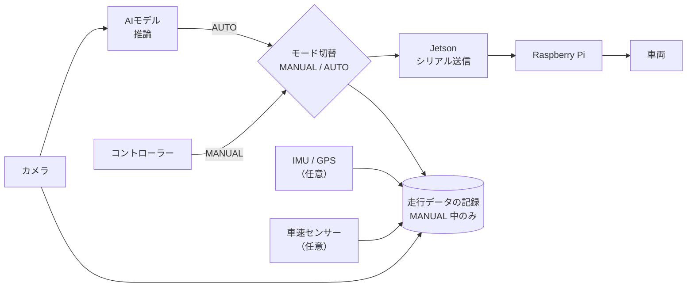

# PIUS 自律走行システム 操作マニュアル

PIUS 自律走行システムを使って「手動走行でのデータ収集」「モデルの学習」「自動走行」を行うための手順書です。
初めて使う人でも、上から順に読めば一通りの操作ができるように構成しています。

## 目次

1. [はじめに](#1-はじめに)
2. [システムの全体像](#2-システムの全体像)
3. [走行前の準備](#3-走行前の準備)
4. [起動と終了](#4-起動と終了)
5. [Webダッシュボード](#5-webダッシュボード)
6. [コントローラー操作](#6-コントローラー操作)
7. [手動走行と学習データ収集](#7-手動走行と学習データ収集)
8. [自動走行（AUTO）](#8-自動走行auto)
9. [走行データの確認](#9-走行データの確認)
10. [モデルの学習と入れ替え](#10-モデルの学習と入れ替え)
11. [実車を動かさない動作確認（机上テスト）](#11-実車を動かさない動作確認机上テスト)
12. [Raspberry Pi 受信側の更新](#12-raspberry-pi-受信側の更新)
13. [困ったときは](#13-困ったときは)
14. [付録](#14-付録)

### 関連ドキュメント

| ドキュメント | 内容 |
| :--- | :--- |
| [README.md](README.md) | システム概要・構成図・クイックスタート・ドキュメント一覧 |
| [docs/specification.md](docs/specification.md) | 詳細仕様（ノード・トピック・シリアル通信・HDF5形式・モデル・設定ファイル・Docker など） |
| [docs/troubleshooting.md](docs/troubleshooting.md) | 症状別のトラブルシューティング（症状 → 原因 → 対処） |

---

## 1. はじめに

### このシステムでできること

PIUS は、車両前方のカメラ映像から AI（CNN モデル）がステアリングとアクセルを判断して走る、模倣学習型の自律走行システムです。
人がコントローラーで運転した走行データを記録し、そのデータで AI を学習させ、学習した AI で自動走行します。
制御は Jetson Orin Nano 上の ROS 2 Humble（Docker コンテナ内）で動作し、車両のモーター等は Raspberry Pi 経由で操作します。

### このマニュアルの対象者

- 車両を実際に走らせる運転担当者
- 走行データを集めてモデルを学習・入れ替える担当者

プログラムの内部構造や通信仕様を知りたい場合は [docs/specification.md](docs/specification.md) を参照してください。

### 安全上の注意

> [!WARNING]
> - 本システムは **時速約 5 km 程度の低速走行** を前提としています。人や障害物のある場所では走らせないでください。
> - 自動走行中も、**運転担当者は必ずコントローラーを手に持ち、いつでも手動に切り替えて止められる状態** でいてください（止め方は [8.4 緊急時の止め方](#84-緊急時の止め方)）。
> - 初めての走行やモデルを入れ替えた直後は、広い場所で短い距離から試してください。

---

## 2. システムの全体像

### 処理の流れ



1. **カメラ** が前方の映像を撮影します（上の空を除いた範囲を 320×128 ピクセルに縮小、1秒間に10枚）。
2. **AI モデル** がその映像から、この先の進路（1 m ごとに 5 点の waypoint）を予測し、**制御** がそれをステアリング（経路上の注視点に向かう）とアクセル・ブレーキ（目標速度に合わせる）に変えます。
3. **コントローラー** からは人の操作（ステア・アクセル・ブレーキ）が届きます。
4. **モード切替** が、今どちらの操作を車両に送るかを決めます。
5. **Jetson** が操作量を信号（PWM 値）に変換し、シリアルケーブルで **Raspberry Pi** に送ります。Pi がモーター・ステアリング・ブレーキを動かします。

このほかに、**IMU / GPS センサー**（WitMotion WTGAHRS3、USB 接続）をつなぐと、車両の傾き・加速度・回転の速さと GPS の位置をダッシュボードに表示し、走行データと一緒に記録します。IMU/GPS は **任意** のセンサーで、つながっていなくても、走行中に抜けても、運転・モード切替・記録には影響しません。

同じように、**車速センサー**（後輪左のブレーキディスクの磁石を検出するリードスイッチ。タイヤ 1 回転で 1 パルス）をつなぐと、車速をダッシュボードに表示し、パルスの時刻を記録します。こちらも **任意** のセンサーで、運転・モード切替・記録には影響しません。

### 走行モード

| モード | 車両を操作するもの | 説明 |
| :--- | :--- | :--- |
| **MANUAL**（手動） | コントローラー | 人が運転します。起動直後は必ずこのモードです。学習データはこのモード中だけ記録されます。 |
| **AUTO**（自動） | AI モデル | AI がステアリングとアクセルを操作します。コントローラーは **SHARE ボタン（MANUAL に戻す）以外は効きません**。 |

### 記録されるもの

MANUAL で走行している間、次のデータが `data/` フォルダに HDF5 形式（`.h5`）で保存されます。

| 項目 | 内容 |
| :--- | :--- |
| カメラ画像 | 320×128 ピクセルのカラー画像（1280×720 のうち空を除いた範囲を縮小。色の並びは BGR。1秒間に最大10枚） |
| ステアリング | -1.0（左いっぱい）〜 0.0（直進）〜 1.0（右いっぱい） |
| スロットル | 0.0 〜 1.0（アクセルの踏み込み量） |
| 時刻 | 画像の撮影時刻と操作量の受信時刻 |
| IMU / GPS | 姿勢（ロール・ピッチ・ヨー）・加速度・角速度と、GPS の緯度・経度・高度・速度・進行方向・衛星数。センサーがつながっていないとき・GPS が測位していないときは「値なし（NaN）」として記録 |
| 車速 | 車速センサーから求めた速度と、タイヤの累計回転数（パルス数）。センサーがない・速度が分からないときは「値なし（NaN）」 |
| 高頻度データ | IMU の全サンプル（1 秒に 50 回）・GPS・車輪パルスの時刻を、カメラ画像とは別に記録（将来の進路予測モデルの正解データ用。[7.3](#73-保存されるファイル)） |

ブレーキ操作は記録されません。記録される条件の詳細は [7.2 記録される条件](#72-記録される条件) を参照してください。

---

## 3. 走行前の準備

### 3.1 機材のチェックリスト

走行前に、次のすべてがそろっていることを確認してください。

| # | 確認項目 | 確認方法 |
| :--- | :--- | :--- |
| 1 | Jetson Orin Nano の電源が入っている | ログインできること |
| 2 | CSI カメラが Jetson に接続されている | ケーブルがしっかり挿さっていること |
| 3 | コントローラー（DualShock / DualSense）が Jetson に接続されている | USB ケーブルで接続、または Bluetooth でペアリング済みであること。バッテリー残量も確認 |
| 4 | Raspberry Pi で受信プログラム `receiver_.py` が動いている | サービス `pius-receiver` として、Pi の電源を入れると自動で動きます（設置は [12.1](#121-更新手順)）。確認: `ssh ais-pius@10.10.10.2 'systemctl is-active pius-receiver'` が `active` |
| 5 | Jetson と Raspberry Pi がシリアルケーブルで接続されている | Jetson 側 `/dev/ttyTHS1` ↔ Pi 側 `/dev/serial0` |
| 6 | （任意）IMU / GPS センサーが Jetson の USB に接続されている | 使う場合のみ。初めて使うときは [3.6](#36-imu--gps-センサーの準備初回のみ) の準備が必要です。GPS を使う場合はアンテナも接続 |
| 7 | （任意）車速センサーが Jetson の 40 ピンヘッダに接続されている | 使う場合のみ。初めて使うときは [3.8](#38-車速センサーの準備初回のみ) の準備が必要です |
| 8 | 走行場所の安全が確保されている | 周囲に人・障害物がないこと |

> [!NOTE]
> Raspberry Pi の受信プログラムは、起動直後や Jetson からの信号が途絶えている間、車両を **フルブレーキ** で停止させています。Jetson 側を起動する前に Pi 側を起動しておいて問題ありません。

### 3.2 シリアルポートの権限

Jetson から車両へ信号を送るには、シリアルポートへのアクセス権が必要です。この権限は Jetson を再起動するたびに元に戻ります。

```bash
sudo chmod 777 /dev/ttyTHS1
```

- 起動スクリプト `start_system.sh` を使う場合は **自動で実行されます**（途中で sudo のパスワードを聞かれることがあります）。
- 権限がないまま起動すると、車両へは何も送信されない **DRY RUN** 状態になり、ダッシュボードに黄色の警告が出ます。

### 3.3 今回の更新後、初めて起動するとき

Web ダッシュボード用にポート `8080` を追加したため、更新後の初回起動時は Docker コンテナが自動的に作り直されます（数十秒かかることがあります）。特に操作は必要ありません。
IMU / GPS 対応でも `docker-compose.yml` を変更したため、この更新を取り込んだ後の初回起動時にも同じようにコンテナが作り直されます。また、新しいプログラム（IMU / GPS のノード）が追加されているので、コンテナ内で再ビルド（[3.5](#35-プログラムを変更したとき再ビルド)）してから起動してください。
車速センサー対応でも `docker-compose.yml` を変更し（40 ピンヘッダの GPIO をコンテナから使うため）、新しいプログラム（車速センサーのノード）を追加しました。同じように、初回起動時のコンテナの作り直しと、コンテナ内での再ビルドが必要です。

> [!NOTE]
> 作り直し前のコンテナの状態は、Docker イメージ `namazyake/roscar2:backup-20260923` として保存してあります。戻し方は [14.3 バックアップイメージに戻す](#143-バックアップイメージに戻す) を参照してください。

### 3.4 コンテナの中で作業する方法

データの確認・学習・机上テストなどは、Docker コンテナの中で実行します。

| パス | 場所 |
| :--- | :--- |
| `/home/yl00/pius` | Jetson（ホスト）側のプロジェクトフォルダ |
| `/home/orin/dev/ws/colcon_ws` | コンテナ内から見た同じフォルダ（中身は同一です） |

1. Jetson の端末で、コンテナが起動していることを確認します（起動していなければ起動します）。
   ```bash
   cd /home/yl00/pius
   docker compose up -d
   ```
2. コンテナに入ります（ユーザー名が `orin` に変わります）。
   ```bash
   docker exec -it roscar2 bash
   ```
3. 作業フォルダに移動し、ROS 2 の環境を読み込みます。**新しい端末でコンテナに入るたびに必要です。**
   ```bash
   cd /home/orin/dev/ws/colcon_ws
   source install/setup.bash
   ```

### 3.5 プログラムを変更したとき（再ビルド）

`src/` 以下のプログラム（ダッシュボードの画面ファイル `index.html` を含む）を変更したときは、コンテナ内で再ビルドしてください。再ビルドしないと変更が反映されません。

```bash
cd /home/orin/dev/ws/colcon_ws
colcon build
source install/setup.bash
```

> [!IMPORTANT]
> `colcon build --symlink-install` は、このコンテナでは失敗します（`option --editable not recognized`）。**`--symlink-install` を付けずに** `colcon build` だけを実行してください。

`config.yaml`（設定ファイル）だけを変更した場合は再ビルド不要で、システムを再起動すれば反映されます。

### 3.6 IMU / GPS センサーの準備（初回のみ）

IMU / GPS センサー（WitMotion WTGAHRS3）を使う場合だけ必要な準備です。使わない場合は読み飛ばしてかまいません。

| 項目 | 内容 |
| :--- | :--- |
| 測れるもの | 姿勢（ロール・ピッチ・ヨー）、加速度（±16 g）、角速度（±500 °/s）、温度、GPS の位置・高度・速度・進行方向（GPS / BeiDou / GLONASS / QZSS） |
| 接続 | USB ケーブルで Jetson につなぐだけです（電源も USB から供給） |
| 抜き差し | いつ抜き差ししてもかまいません。システムは 1 秒ごとに自動で再接続を試みます |

#### ドライバのインストール（ホスト、初回のみ）

Jetson のカーネルには、センサーに内蔵されている USB シリアル変換チップ（CH340）のドライバが入っていません。**ホスト（コンテナの外）の端末** で、次を 1 回だけ実行します。

```bash
cd /home/yl00/pius/drivers/ch341
make
sudo ./install.sh
```

- `install.sh` は、CH340 を横取りしてしまう点字ディスプレイ用のサービス（`brltty`）を無効化し、ドライバをインストールして読み込みます。
- インストール後は、Jetson を再起動してもセンサーを挿すだけで使えます。
- 元に戻すときは、同じフォルダで `sudo ./uninstall.sh` を実行します。

> [!IMPORTANT]
> `sudo apt upgrade` などで **Jetson のカーネルが更新されると、ドライバを作り直す必要があります**（作り直すまでセンサーが認識されません）。同じフォルダで次を実行してください。
> ```bash
> make clean && make
> sudo ./install.sh
> ```

#### 認識の確認（ホスト）

センサーを挿し直してから、次のコマンドで確認します。

```bash
ls -l /dev/ttyUSB* /dev/serial/by-id/
```

`/dev/ttyUSB0` と `/dev/serial/by-id/usb-1a86_USB_Serial-if00-port0` があれば準備完了です。システムは後者（抜き差ししても変わらない名前）を使ってセンサーを開きます。

#### センサー単体の動作確認（任意）

センサーから値が出ているかだけを確かめたいときは、確認スクリプトを使います。走行システムを `Ctrl + C` で止めてから、ホストの端末で実行してください（`Ctrl + C` で終了）。

```bash
docker run --rm -it --device /dev/ttyUSB0 --group-add 20 -v /home/yl00/pius:/ws namazyake/roscar2:cu126 python3 /ws/tools/witmotion_check.py /dev/ttyUSB0 115200
```

末尾の `115200` は通信速度です（下の「出力を 50 Hz にする」を行う前、出荷時の設定のままなら `9600`）。0.5 秒ごとに加速度・角速度・角度・位置・衛星数が表示されます。`※ 正常なパケットが届いていません。…` と出る場合は、[docs/troubleshooting.md](docs/troubleshooting.md#9-imu--gps) を参照してください。

> [!NOTE]
> - GPS は **屋外の空が見える場所** でないと測位できません。屋内では衛星数 0 のまま `未測位` になりますが、故障ではありません。電源を入れてから測位するまで、屋外でも数十秒かかります。GPS を使う場合はアンテナを接続してください。
> - このセンサーには地磁気センサーがないため、ヨー（方位）は時間とともに少しずつずれていきます。

#### 出力を 50 Hz にする（初回のみ・設定済み）

センサーは出荷時、1 秒に 10 回・通信速度 9600 bps でデータを出します。進路の記録に使うため、設定ツール `tools/imu_config.py` で **1 秒に 50 回・115200 bps** に変更して、センサーに保存してあります（`config.yaml` の `imu.baudrate` も `115200` にしてあります）。センサーを交換したときや、設定を出荷時に戻したときだけ、次の手順で設定し直してください。

1. 走行システムを `Ctrl + C` で止めます（センサーを使うプログラムが動いていると設定できません）。
2. ホストの端末で、現在の設定を確認します。
   ```bash
   docker run --rm -it --device /dev/ttyUSB0 --group-add 20 -v /home/yl00/pius:/ws namazyake/roscar2:cu126 python3 /ws/tools/imu_config.py --show
   ```
   `通信速度: 115200 bps` と `出力頻度 (RRATE 0x03): 0x08 = 50 Hz` と表示されれば、設定済みです。
3. 設定済みでなければ、同じコマンドの `--show` を `--apply` に変えて実行します。
4. USB を挿し直してから、もう一度 `--show` で 115200 bps・50 Hz のままであることを確認します。

> [!NOTE]
> - `--factory-reset` を付けて実行すると、出荷時の設定（9600 bps・10 Hz）に戻ります。戻したまま使う場合は、`config.yaml` の `imu.baudrate` を `9600` に戻してください（合っていないと、ダッシュボードの IMU/GPS が `データなし` になります）。
> - GPS の位置が更新されるのは 1 秒に 5 回です。50 Hz にしても、GPS は同じ位置が繰り返し届きます。

### 3.7 カメラの色補正（初回のみ）

使用しているカメラ（Waveshare IMX219-160、160° 広角）は、そのままだと画像の周辺がピンク色になります。ホスト（Jetson）の端末で次を実行し、メーカーの補正ファイルを導入してください。

```bash
cd /home/yl00/pius
sudo ./tools/camera_isp.sh install
```

*   補正ファイルのダウンロード・配置・カメラ制御デーモン（`nvargus-daemon`）の再起動をまとめて行います。システムを起動したままでも、カメラは自動で再接続します。
*   元に戻すときは `sudo ./tools/camera_isp.sh remove` です。

> [!IMPORTANT]
> 補正の前後でモデルに入力される画像の色が変わります。補正前に集めたデータや、それで学習したモデルとは色が合わないため、補正後にデータを集め直して再学習してください。

### 3.8 車速センサーの準備（初回のみ）

車速センサーを使う場合だけ必要な準備です。使わない場合は読み飛ばしてかまいません（センサーがなくてもシステムは動きます）。

| 項目 | 内容 |
| :--- | :--- |
| 測れるもの | 後輪左のタイヤの回転（ブレーキディスクに付けた磁石がリードスイッチの前を通るたびに 1 パルス。磁石が N 個なら、タイヤ 1 回転で N パルス） |
| センサー | PIUS 純正の速度計のセンサーです。純正の表示器から線を外して Jetson につないでいるため、**つないでいる間は PIUS 純正の速度表示は動きません**。元に戻すときは、線を表示器につなぎ直します |
| 接続 | 74HC14 のバッファ基板を通して、Jetson の 40 ピンヘッダの **1 番（3.3 V）・7 番（信号）・9 番（GND）** につなぎます |
| 使い道 | 車速の表示と、走行距離の記録（将来の進路予測モデルの正解データ用） |

> [!WARNING]
> 40 ピンヘッダの **2 番・4 番（5 V）には絶対につながないでください**。Jetson が壊れるおそれがあります。配線の詳細は仕様書の「車速センサー仕様」（[docs/specification.md](docs/specification.md#11-車速センサー仕様)）を参照してください。

#### 配線の確認（ホスト）

確認スクリプト `tools/speed_sensor_check.py` を使います。**走行システムを `Ctrl + C` で止めてから**、ホストの端末で実行してください（同じピンは 1 つのプログラムしか使えないため、システムが動いているとエラーになります）。`Ctrl + C` で終了します。

1. 入力の変化をそのまま表示して、配線を確認します。
   ```bash
   cd /home/yl00/pius
   python3 tools/speed_sensor_check.py --raw
   ```
   磁石をスイッチに近づけると `レベル 1  スイッチ閉（マグネット検知）`、離すと `レベル 0  スイッチ開` と表示されれば、配線は正常です（1 回近づけただけで 0 と 1 が細かく何度も切り替わるのは、スイッチのチャタリングで、異常ではありません）。
2. 車輪を回して、パルスが数えられることを確認します。
   ```bash
   python3 tools/speed_sensor_check.py
   ```
   タイヤが 1 回転するたびに `パルス #   N  間隔 … s  回転数 … rpm` と表示されます。

- `gpio` グループに入っているユーザー（通常のログインユーザー）なら `sudo` は不要です。

#### タイヤの外周を設定する（必須）

車速を計算するには、**後輪左のタイヤの外周**（1 回転で進む距離）が必要です。`config.yaml` の `wheel.circumference_m` は、最初は `0.0`（未設定）になっています。未設定の間はパルスの記録だけを行い、ダッシュボードの車速は `外周未設定` と表示されます。

1. タイヤの接地点と地面に印を付け、車両をまっすぐ押してタイヤをちょうど 1 回転させ、進んだ距離をメートル単位で測ります（何回転か転がして回転数で割ると正確です）。
2. `config.yaml` の `wheel:` にある `circumference_m` に、測った値を書きます。
   ```yaml
   wheel:
     circumference_m: 1.50   # 例。実測した後輪左タイヤの外周 [m]
   ```
3. システムを起動し直すと反映されます（再ビルドは不要です）。

外周を指定して確認スクリプトを実行すると、速度 [km/h] も表示されます（例: `python3 tools/speed_sensor_check.py --circumference 1.50`）。

> [!NOTE]
> 外周が未設定のまま記録したデータでも、パルスの時刻と数は記録されています。後から外周を掛ければ走行距離を求められます。

#### 磁石の数を変えたとき

磁石を増やすと、1 回転で出るパルスが増え、低速や止まる前後の車速が正確になります。磁石は、同じものを、同じ半径・同じ向きで、**等間隔に**付けてください（4 個なら 90° ごと）。

1. 走行システムを止め、手でタイヤをちょうど 1 回転させて、パルスの数が磁石の数と同じになるか確かめます（磁石 4 個の例）。
   ```bash
   python3 tools/speed_sensor_check.py --slow --ppr 4 --circumference 1.249
   ```
   終了すると、通過の回数と、磁石ごとの「閉じていた時間」が表示されます。ほかより極端に短い磁石は、センサーとの距離・向き・強さを見直してください。
2. `config.yaml` の `wheel.pulses_per_rev` を磁石の数にします。
   ```yaml
   wheel:
     pulses_per_rev: 4
   ```
3. 走行システムを起動し直します（再ビルドは不要です）。記録ファイルには、記録時の値が属性 `wheel_pulses_per_rev` として残ります。

> [!IMPORTANT]
> 磁石の数と `pulses_per_rev` が合っていないと、車速と走行距離が何倍にもずれます（磁石 4 個で設定が 1 なら 4 倍）。設定を間違えたまま記録したファイルは、学習のときに `train_waypoint.py --pulses_per_rev 4` のように正しい値を指定し直せます。

### 3.9 カメラの切り出し範囲の調整（初回・カメラの向きを変えたとき）

モデルに渡すのは、カメラの 1280×720 の画像のうち `config.yaml` の `camera.crop`（`[x, y, 幅, 高さ]`）の範囲だけです。上の空を除き、320×128 に縮小して使います。ダッシュボードのカメラ画像に、この範囲が **白い破線の枠** で表示されます。

1. システムを起動し、ダッシュボードでカメラ画像を見ます。
2. 枠の中に空が入らず、路面ができるだけ広く入るように、`camera.crop` の `y`（上端）を調整します。幅と高さは `1280` と `512` のまま（縦横比 2.5:1）にして、`y` だけを変えるのが基本です（`y + 512` が 720 を超えないこと）。
3. `config.yaml` を保存したら、システムを起動し直します。

> [!IMPORTANT]
> **学習データを集め始めたら、カメラの取り付けと `camera.crop` は変えないでください。** 画像と進路の対応が変わり、それまでのデータと混ぜて学習できなくなります。記録ファイルには切り出し範囲が記録されます（`camera_crop` 属性）。

### 3.10 仮の値（未確定のパラメータ）の確認

タイヤ外周・操舵の効き・カメラの位置などは、実測するまで **仮の値** が入っています。入れ忘れを防ぐため、`config.yaml` の各セクションの `unverified` に、仮の値の項目名を並べてあります。

```yaml
wheel:
  circumference_m: 1.277
  unverified: [circumference_m]      # 実測した値を入れたら、ここから名前を消す
```

| 知らせる場所 | 内容 |
| :--- | :--- |
| ダッシュボード | 黄色の警告バナー `仮の値（未確定）のパラメータが N 件あります（AUTO に必須: …）` と、「自動運転の制御」欄 |
| 起動時の端末 | 接続のまとめの後に、項目・今の値・求め方の一覧 |
| 記録ファイル | 記録時に仮だった項目を `unverified_params` 属性に保存（後から分かるように） |
| 学習時 | 正解データの作成に使う値（外周・ヨーレートの符号など）が仮なら警告 |

一覧と求め方は次のコマンドで確認できます（ホストでもコンテナでも可）。

```bash
python3 tools/check_calibration.py
```

★ の付いた **AUTO に必須** の項目（タイヤ外周 `wheel.circumference_m`、ヨーレートの符号 `vehicle.yaw_sign`、操舵の対応表 `vehicle.steer_table`）が仮のままだと、**制御ノードは AUTO 用の操作量を出さず、AUTO には切り替わりません**。

| 項目 | 求め方 |
| :--- | :--- |
| `wheel.circumference_m` ★ | [3.8](#38-車速センサーの準備初回のみ)（人が乗った状態で 5 回転押して距離を測る） |
| `vehicle.yaw_sign` ★ | [9.3](#93-走行軌跡の確認確認用の走行)（左回りの円で向きの変化が + になれば `1`） |
| `vehicle.steer_table` ★ | [10.8](#108-操舵の対応表を作る) |
| `camera.crop` | [3.9](#39-カメラの切り出し範囲の調整初回カメラの向きを変えたとき) |
| `camera.preview_white_balance` | [3.11](#311-ダッシュボードの映像の色表示用の補正)（表示用のみ） |
| `camera_geometry.*` | [10.9](#109-カメラのキャリブレーション経路の重ね表示用)（走行経路を画像に重ねる表示だけに使用） |
| `controller.*` | [8.8](#88-制御の調整)（実車で調整） |

### 3.11 ダッシュボードの映像の色（表示用の補正）

カメラの色補正ファイル（[3.7](#37-カメラの色補正初回のみ)、Jetson Nano 用）を入れると、画像の周辺の色むらは直りますが、全体がやや紫寄りになります（蛍光灯の下の白い壁で、緑に対して赤が約 1.1 倍、青が約 1.3 倍）。そこで、**人が見るダッシュボードの映像だけ** を `config.yaml` の `camera.preview_white_balance`（[赤, 緑, 青] の倍率）で補正しています。

- **モデル用の画像と学習データには補正をかけません。** 学習と走行で同じ（紫寄りの）画像を使うので、運転には影響しません。補正の値を後から変えても、集めたデータやモデルはそのまま使えます。
- 白飛びした部分（照明など）は白のまま残します。
- 値の測り方: 走行システムを起動し、白い紙（コピー用紙で可）をダッシュボードの白い破線の枠の中央に大きく写して、コンテナ内で次を実行します。表示された値を `config.yaml` に貼り付け、システムを再起動すると反映されます。
  ```bash
  python3 tools/camera_white_balance.py
  ```
- 今の値は屋内の蛍光灯の下で測った仮の値です。屋外でも測って値が近ければ、`camera.unverified` から `preview_white_balance` を消してください（[3.10](#310-仮の値未確定のパラメータの確認)）。

---

## 4. 起動と終了

### 4.1 起動する

Jetson（ホスト）の端末で、次のコマンドを実行します。

```bash
cd /home/yl00/pius
./start_system.sh            # 標準のモデルで起動
./start_system.sh model_v2   # models/model_v2.pth を使って起動
```

スクリプトは次の3段階を自動で行います。

1. シリアルポートの権限付与（[3.2](#32-シリアルポートの権限)）
2. Docker コンテナの起動（`docker compose up -d`）
3. コンテナ内で ROS 2 システム一式を起動

### 4.2 使用するモデルの指定方法

| 指定のしかた | 実際に使われるファイル |
| :--- | :--- |
| 何も指定しない | `config.yaml` の `inference.model_path`（通常は `models/waypoint.pth`） |
| ファイル名のみ（例: `model_v2.pth`） | `models/model_v2.pth` |
| 拡張子なし（例: `model_v2`） | `.pth` が自動で付き、`models/model_v2.pth` |
| `/` で始まるパス | そのパスをそのまま使用 |

> [!NOTE]
> `/` で始まるパスは **コンテナ内のパス** として扱われます。ホスト側のパス（`/home/yl00/pius/...`）ではなく `/home/orin/dev/ws/colcon_ws/...` で指定してください。通常はモデルを `models/` に置き、ファイル名だけで指定するのが簡単です。

### 4.3 起動後に表示されるもの

| タイミング | 表示内容 |
| :--- | :--- |
| 起動直後 | 各部の起動メッセージ。`【ダッシュボード】Webダッシュボードを起動しました。ブラウザで開いてください: http://...` の行にダッシュボードのアドレスが表示されます |
| 約15秒後 | **接続健全性サマリー**（カメラ・コントローラー・車両シリアル・AI 推論モデル・IMU/GPS の状態）。すべて正常なら `[システム診断: ALL GREEN]`、問題があれば `[システム診断: 一部機能制限あり]` と原因が表示されます。IMU/GPS は任意のセンサーのため、この判定には含まれません。車速センサーはこのサマリーには表示されません（ダッシュボードで確認します） |
| 動作中 | 各部のログ（モード切替、記録状態の変化、接続の切断・再接続など） |

起動直後は **MANUAL モード** です。これまで通り、ROS のログはすべてこの端末に表示されます。詳しい状態は [Web ダッシュボード](#5-webダッシュボード) で確認できます。

### 4.4 終了する

起動した端末で **`Ctrl + C`** を押します。終了時には次の処理が自動で行われます。

| 対象 | 終了時の動作 |
| :--- | :--- |
| 車両 | 直進・スロットル停止・**フルブレーキ（PWM 1135）**・ニュートラルの停止信号を送ってから終了します |
| 走行データ | メモリに残っているデータを HDF5 ファイルへ書き出してから閉じます |
| Raspberry Pi | Jetson からの信号が途絶えて 0.5 秒後、Pi 側でもフルブレーキを保持します |

最後に `PIUS自律走行システムが終了しました。` と表示されれば終了です。Docker コンテナは起動したまま残ります（次回の起動が速くなります）。

---

## 5. Webダッシュボード

システムの状態をブラウザで確認できる画面です。システムの起動と同時に自動で立ち上がります。

### 5.1 開き方

| 使う端末 | 開くアドレス |
| :--- | :--- |
| Jetson 本体のブラウザ | `http://localhost:8080` |
| Tailscale でつないだ PC・タブレット・スマートフォン | `http://<Jetson の Tailscale の IP>:8080`（IP はホストで `tailscale ip -4` で確認） |

> [!IMPORTANT]
> **ローカルネットワーク（同じ Wi-Fi など）からのアクセスは拒否します**（`このダッシュボードは Jetson 本体（localhost）と Tailscale 経由でのみ利用できます。` と表示）。許可する接続元は `config.yaml` の `dashboard.allowed_networks` で変えられます。

> [!NOTE]
> ダッシュボードは **表示専用** です。画面から車両を操作することはできません。操作はすべてコントローラーで行います。

### 5.2 画面の見方

| 場所 | 表示内容 |
| :--- | :--- |
| **ヘッダー** | 全体の状態（`すべて正常` / `一部機能制限あり` / `異常あり` / `通信断`）と現在時刻 |
| **警告バナー**（ヘッダーの下） | 対応が必要な問題（[5.3](#53-警告バナーの意味と対処)）。問題がなければ表示されません |
| **走行モード** | `MANUAL` / `AUTO`。MANUAL 中は「AUTOに切替可能」かどうかも表示されます |
| **学習データ収集** | `記録中`（保存フレーム数・ファイル名）/ `記録OFF`（OPTIONS で一時停止中）/ `記録待機`（記録していない理由を表示） |
| **シフト** | `D（前進）` / `R（後退）` |
| **走行モデル** | 読み込んだモデルのファイル名と、読み込めたかどうか |
| **カメラ画像** | カメラ映像（表示専用の 640×360・15 fps のプレビュー）と解像度・fps。白い破線の枠はモデルに渡す範囲（[3.9](#39-カメラの切り出し範囲の調整初回カメラの向きを変えたとき)）。水色の線はステア指令から描いた進路の目安（AUTO 中は青）。**黄色の線と点はモデルが予測した走行経路**、赤い点は制御が目指している注視点です（カメラの位置・向きが仮の値の間は、実際の路面とずれて描かれます。[10.9](#109-カメラのキャリブレーション経路の重ね表示用)） |
| **操作量** | ステア・スロットル・ブレーキの値を「手動（コントローラー）」「AUTO（モデル出力）」「車両へ出力」の3列で比較 |
| **車両へ送信した値（PWM）** | 実際に車両へ送った PWM 値とギア状態（D / N / R）。ブレーキは `フルブレーキ（1135）` / `解放（1948）` / `○%` で表示 |
| **接続状況** | 各部の状態ランプ（下表） |
| **コントローラー入力** | 左スティック・R2・L2 の値と、押されているボタン |
| **操作方法** | ボタン割り当ての早見表 |
| **自動運転の制御** | 制御の状態（`準備完了（MANUAL 中）` / `AUTO で制御中` / `操作量を出していません` と理由）、目標速度と実測速度、操舵角とステア指令、スロットル・ブレーキ、注視距離と曲率、仮の値の件数。右側は上から見た予測経路（後軸中央が原点、1 m 格子。黄: waypoint、赤: 注視点） |
| **IMU / GPS（WitMotion WTGAHRS3）** | 車両の姿勢・加速度・角速度・温度、車速センサーによる車速と、GPS の測位状態・位置・速度（[5.5](#55-imu--gps-の表示)） |
| **通知** | 各部からのお知らせの履歴（[5.4](#54-通知)） |

#### 接続状況のランプ

| 表示名 | 対象 |
| :--- | :--- |
| カメラ | CSI カメラ |
| コントローラー | DualShock / DualSense コントローラー |
| 操作解析 | コントローラー入力を操作量に変換する部分 |
| モード管理 | MANUAL / AUTO を切り替える部分 |
| AI推論 | AI モデルによる推論 |
| 車両シリアル | Raspberry Pi への送信 |
| データ保存 | 走行データの記録 |
| IMU/GPS | IMU / GPS センサー（任意） |
| 車速センサー | 車速センサー（任意） |
| 自動運転の制御 | 予測した経路を操作量に変える部分。MANUAL での走行には不要なので、準備ができていないときは黄（`仮の値で停止中` など） |

| ランプの色 | 意味 |
| :--- | :--- |
| 緑 | 正常 |
| 黄 | 制限付きで動作中（ダミー動作・DRY RUN・モデル未読込など）。IMU/GPS と車速センサーは任意のセンサーなので、再接続中・データなし・`ERROR` でも赤ではなく黄になります |
| 赤 | 異常（応答なし・カメラやコントローラーの再接続中など） |
| 灰 | 起動待ち |

3 秒以上応答がない部分は `応答なし` と表示されます（そのプログラムが止まっている可能性があります）。

### 5.3 警告バナーの意味と対処

| バナーの表示 | 意味 | 対処 |
| :--- | :--- | :--- |
| 【赤】`〇〇が応答していません（ノードが停止している可能性があります）` | その部分から 3 秒以上応答がない | 端末のエラー表示を確認。直らなければ `Ctrl + C` で終了して再起動 |
| 【赤】`カメラ: 再接続中 — …` / `カメラ: 再起動中 — …` | カメラが切断またはフリーズし、自動で復旧中 | 通常は数秒で復旧します。30 秒以上続く場合は [13 困ったときは](#13-困ったときは) を参照 |
| 【赤】`コントローラーが接続されていません。車両は安全停止します…` | コントローラーが切断されている | USB ケーブルまたは Bluetooth 接続・バッテリーを確認（1 秒ごとに自動で再接続を試みます） |
| 【黄】`車両へ送信していません（DRY RUN）: …` | 車両へ信号を送っていない（ポート権限がない、または `dry_run:=true` で起動） | 実車を動かす場合は `sudo chmod 777 /dev/ttyTHS1` を実行して再起動 |
| 【黄】`モデルが読み込まれていません（…）。AUTO走行は使用できません` | モデルファイルがない、または読み込めない | `models/` にモデルがあるか、起動時に指定したモデル名が正しいか確認 |
| 【黄】`IMU/GPS: …（走行・記録には影響しません）` | IMU / GPS センサーが見つからない（再接続中）、またはつながっているのにデータが届かない（データなし） | センサーを使わないなら対処は不要です。使う場合は USB ケーブルとドライバ（[3.6](#36-imu--gps-センサーの準備初回のみ)）を確認。詳しくは [docs/troubleshooting.md](docs/troubleshooting.md#9-imu--gps) |
| 【黄】`車速センサー: GPIO を使えません: …（走行・記録には影響しません）` | 車速センサーのプログラムが Jetson の GPIO を使えない（別のプログラムが同じピンを使っている、コンテナが古い設定のままなど） | センサーを使わないなら対処は不要です。使う場合は `tools/speed_sensor_check.py` などを止めてからシステムを再起動。詳しくは [docs/troubleshooting.md](docs/troubleshooting.md#10-車速センサー) |
| 【黄】`仮の値（未確定）のパラメータが N 件あります（AUTO に必須: …）。…` | 実測していない仮の値が残っている | `python3 tools/check_calibration.py` で一覧と求め方を確認し、実測した値を入れて `unverified` から消す（[3.10](#310-仮の値未確定のパラメータの確認)） |
| 【赤】その他の赤いバナー（例: `AUTO走行を中断し、停止してMANUALに戻しました: …`） | 直近 10 秒以内に発生したエラー通知 | 表示された内容に従って確認。「通知」欄に履歴が残ります |
| 【赤】`ダッシュボードと通信できません…` | ブラウザがダッシュボードに接続できない | システムが起動しているか、Jetson の IP アドレスが正しいか確認 |

### 5.4 通知

画面下部の「通知」欄には、各部からのお知らせが新しい順に表示されます（時刻・発信元・内容）。

| 色 | レベル | 例 |
| :--- | :--- | :--- |
| 青 | お知らせ（INFO） | `走行モードを AUTO に切り替えました`、`カメラに再接続しました`、`コントローラーに再接続しました`、`IMUに再接続しました` |
| 黄 | 注意（WARN） | `AUTOへの切替を拒否しました: …`（理由付き）、`IMUとの接続が切れました。再接続を試みています（走行には影響しません）` |
| 赤 | エラー（ERROR） | `AUTO走行を中断し、停止してMANUALに戻しました: …`、`カメラとの接続が切れました…` |

### 5.5 IMU / GPS の表示

「IMU / GPS（WitMotion WTGAHRS3）」欄には、センサーの値が表示されます。センサーがつながっていないときは `—` と、その理由（`再接続中: …` など）が表示されます。

| 表示 | 内容 |
| :--- | :--- |
| ロール / ピッチ / ヨー | 車両の傾き（左右・前後）と向き [°]。棒グラフは ±180° を端とした目安です |
| 加速度 [g] | X・Y・Z 方向の加速度。センサーを水平に置いて止めているときは、Z が約 1 g（重力の分）になります |
| 角速度 [°/s] | X・Y・Z 軸まわりの回転の速さ |
| 温度 | センサー内部の温度 |
| 車速（車輪） | 車速センサーから求めた速度 [km/h] と累計パルス数（例 `5.2 km/h ・ 累計 128 パルス`）。動き出してから 2 回目のパルスまでは `不明（パルス2回目から計算）`、タイヤの外周を設定していないときは `外周未設定（config.yaml の wheel.circumference_m）`（[3.8](#38-車速センサーの準備初回のみ)）。3 秒以上パルスがないと 0.0 km/h（停止）になります |
| 注意書き | 通常は `ヨー（方位）は地磁気センサーがないため、時間とともに少しずつずれます`。角速度が測定範囲（±500 °/s）に達したときは赤で `角速度が測定範囲（±500°/s）に達しました。…` と表示されます |
| 測位状態 | `測位中`（緑）/ `未測位`（黄） |
| 衛星数 / HDOP | 受信している衛星の数と、水平方向の精度の目安（小さいほど精度が高い） |
| 緯度 / 経度、高度、速度 / 進行方向 | 測位中のみ表示（速度は km/h、進行方向は北を 0° とした角度） |

> [!NOTE]
> - **角速度の測定範囲超え**: センサーを手で素早くひっくり返したときなどに起こり、しばらく姿勢・加速度の値が不正確になることがあります。故障ではありません。時速約 5 km で走る車両では、まず起こりません。センサーを静止させると、ロール・ピッチは少しずつ正しい値に戻りますが、**ヨーは戻りません**。ヨーがずれたままのときは USB を挿し直してください（センサーの電源が入り直します）。
> - **ヨー**: 止まっている間はずれませんが、走行中は少しずつずれていきます。
> - **GPS**: 屋外の空が見える場所でないと `未測位` のままです（[3.6](#36-imu--gps-センサーの準備初回のみ)）。

---

## 6. コントローラー操作

DualShock / DualSense コントローラーで操作します。

| 操作 | ボタン / スティック | 説明 |
| :--- | :--- | :--- |
| ステアリング | **左スティック（左右）** | 左いっぱい = -1.0、中央 = 直進、右いっぱい = 1.0 |
| アクセル | **R2 トリガー** | 押し込み量 0〜1。シフトが R のときは後退します。0.3 以下ではほとんど動かず、0.6 で約 2 km/h、0.8 で約 4 km/h、押し切ると 5 km/h（補足資料の参考値） |
| ブレーキ | **L2 トリガー** | 押し込み量 0〜1。押し切るとフルブレーキ |
| シフト切替 | **× ボタン** | D（前進）と R（後退）を切り替え（起動時は D） |
| 走行モード切替 | **SHARE ボタン** | MANUAL と AUTO の切り替えを要求（AUTO は準備が整っているときだけ受け付け。[8.1](#81-autoに切り替えられる条件)） |
| 記録 ON / OFF | **OPTIONS ボタン** | 学習データの記録を一時停止・再開（起動時は ON） |

L1・R1 などその他のボタンは使用しません。

> [!NOTE]
> - L2 を離しているときはブレーキ **解放** です。停車中に車両を確実に止めておきたいときは L2 を押し込んでください。
> - AUTO 中は、SHARE 以外の操作（スティック・R2・L2）は車両に反映されません。
> - 車両は、アクセルを離した状態でしか前進・後退を切り替えられません（補足資料の注意事項）。そのため、止まった状態から R2 を押すと、まず前進（D）に切り替え、**約 0.3 秒後にアクセルが効き始めます**。R2 を離して 0.5 秒たつと N に戻ります。D と R を切り替えたときは、N を経由するため約 0.6 秒かかります。

---

## 7. 手動走行と学習データ収集

### 7.1 手順

1. [3.1 機材のチェックリスト](#31-機材のチェックリスト) を確認します。
2. `./start_system.sh` で起動し、ダッシュボードを開きます。
3. ダッシュボードで次を確認します。
   - 走行モードが `MANUAL`
   - シフトが `D（前進）`
   - 接続状況のカメラ・コントローラー・車両シリアルが緑
4. コースまで移動する間は **OPTIONS** を押して記録を `記録OFF` にします（車庫出しや位置合わせの走行を学習させないため）。
5. スタート位置で **OPTIONS** を押して記録を再開し、コースを走ります。ダッシュボードが `記録中` になり、フレーム数が増えていくことを確認します。
6. 必要な量を走り終えたら、端末で `Ctrl + C` を押して終了します。データはファイルに書き出されます。
7. [9. 走行データの確認](#9-走行データの確認) でデータを確認します。

> [!TIP]
> - コースを **3〜5 周以上**、いろいろなラインで走ると学習が安定します。データセット全体で **3000 フレーム以上** が目安です（1 秒に 10 枚記録されるので、記録中の走行 1 分で約 600 フレームです）。
> - **車速センサーと IMU をつないだ状態で記録してください。** 正解の進路（waypoint）は、この 2 つの記録から作ります。
> - ナビ指令（交差点で曲がる / 直進する）を使わないので、**交差点ごとに進む向きが 1 つに決まるルート** を走ってください。同じ交差点を、あるときは曲がり、あるときは直進すると、モデルが迷います。
> - 別の日・別の時間帯にも記録しておくと、検証用のデータ（[10.2](#102-学習に使われるデータ)）として使えます。
> - コースの端から中央へ戻る走行を少し混ぜると、自動走行中にずれたときに戻りやすくなります。端へはみ出していく部分は OPTIONS で記録を止めてください。

### 7.2 記録される条件

記録は MANUAL 中だけ行われ、次の **すべて** を満たしたフレームだけが保存されます（`save.record_when: "moving"`、2026-11 から）。**ペダルで運転しても、コントローラーで運転しても記録されます。** 記録していないときは、ダッシュボードの「学習データ収集」に理由が表示されます。

| 条件 | 満たしていないときの表示 |
| :--- | :--- |
| OPTIONS で記録が ON | `記録OFF`（OPTIONS で再開） |
| 走行モードの状態が届いている | `走行モードが不明（MUXノードからの状態が届いていません）` |
| 走行モードが MANUAL | `AUTO走行中は記録しません` |
| カメラ画像が前のフレームから変化している | `カメラ画像が更新されていません（フリーズの可能性）` |
| 車速センサーの値が届いている | `車速が届いていません（車速センサーのノードの停止）` / `車速が不明です（…）` |
| 後退していない（車速センサーの判定、またはスロットルがマイナス） | `後退中は記録しません` |
| 車が動いている（車速 0.05 m/s 超。止まってから 2 秒までは続けて記録） | `停止中` |

- アクセルを離して惰性で走っているとき、ブレーキで減速しているとき、止まる直前も記録します。waypoint モデルが減速・停止の場面も学べるようにするためです。
- コントローラーの操作量（ステア・スロットル・ブレーキ）は、届いていれば一緒に記録し、届いていなければ「値なし（NaN）」にします。waypoint モデルの正解は走行軌跡から作るので、操作量がなくても学習できます。
- 以前の条件（操作量が届き、スロットルが 0.05 以上のときだけ）に戻すには、`config.yaml` の `save.record_when` を `"throttle"` にします。

> [!NOTE]
> **後退は記録しません。** 正解の走行軌跡でも後退区間は使わないためです。**車速センサーが必要**です（車速が分からない間は記録しません）。

IMU / GPS・車速センサーの状態は記録の条件に含まれません。センサーがつながっていなくても、GPS が測位していなくても、上の条件を満たせば記録されます（そのフレームの IMU / GPS・車速の値は「値なし（NaN）」になります）。

IMU の全サンプル・GPS・車輪パルスの **高頻度データ** は、この表の条件とは関係なく、OPTIONS で記録が ON の間はずっと記録されます（AUTO 中・停止中・後退中も含みます。[7.3](#73-保存されるファイル)）。

### 7.3 保存されるファイル

| 項目 | 内容 |
| :--- | :--- |
| 保存先 | `data/pius_drive_YYYYMMDD_HHMMSS.h5`（ファイル名の日時は起動時刻） |
| ファイル数 | 起動 1 回につき 1 ファイル |
| 書き込みのタイミング | 100 フレームごと、および終了時 |
| 1 フレームも記録しなかった場合 | ファイルは作成されません |
| IMU / GPS・車速の値 | 各フレームと一緒に同じファイルに記録されます（モデルの入力には使いません） |
| 高頻度データ | IMU の全サンプル（1 秒に 50 回）・GPS（1 秒に 50 回。位置の更新は 1 秒に 5 回）・車輪パルスの時刻を、カメラ画像とは別に同じファイルに記録します。**学習の正解（waypoint）はここから作ります** |

**高頻度データについて**

- 進路予測モデル（waypoint モデル）の正解データ（その後に車両がどう進んだか）を作るためのものです。向きの変化は IMU の角速度から、進んだ距離は車輪のパルス数 × タイヤの外周から求め、左後輪の距離を後軸の中央の距離に補正します（[10.1](#101-モデルについて)）。
- OPTIONS で記録が ON の間は、走行モードやスロットルに関係なく記録されます。OFF の間は記録されません。
- 最初のフレームを記録するより前の高頻度データは、その直前 10 秒分（`save.pre_record_sec`）だけを残します。最初のフレーム以降は、ファイルが作られる（最初の 100 フレームを書き出す）までの分も含めてすべて記録されます。
- 1 フレームも記録しなかった場合は、高頻度データだけのファイルは作られません。

ファイルの詳しい形式は、仕様書の「HDF5 データ形式」（[docs/specification.md](docs/specification.md)）を参照してください。

---

## 8. 自動走行（AUTO）

AUTO では、モデルが画像から予測した走行経路（waypoint）を、制御ノードが 1 秒に 50 回、操作量に変えます。ステアリングは経路上の **注視点** に向かうように（Pure Pursuit）、アクセルとブレーキは **目標速度** に合わせて（カーブでは自動で減速）決めます。

**AUTO を始めるまでの準備**（初回）

1. waypoint モデルを学習して置く（[10章](#10-モデルの学習と入れ替え)）。
2. `python3 tools/check_calibration.py` で仮の値を確認し、**AUTO に必須の 3 項目**（タイヤ外周・ヨーレートの符号・操舵の対応表）を実測して入れる（[3.10](#310-仮の値未確定のパラメータの確認)）。
3. カメラのキャリブレーション（[10.9](#109-カメラのキャリブレーション経路の重ね表示用)）をすると、予測経路が画像に正しく重なり、モデルの出力を目で確かめられます（AUTO に必須ではありません）。
4. 車輪を浮かせた状態で、ステアの向きとアクセルの出方を確かめてから、低速で実走して調整する（[8.8](#88-制御の調整)）。

### 8.1 AUTOに切り替えられる条件

安全のため、次の条件がそろっていないと AUTO への切り替えは **拒否** されます。

| 条件 | 確認方法（ダッシュボード） |
| :--- | :--- |
| モデルが読み込まれている | 「走行モデル」が `読込完了` |
| カメラが動いており、AI の推論結果が出ている | 「接続状況」のカメラ・AI推論が緑 |
| コントローラーがつながっている（いつでも手動に戻せるようにするため） | 「接続状況」のコントローラーが緑 |
| 自動運転の制御の準備ができている（waypoint が届いている、車速が分かる、AUTO に必須の値が実測済み） | 「自動運転の制御」欄が `準備完了（MANUAL 中）`。そうでなければ理由が表示されます |

切り替えが拒否されると、端末とダッシュボードの「通知」に `AUTOへの切替を拒否しました: …` と理由が表示され、MANUAL のままになります。
MANUAL 中の「走行モード」欄に `（AUTOに切替可能）` と表示されていれば、おおむね準備が整っています。

### 8.2 AUTOで走らせる

1. 必要なら使うモデルを指定して起動します（例: `./start_system.sh model_v2`）。
2. 車両をコース上に置き、ダッシュボードで `AUTOに切替可能` になっていることを確認します。
3. コントローラーを手に持ったまま **SHARE** を 1 回押します。
4. 「走行モード」が `AUTO` になり、AI による走行が始まります。端末には `【MUX】アクティブな制御ソースを AUTO に切り替えました。` と表示されます。

> [!WARNING]
> AUTO 中は、**左スティック・R2・L2 は車両に効きません**。止めるときは、必ず先に SHARE で MANUAL に戻してください。

- AUTO 中は、目標速度（`controller.target_speed_mps`、既定 1.0 m/s = 3.6 km/h）に合わせてアクセルとブレーキを自動で調整します。カーブでは曲がり具合に応じて減速します。後退はしません。
- AUTO 中は走行データを記録しません。

### 8.3 MANUALに戻す

**SHARE** をもう一度押すと MANUAL に戻ります。
戻った瞬間からコントローラーの入力がそのまま車両に送られます。R2 を離していればアクセルは 0 ですが、L2 を押していなければブレーキは解放のままです。止めたいときは L2 を押し込んでください。

### 8.4 緊急時の止め方

コースアウトしそう・障害物があるなど、すぐに止めたいときは次の順で操作します。

1. **SHARE** を押して MANUAL に戻す。
2. **R2**（アクセル）から指を離す。
3. **L2**（ブレーキ）を押し込む（押し切るとフルブレーキ）。
4. システムごと止める場合は、端末で `Ctrl + C` を押す（車両はフルブレーキで停止します）。

### 8.5 システムが自動で止める場合

次のような場合、人が操作しなくてもシステムが車両を止めます。

| 状況 | システムの動作 |
| :--- | :--- |
| AUTO 中にカメラ・AI 推論・制御・コントローラーのいずれかが 0.5 秒途絶えた（予測経路が 0.4 秒届かない、車速が 0.5 秒分からない場合も、制御が操作量を止めるため同じ） | 停止信号（スロットル 0・フルブレーキ）を送り、MANUAL に戻して通知 |
| 実測速度が `controller.max_speed_mps`（1.35 m/s）を超えた | アクセルを戻してブレーキ |
| コントローラーが切断された | 1 秒ごとに自動で再接続を試みます。その間は操作が届かないため下の行により停止 |
| Jetson 内で車両への操作指令が 1 秒以上届かない | スロットル停止・フルブレーキを送信 |
| Raspberry Pi に有効な信号が 0.5 秒以上届かない（ケーブル断・Jetson 停止など） | Pi 側で直進・スロットル停止・フルブレーキ |
| カメラが切断・フリーズした | 自動で再接続（1 → 2 → 4 秒…最大 5 秒間隔）。3 秒以上画像が止まるとカメラ部分を自動再起動。その間 AUTO は中断されます |
| モデルが読み込めていない | AI は何も出力しません（AUTO に切り替わりません） |
| AUTO に必須の値（タイヤ外周・ヨーレートの符号・操舵の対応表）が仮のまま、または操舵の対応表が誤っている | 制御が操作量を出しません（AUTO に切り替わりません） |
| 起動直後 | Jetson・Pi ともにフルブレーキの状態から始まります |

安全機能の詳細は、仕様書の「安全機能」（[docs/specification.md](docs/specification.md)）を参照してください。

### 8.6 コマンドでモードを切り替える

コントローラーのボタンの代わりに、コンテナ内（[3.4](#34-コンテナの中で作業する方法)）の別の端末からコマンドで切り替えることもできます。AUTO の受付条件は SHARE ボタンと同じです。

```bash
ros2 topic pub -1 /cmd/mode std_msgs/msg/String "{data: 'auto'}"     # AUTO へ
ros2 topic pub -1 /cmd/mode std_msgs/msg/String "{data: 'manual'}"   # MANUAL へ
ros2 topic pub -1 /cmd/mode std_msgs/msg/String "{data: 'toggle'}"   # 切り替え（SHARE と同じ）
```

### 8.7 起動と同時に AUTO にする

`config.yaml` の `mux:` にある `default_mode` を `"auto"` にすると、起動後に条件（[8.1](#81-autoに切り替えられる条件)）がそろった時点で自動的に AUTO に切り替わります。

```yaml
mux:
  default_mode: "auto"   # 通常は "manual"
```

> [!WARNING]
> この設定では、起動してしばらくすると車両が勝手に走り出します。車両を安全な位置に置いてから起動し、使い終わったら `"manual"` に戻してください。

### 8.8 制御の調整

制御のパラメータは `config.yaml` の `controller` にあります。最初は仮の値（`controller.unverified` に列挙）なので、次の順で確かめながら調整し、決まったものから `unverified` の名前を消してください。

1. **シミュレーションで確認**（ホスト）: `python3 tools/sim_controller.py`。楕円コースを模擬車両に走らせ、横ずれと速度の追従を表示します。`--true-max-steer 18` などで操舵の効きが違う場合も試せます（`--png` で図を保存）。
2. **車輪を浮かせて確認**: 前輪と後輪（駆動輪）を浮かせ、`controller.allow_unverified: true` にして起動し、AUTO で次を確かめます。**確認後は必ず `false` に戻してください。**
   - ダッシュボードの予測経路が左に曲がるとき、前輪が左に切れる（ステア指令がマイナス）。
   - 目標速度に向けてスロットルが出て、速すぎるとブレーキがかかる。
3. **低速で実走**: 必須の値を実測したうえで、`target_speed_mps` を小さめ（例 0.6 m/s）にして、コントローラーを手に持ち、すぐ SHARE で戻せる状態で走らせます。`tools/speed_live.sh` で記録すると、制御の状態（`/control/status`）もログに残ります。

| パラメータ | 既定（仮） | 調整の目安 |
| :--- | :--- | :--- |
| `target_speed_mps` | 1.0 | 設定速度 [m/s]。車両の上限 5 km/h（1.39 m/s）以下 |
| `lookahead_base_m` / `lookahead_gain_s` | 1.5 / 0.8 | 注視距離 = base + gain × 速度。ふらつく（左右に振れる）なら大きく、カーブの内側を回る（ショートカットする）なら小さく |
| `lookahead_min_m` / `lookahead_max_m` | 1.2 / 4.5 | 注視距離の範囲。waypoint は 5 m 先までなので max は 5 m 未満に |
| `max_lateral_acc` | 0.6 | カーブで減速する強さ [m/s²]。小さいほどカーブで遅くなる |
| `min_speed_mps` | 0.4 | カーブでもこれ以上の速度を保つ |
| `throttle_table` | 補足資料の参考値 | スロットルと速度の対応表。目標速度に必要なスロットルをここから引く。平地で目標速度に届かない・行き過ぎるなら、速度の値を実測に合わせる |
| `speed_kp` / `speed_ki` | 0.5 / 0.2 | 速度の追従。遅れるなら kp を大きく、目標より常に遅い／速いなら ki を大きく。速度が波打つなら小さく |
| `brake_gain` | 1.0 | 目標より速いときのブレーキの強さ |
| `max_throttle` | 0.9 | スロットルの上限（表では約 4.5 km/h） |
| `steer_rate_limit` | 3.0 | ステア指令の変化の上限 [1/s] |

---

## 9. 走行データの確認

収集した HDF5 ファイルが学習に使える状態かを、`verify_h5.py` で確認します。コンテナ内（[3.4](#34-コンテナの中で作業する方法)）で実行してください。

```bash
cd /home/orin/dev/ws/colcon_ws
python3 verify_h5.py                                   # 最新の 1 ファイルを詳しく確認
python3 verify_h5.py --all                             # data/ 内の全ファイルの一覧と合計
python3 verify_h5.py --file pius_drive_XXXXXXXX_XXXXXX.h5   # 指定したファイルを詳しく確認
```

### 9.1 詳細レポートの読み方（最新ファイル / `--file`）

| 項目 | 見るところ | 正常な状態・注意点 |
| :--- | :--- | :--- |
| 解像度・記録形式 | `解像度: 320x128`、`記録形式: v5` | 320x128 以外のファイル（以前の 160x120 など）は、今のモデルの学習には使えません |
| 色の並び | `色の並び: BGR` | `記録なし` は旧形式のファイル（学習時は BGR として扱われます） |
| フリーズ画像 | `直前と完全に同一の画像が N フレーム` | カメラが固まっていた間に記録された可能性。少数なら影響は小さいです |
| フレーム間隔 | `フレーム間隔の中央値` | 約 100 ms（1 秒 10 枚）が通常です |
| 途切れ | `0.5秒を超える途切れ : N 箇所` | 記録 OFF や停止中の区間です。学習時に自動で除外されるので問題ありません |
| 画像と操作量の時刻差 | `画像と操作量の時刻差(最大)` | おおむね 300 ms 以下が通常です（0.3 秒より古い操作量は値なしとして記録されるため）。操作量が 1 つもないファイル（ペダル運転）では表示されません |
| IMU / GPS | `【IMU/GPSチェック】` の `IMUの値があるフレーム`・`GPS測位中のフレーム` | IMU / GPS の値が記録されたフレームの割合です。センサーを使っていなければ 0 % で問題ありません。`IMU/GPSの記録なし` はこの機能より前の形式のファイルです。学習には影響しません |
| 高頻度データ | 同じ欄の `IMU 全サンプル`・`GPS`・`車輪パルス` | 記録された件数と時間の長さ（IMU・GPS は周期の中央値も。約 50 Hz が正常）です。`高頻度データ（…）の記録なし` は、この機能より前の形式のファイルか、センサーがつながっていなかったファイルです。学習には影響しません |
| waypoint の正解 | 同じ欄の `waypoint の正解があるフレーム` | 車輪パルスと IMU から進路を復元し、正解（その後に通った位置）を作れたフレームの割合です。通常は 8 割以上。半分未満なら車速センサー・IMU の接続とタイヤ外周の設定を確認してください。記録の最後の数メートル分は正解を作れません |
| ステアリング | `出力範囲` と判定 | `操作値が完全に一定です` の警告が出たらコントローラー入力を確認してください |
| スロットル | `出力範囲` と判定 | 同上 |
| 総合診断 | 最後の判定 | `正常データです` なら学習へ進めます。警告があればアドバイスに従ってください |

### 9.2 一覧レポートの読み方（`--all`）

各ファイルのサイズ・フレーム数・記録時間・診断結果（`正常` / `警告有り` / `同一画像N枚` / `破損/エラー`）と、データセット全体の合計が表示されます。
`破損/エラー` のファイルは `data/` から取り除いてください（学習時は `data/` 直下のすべての `.h5` が使われます）。

### 9.3 走行軌跡の確認（確認用の走行）

`tools/trajectory_check.py` は、学習の正解を作るのと同じ処理で、車輪パルスと IMU から後軸中心の走行軌跡を復元します。タイヤ外周や片輪補正が正しいかを確かめるのに使います。`speed_live.sh` のログ（`.jsonl`）でも、記録ファイル（`.h5`）でも使えます。

走り方ごとに記録を分けると、解析で区間を探す必要がなく、失敗した走りだけを測り直せます。`--name` で付けた名前が、ログのファイル名の末尾に付きます。記録を止めて（`Ctrl + C`）、次の名前でもう一度起動すると、新しいファイルに記録します。同じ名前でも時刻が違うので、前の記録は上書きされません。

```bash
./tools/speed_live.sh --name B_left    # → data/speed_logs/speed_YYYYmmdd_HHMMSS_B_left.jsonl
```

```bash
python3 tools/trajectory_check.py data/speed_logs/speed_YYYYmmdd_HHMMSS.jsonl
python3 tools/trajectory_check.py <ログ> --circumference 1.21      # 外周を変えて再計算
python3 tools/trajectory_check.py <ログ> --from 30 --to 75         # 記録開始からの秒数で区間を指定
```

走行距離・向きの変化・始点と終点のずれが表示され、上から見た軌跡の図（`<ログ名>_trajectory.png`）が保存されます。

| 走り方 | 確認すること |
| :--- | :--- |
| 巻き尺で測った直線 | 表示される走行距離が実測と合うか（合わなければ外周を見直す） |
| 同じ大きさの円を左回り・右回りに数周 | 区間ごとの走行距離が左右で揃うか（揃えば片輪補正とヨーレートの符号が正しい） |
| コースを一周して同じ位置・向きで止まる | 始点と終点のずれ（復元の誤差の目安） |

---

## 10. モデルの学習と入れ替え

### 10.1 モデルについて

| 項目 | 内容 |
| :--- | :--- |
| モデル | ResNet-18（ImageNet の事前学習重みから学習）＋ GRU。画像の特徴は平均で潰さず、位置の情報を残します |
| 入力 | カメラ画像 320×128 ピクセル（BGR）だけ。車速や IMU は入力しません |
| 出力 | この先の進路（waypoint）。後軸の中央を原点に、x が前方・y が左 [m] で、進んだ距離 1 m ごとに 5 点（1〜5 m 先） |
| 正解データ | 記録した車輪パルスと IMU から、各フレームの後に車が実際に通った位置を自動で復元します（人手の作業は不要） |
| ファイル | `models/<名前>.pth`（重みと構成をまとめて保存。推論ノードがそのまま読み込みます） |

ステアリングは waypoint から Pure Pursuit で、アクセルは目標速度と実測速度の PID で決めます（車両側の制御ノード。調整は [8.8](#88-制御の調整)）。詳細は仕様書の「waypoint モデル」を参照してください。

### 10.2 学習に使われるデータ

- `data/` の **直下にある `.h5` ファイル** のうち、画像が 320×128 で、IMU の全サンプルと車輪パルスが記録されたもの（記録形式 v5）が使われます。条件に合わないファイルは、理由を表示して除外されます。
- サブフォルダ（例: `data/_backup/`）の中のファイルは使われません。
- **学習用と検証用はファイル（記録セッション）単位で分けます。** 何も指定しなければ、ファイル名（記録日時）が新しいものから約 2 割が検証用になります。別の日・別の時間帯に記録したファイルを検証用にすると、実力に近い成績が分かります。

### 10.3 学習する（Jetson）

コンテナ内（[3.4](#34-コンテナの中で作業する方法)）で実行します。走行システムは `Ctrl + C` で止めてから行ってください。

```bash
cd /home/orin/dev/ws/colcon_ws
python3 train_waypoint.py                                          # data/ のファイルで学習 → models/waypoint.pth
python3 train_waypoint.py --name waypoint_v2 --epochs 40           # 名前と回数を指定
python3 train_waypoint.py --val "pius_drive_20261010_*.h5"         # 検証に使うファイルを指定
```

> [!NOTE]
> 初回は ImageNet の事前学習重みをダウンロードするため、インターネット接続が必要です（`models/torch_cache/` に保存され、2 回目以降はオフラインで学習できます）。外部の GPU 付き PC でも、`train_waypoint.py` と `src/pius_control/pius_control/` の `waypoint_model.py`・`waypoint_labels.py`・`wheel_estimator.py`、記録ファイルをコピーすれば同じように学習できます（`pip install h5py`）。

### 10.4 主なオプションと出力

| オプション | 既定値 | 説明 |
| :--- | :--- | :--- |
| `--name` | `waypoint` | 保存するモデルの名前（`models/<名前>.pth`）。**同じ名前のファイルは上書きされます** |
| `--epochs` | `30` | 学習の繰り返し回数 |
| `--batch_size` | `32` | 一度に学習するサンプル数 |
| `--lr` | `3e-4` | 学習率（ResNet 部分はその 1/3） |
| `--val` | なし | 検証に使うファイル名のパターン（複数可） |
| `--control_weight` | `0.5` | 補助の制御分岐（ステア・スロットルも同時に学習）の重み。`0` で使わない |
| `--hflip` | `0` | 左右反転のデータ拡張の確率。**カメラが車体の中心線上にある場合だけ** 使ってください |
| `--circumference` | 記録ファイルの値 | タイヤ外周 [m]。外周を実測し直したときに、記録済みのファイルの値を上書きできます |

| 出力ファイル | 説明 |
| :--- | :--- |
| `models/<名前>.pth` | 検証の成績（ADE）が最も良かったエポックのモデル |
| `models/<名前>_history.json` | エポックごとの成績 |

学習中はエポックごとに次の成績が表示されます。いずれも検証データでの値で、小さいほど良いです。

| 表示 | 意味 |
| :--- | :--- |
| `ADE` | 予測した 5 点と正解の距離の平均 [m] |
| `FDE` | 最も遠い点（5 m 先）の距離 [m] |
| `3 m 先の横ずれ` | 3 m 先の点の左右方向のずれ [m]。ステアリングに最も効きます |

### 10.5 推論時間の確認

学習前でも、モデルの推論時間を Jetson 上で測れます（コンテナ内で実行）。

```bash
python3 tools/benchmark_model.py                              # ランダムな重みのモデル
python3 tools/benchmark_model.py --model models/waypoint.pth  # 学習済みモデル
```

PyTorch（FP32 / FP16）と TensorRT（FP16）について、平均・中央値・99 パーセンタイル・最大の時間が表示されます。

### 10.6 モデルを入れ替える

1. 学習したモデルを Jetson の `/home/yl00/pius/models/` に置きます（Jetson で学習した場合はすでに置かれています）。
2. そのモデルを指定して起動します（`config.yaml` の `inference.model_path` の既定は `models/waypoint.pth`）。
   ```bash
   ./start_system.sh waypoint_v2
   ```
3. ダッシュボードの「走行モデル」にファイル名が表示され、「AI推論」が正常になることを確認します。予測した進路は `/inference/waypoints` に配信されます。

以前の操作量モデル（160×120 の画像からステア・スロットルを出す `model.pth` など）は、今の推論ノードでは読み込めません（`waypoint モデルの形式ではありません` と表示されます）。

### 10.7 DonkeyCar のデータを使う

DonkeyCar 形式の走行データは、`legacy/convert_donkey_to_h5.py` で PIUS 用の HDF5（BGR、`color_order` 属性付き）に変換できます。ただし変換後の画像は 160×120 で、車輪パルスと IMU の記録もないため、**今の waypoint モデルの学習には使えません**（以前の操作量モデル用の `legacy/train.py` でのみ使えます）。コンテナ内から見えるように、元データはプロジェクトフォルダ内（例: `data/donkey_raw/`）に置いてください。

```bash
cd /home/orin/dev/ws/colcon_ws
python3 legacy/convert_donkey_to_h5.py --data_dir data/donkey_raw/<DonkeyCarのdataフォルダ> --output data/donkey_converted.h5
```

### 10.8 操舵の対応表を作る

制御は、計算した前輪の操舵角を、`vehicle.steer_table`（ステア指令 -1〜+1 と操舵角の対応表）でステア指令に変えます。この表を走行ログから作ります。先に `vehicle.yaw_sign` を確認しておいてください（[9.3](#93-走行軌跡の確認確認用の走行)）。

1. 走行システムを起動し、別の端末で `tools/speed_live.sh --name D_steer` を実行して記録します。
2. MANUAL で、ゆっくり（2〜4 km/h）走りながら、ステアを **左いっぱい・左半分・右半分・右いっぱい** などの位置で一定に保ち、それぞれ円を 1 周以上走ります。
3. 記録を止め、ホストで次を実行します。
   ```bash
   python3 tools/steering_calibration.py data/speed_logs/speed_YYYYmmdd_HHMMSS_D_steer.jsonl
   ```
4. ステア指令ごとの操舵角と回転半径が表示されるので、最後の `steer_table: [...]` を `config.yaml` の `vehicle` に貼り付け、`vehicle.unverified` から `steer_table` を消します。

> [!NOTE]
> 右（+）の指令で左に曲がっていると警告が出ます。その場合は `vehicle.yaw_sign` か、ステアの配線・設定の向きを確認してください。左右いっぱいの回転半径は、主要諸元の最小回転半径（3.4 m）に近くなるはずです。

### 10.9 カメラのキャリブレーション（経路の重ね表示用）

予測した走行経路をカメラ画像に重ねて表示するには、レンズの性質（焦点距離・歪み）と、カメラの位置・向きが必要です（`config.yaml` の `camera_geometry`）。**AUTO の制御には使いません**（表示だけ）が、モデルの出力を目で確かめるのに役立ちます。

1. **レンズ（K, D）**: チェッカーボード（例: 内側の角が 9×6、1 マス 25 mm）を印刷して板に貼り、走行システムを起動した状態でコンテナから撮影します。位置・向き・距離を毎回変えて 20 枚以上撮ってください。
   ```bash
   python3 tools/camera_calibration.py capture --out data/calib/board --count 25 --interval 2
   python3 tools/camera_calibration.py intrinsics "data/calib/board_*.jpg" --pattern 9x6 --square 0.025
   ```
2. **位置と向き**: 車の前の地面にテープで印を 6 個以上貼ります（例: 後軸中央から 2・3・5 m 先の中心線上と、その左右 1 m）。1 枚撮影し（`capture --out data/calib/markers --count 1`）、画像ビューアーで各印の画素位置を読み取って `data/calib/markers.json` に書きます（書式は `tools/camera_calibration.py` の先頭の説明を参照）。
   ```bash
   python3 tools/camera_calibration.py extrinsics data/calib/markers.json
   ```
3. 表示された `K`・`D`・`position_m`・`rpy_deg` を `config.yaml` の `camera_geometry` に貼り付け、`camera_geometry.unverified` から消します。
4. **確認**: `python3 tools/camera_calibration.py check data/calib/markers_00.jpg` で、地面の 1 m 格子を重ねた画像が保存されます。印の位置と格子が合っていれば完了です。

> [!IMPORTANT]
> カメラの取り付けを動かしたら、位置と向きのキャリブレーション（手順 2〜4）をやり直してください。

---

## 11. 実車を動かさない動作確認（机上テスト）

車両を動かさずにシステム全体の動作を確認できます。コンテナ内（[3.4](#34-コンテナの中で作業する方法)）で実行してください。`start_system.sh` で起動中のシステムがある場合は、先に `Ctrl + C` で止めてください。

### 11.1 すべてダミーで動かす

```bash
ros2 launch pius_control pius_launch.py use_dummy_camera:=true use_dummy_joy:=true dry_run:=true
```

- ダミーのカメラ画像と、ダミーのコントローラー入力（左右に蛇行する操作）で動作します。
- `dry_run:=true` を付けると、シリアルポートが使える状態でも **車両へは一切送信しません**。ダッシュボードの「車両シリアル」が `送信なし（DRY RUN）` になり、「車両へ送信した値（PWM）」で本来送るはずだった値を確認できます。
- ダミーのコントローラーは **15 秒ごとに SHARE ボタンを押します**。モデルが読み込まれていれば MANUAL / AUTO が交互に切り替わり、読み込まれていなければ切替拒否の通知が出ます。
- IMU / GPS センサーと車速センサーは、つながっていれば机上テストでもそのまま使われます。つながっていなくても動作に影響はありません（IMU/GPS はダッシュボードの IMU/GPS が黄色になるだけです。車速センサーは、GPIO が使えれば `正常` のまま累計 0 パルスになります）。

### 11.2 一部だけ実機を使う

| 確認したいこと | コマンド |
| :--- | :--- |
| 実際のカメラ画像でモデルの推論を確認する（コントローラーなし） | `ros2 launch pius_control pius_launch.py use_dummy_joy:=true dry_run:=true` |
| 実機のカメラとコントローラーで、車両だけ動かさずに確認する | `ros2 launch pius_control pius_launch.py dry_run:=true` |
| カメラなしでコントローラーの動作を確認する | `ros2 launch pius_control pius_launch.py use_dummy_camera:=true dry_run:=true` |

特定のモデルを使う場合は `model_path:=/home/orin/dev/ws/colcon_ws/models/model_v2.pth` を追加します。
IMU / GPS のノードを起動しない場合は `use_imu:=false` を追加します（ダッシュボードの IMU/GPS は `起動待ち` のままになります）。
車速センサーのノードを起動しない場合は `use_wheel:=false` を追加します（ダッシュボードの車速センサーは `起動待ち` のままになります）。`tools/speed_sensor_check.py` で車速センサーを確認しながらシステムを動かしたいときにも使います。

> [!WARNING]
> ダミーのコントローラー（`use_dummy_joy:=true`）を使うときに `dry_run:=true` を付け忘れると、**ダミーの操作が実際に車両へ送られ、車両が動きます**。机上テストでは必ず `dry_run:=true` を付けてください。

> [!IMPORTANT]
> 机上テスト中のデータも `data/` に記録されます。ダミーの画像や操作を学習に混ぜないよう、テスト後は該当ファイル（`data/pius_drive_...h5`）を削除するか、`data/_backup/` などのサブフォルダに移動してください。

---

## 12. Raspberry Pi 受信側の更新

車両側の Raspberry Pi で動く受信プログラム `receiver_.py` は、Jetson のプロジェクトフォルダ（`/home/yl00/pius/receiver_.py`）で管理していますが、**Pi には自動で反映されません**。変更があった場合は次の手順で更新します。

### 12.1 更新手順

受信プログラムは、Raspberry Pi の**サービス**（`pius-receiver`）として動かします。Pi の電源を入れると自動で起動し、**SSH の接続が切れても止まりません**。落ちたときは、1 秒後に自動で起動し直します。

> [!WARNING]
> **受信プログラムを、SSH でつないだ端末から起動して走らないでください。** 2026-11-06 に、走行中に SSH が切れて受信プログラムが止まり、Pi が最後の指令（左いっぱい・アクセル）を出し続けました。今の版は SSH が切れると安全な値で止まりますが、止まると車は動かせなくなります。

設置・更新は、Jetson で次を実行します（Pi の sudo のパスワードを 1 回聞かれます）。
```bash
cd /home/yl00/pius && ./tools/pi/install_receiver.sh
```
宛先の既定は `ais-pius@10.10.10.2`（LAN ケーブルの直結、[12.3](#123-lan-ケーブルでつなぐ)）です。Wi-Fi 経由なら `./tools/pi/install_receiver.sh ais-pius@<PiのIP>` のように指定します。前の版は Pi の `receiver_.py.prev` に残ります。

| 操作 | コマンド（Jetson で実行） |
| :--- | :--- |
| 動いているか | `ssh ais-pius@10.10.10.2 'systemctl is-active pius-receiver'` |
| 表示を見る | `ssh ais-pius@10.10.10.2 'journalctl -u pius-receiver -f'` |
| 止める | `ssh -t ais-pius@10.10.10.2 'sudo systemctl stop pius-receiver'`（止めた後も安全な値を出し続けます） |
| 動かす | `ssh -t ais-pius@10.10.10.2 'sudo systemctl start pius-receiver'` |

> [!NOTE]
> **Jetson と Pi はどちらを先に更新しても安全です。**
> - Jetson だけ先に更新した場合: 古い受信プログラムでも新しい形式の信号を正しく受け取れます。
> - Pi だけ先に更新した場合: Jetson を更新するまで信号が受け付けられず、車両はフルブレーキで止まったままになります（安全側）。

### 12.2 受信プログラムの動作

| 状況 | 動作 |
| :--- | :--- |
| 起動直後 | 直進・スロットル停止・フルブレーキ・ニュートラル |
| 有効な信号を受信 | その値を車両に出力（値は安全な範囲に制限されます） |
| 0.5 秒以上信号がない | 直進・スロットル停止・フルブレーキ・ニュートラル（受信が戻れば自動で復帰） |
| 壊れたデータを受信 | 破棄して警告を表示（チェックサムで判定） |
| 止まったとき（`Ctrl + C`・サービスの停止・SSH の切断・異常終了） | 直進・スロットル停止・フルブレーキ・ニュートラルを出し、**その出力を保ったまま**終了（出力を止めると、Pi が最後の指令を出し続けたり、信号がなくなったりするため） |

### 12.3 LAN ケーブルでつなぐ

Jetson と Raspberry Pi を LAN ケーブルで直接つなぎ、専用のアドレス（Jetson `10.10.10.1`、Pi `10.10.10.2`）を割り当てます。Wi-Fi が届かない場所でも、保守用の SSH が安定します。インターネットは、これまでどおり Wi-Fi を使います。どちらも一度だけ設定すれば、次からは自動でつながります。

1. Jetson（有線の端子 `enP8p1s0`）:
   ```bash
   sudo nmcli con add type ethernet ifname enP8p1s0 con-name pius-pi ipv4.method manual ipv4.addresses 10.10.10.1/24 ipv4.never-default yes ipv6.method disabled
   ```
2. Raspberry Pi（有線の端子 `eth0`）:
   ```bash
   sudo nmcli con add type ethernet ifname eth0 con-name pius-jetson ipv4.method manual ipv4.addresses 10.10.10.2/24 ipv4.never-default yes ipv6.method disabled
   ```
3. Jetson から `ssh ais-pius@10.10.10.2` でつながれば完了です（鍵は Wi-Fi のときと同じものが使えます）。

信号の形式（11 バイトのパケット）などの詳細は、仕様書の「シリアル通信仕様」（[docs/specification.md](docs/specification.md)）を参照してください。

---

## 13. 困ったときは

よくある症状と対処です。これで解決しない場合は [docs/troubleshooting.md](docs/troubleshooting.md) を参照してください。

| 症状 | まず確認すること |
| :--- | :--- |
| SHARE を押しても AUTO にならない | ダッシュボードの「通知」に表示された拒否の理由を確認（[8.1](#81-autoに切り替えられる条件)）。モデル未読込・カメラ停止・コントローラー未接続のいずれかです |
| 車両が動かない | ダッシュボードの `DRY RUN` バナーの有無（あれば `sudo chmod 777 /dev/ttyTHS1` して再起動）。Pi の受信プログラムが起動しているか、Pi だけ新しい `receiver_.py` に更新していないか（[12](#12-raspberry-pi-受信側の更新)） |
| カメラの再接続が 30 秒以上続く | カメラのケーブルを確認し、ホスト（Jetson）の端末で `sudo systemctl restart nvargus-daemon` を実行してからシステムを再起動 |
| コントローラーがつながらない | USB ケーブル・Bluetooth ペアリング・バッテリーを確認。1 秒ごとに自動で再接続を試みます |
| データが記録されない | ダッシュボードの「学習データ収集」に表示される理由を確認（[7.2](#72-記録される条件)） |
| ダッシュボードが開けない | システムが起動しているか、IP アドレスとポート `8080` が正しいか確認。更新後の初回はコンテナの作り直しが必要です（`start_system.sh` で自動） |
| プログラムを変更したのに反映されない | コンテナ内で `colcon build` と `source install/setup.bash` を実行したか確認（[3.5](#35-プログラムを変更したとき再ビルド)） |
| `colcon build --symlink-install` が失敗する | このコンテナでは使えません。`--symlink-install` なしで `colcon build` を実行 |
| 「〇〇が応答していません」と表示される | 端末のエラー表示を確認し、`Ctrl + C` で終了して再起動 |
| IMU/GPS が `再接続中` のまま | センサーの USB ケーブルを確認し、ホストで `ls /dev/serial/by-id/` にセンサーが表示されるか確認。表示されなければドライバをインストール（カーネル更新後は作り直し）（[3.6](#36-imu--gps-センサーの準備初回のみ)）。走行・記録には影響しません。詳しくは [docs/troubleshooting.md](docs/troubleshooting.md#9-imu--gps) |
| GPS が `未測位` のまま | 屋外の空が見える場所で、アンテナを接続して数十秒〜数分待つ。屋内では測位できません |
| IMU/GPS が `データなし` | センサーの通信速度と `config.yaml` の `imu.baudrate`（115200）が合っているか確認（出荷時の設定に戻したセンサーは 9600）。[3.6](#36-imu--gps-センサーの準備初回のみ) の「出力を 50 Hz にする」を参照 |
| 車速が `外周未設定` と表示される | `config.yaml` の `wheel.circumference_m` にタイヤの外周を設定して再起動（[3.8](#38-車速センサーの準備初回のみ)） |
| 車輪を回しても車速センサーのパルスが増えない | システムを止めて `python3 tools/speed_sensor_check.py --raw` で配線を確認（[3.8](#38-車速センサーの準備初回のみ)）。詳しくは [docs/troubleshooting.md](docs/troubleshooting.md#10-車速センサー) |
| 車速センサーが黄色の `ERROR` | `tools/speed_sensor_check.py` など、同じピンを使うプログラムを止めてからシステムを再起動。走行・記録には影響しません。詳しくは [docs/troubleshooting.md](docs/troubleshooting.md#10-車速センサー) |

---

## 14. 付録

### 14.1 主なファイルとフォルダ

| パス（`/home/yl00/pius/` から） | 内容 |
| :--- | :--- |
| `start_system.sh` | 一括起動スクリプト |
| `config.yaml` | システム全体の設定ファイル（全項目の説明は仕様書の「設定ファイル」） |
| `data/` | 収集した走行データ（`.h5`）。`data/_backup/` などのサブフォルダは学習に使われません |
| `models/` | 学習済みモデル（`.pth`） |
| `train_waypoint.py` | waypoint モデルの学習スクリプト（[10](#10-モデルの学習と入れ替え)） |
| `legacy/train.py` | 以前の操作量モデル（160×120 → ステア・スロットル）の学習スクリプト |
| `verify_h5.py` | 走行データの確認スクリプト |
| `legacy/convert_donkey_to_h5.py` | DonkeyCar データの変換スクリプト |
| `receiver_.py` | Raspberry Pi 用の受信プログラム（Pi へ手動でコピー） |
| `drivers/ch341/` | IMU / GPS センサー用の USB シリアルドライバ（[3.6](#36-imu--gps-センサーの準備初回のみ)） |
| `tools/witmotion_check.py` | IMU / GPS センサー単体の動作確認スクリプト |
| `tools/imu_config.py` | IMU / GPS センサーの出力設定ツール（[3.6](#36-imu--gps-センサーの準備初回のみ)） |
| `tools/speed_sensor_check.py` | 車速センサー単体の動作確認スクリプト（[3.8](#38-車速センサーの準備初回のみ)） |
| `tools/camera_isp.sh` | カメラの色補正ファイルの導入スクリプト（[3.7](#37-カメラの色補正初回のみ)） |
| `tools/speed_live.sh` | 車速のリアルタイム表示とログ記録（ブラウザ `:8888`）。`--name 名前` でログのファイル名に名前を付ける |
| `tools/h5_cut.py` | 記録ファイルから時間の範囲（日本時間 HH:MM:SS）を切り出して別のファイルにする。学習用と検証用に分ける・走行と関係ない部分を除く。`--list` で記録の切れ目の一覧 |
| `tools/imu_forward_axis.py` | IMU の前方向を走行ログから推定（IMU を付け直したとき）。前進だけで加速・減速した `speed_live.sh` のログを渡す |
| `tools/steer_hold.py` | ステアを決まった値で保つ（操舵角の測定用）。走行システムを止めて、ホストで `sudo python3 tools/steer_hold.py`。キーボードで操作（1〜9 で -1〜+1、← → で 0.05 ずつ、q で終了）。アクセルはオフ・ブレーキはフルで送る |
| `tools/speed_replay.py` | 車速ログを車速の推定処理で再生して検証 |
| `tools/trajectory_check.py` | 走行ログから後軸中心の軌跡を復元して確認（[9.3](#93-走行軌跡の確認確認用の走行)） |
| `tools/benchmark_model.py` | モデルの推論時間の実測（[10.5](#105-推論時間の確認)） |
| `tools/camera_white_balance.py` | ダッシュボードの映像の色の補正値を白い紙から測る（[3.11](#311-ダッシュボードの映像の色表示用の補正)） |
| `tools/check_calibration.py` | 仮の値（未確定のパラメータ）の一覧と求め方（[3.10](#310-仮の値未確定のパラメータの確認)） |
| `tools/steering_calibration.py` | 走行ログから操舵の対応表を作る（[10.8](#108-操舵の対応表を作る)） |
| `tools/camera_calibration.py` | カメラのキャリブレーション（[10.9](#109-カメラのキャリブレーション経路の重ね表示用)） |
| `tools/sim_controller.py` | 制御の閉ループ・シミュレーション（[8.8](#88-制御の調整)） |
| `docker-compose.yml` | Docker コンテナの設定 |

`data/` と `models/` は git の管理対象外です。git の操作でこれらのファイルが変わることはありません。

### 14.2 Docker イメージを保存する（フリーズ）

セットアップ済みのコンテナの状態をイメージとして保存し、あとで同じ環境を再現できるようにする手順です。Jetson（ホスト）の端末で実行します。

1. 動作中のコンテナを確認します。
   ```bash
   docker ps
   ```
2. コンテナをイメージとして保存します。
   ```bash
   docker commit roscar2 namazyake/roscar2:pius_frozen
   ```
3. （任意）他の環境への受け渡しやバックアップのため、ファイルに書き出します。
   ```bash
   docker save -o pius_frozen_image.tar namazyake/roscar2:pius_frozen
   ```
   書き出したファイルは、別の環境で `docker load -i pius_frozen_image.tar` で読み込めます。
4. 保存したイメージを使うには、`docker-compose.yml` の `image:` を `namazyake/roscar2:pius_frozen` に書き換えてから `docker compose up -d` を実行します。

### 14.3 バックアップイメージに戻す

ダッシュボード追加に伴うコンテナ作り直しの前の状態は、`namazyake/roscar2:backup-20260923` として保存してあります。問題があった場合は、`docker-compose.yml` の `image:` をこのイメージ名に書き換えて `docker compose up -d` を実行してください。

### 14.4 動作確認済みの版（ベースライン）に戻す

実車で動作確認済みの版には、git のタグ `baseline-verified-20260923` が付いています。

1. 作業中の変更がある場合は、先にコミットしておきます。
2. ホストの端末でベースラインに切り替えます。
   ```bash
   cd /home/yl00/pius
   git checkout baseline-verified-20260923
   ```
3. コンテナ内で再ビルドします。
   ```bash
   cd /home/orin/dev/ws/colcon_ws
   colcon build
   source install/setup.bash
   ```

元の版に戻すときは `git checkout main`（または作業していたブランチ名）を実行し、同じように再ビルドします。

> [!WARNING]
> ベースラインは、安全対策・ダッシュボード・シリアル通信のチェックサムなどを追加する **前** の版です。
> - ベースラインの Jetson はチェックサムなしの信号を送るため、Pi が新しい `receiver_.py` のままだと信号が受け付けられず、車両は止まったままになります。
> - ベースラインでは、終了時の停止信号がブレーキ解放（1948）になっています。
>
> ベースラインで走らせる場合は、これらの違いを理解したうえで使ってください。
